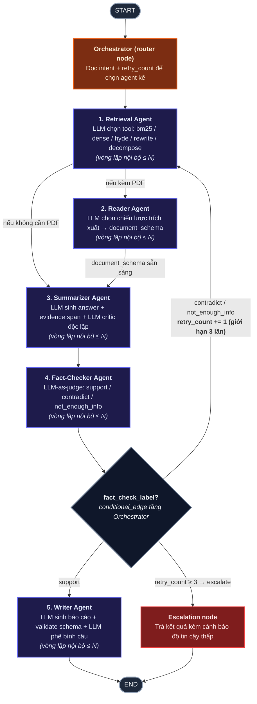

# Multi-Agent Research RAG System

Hệ thống Multi-Agent RAG nâng cao dành cho nghiên cứu và xử lý tài liệu học thuật/kỹ thuật, được xây dựng dựa trên **LangGraph StateGraph** với 5 Agent chuyên trách, cơ chế tự sửa lỗi đa tầng (Multi-level Self-Correction), kiểm chứng độ thật giả (Fact-Checking) và tổng hợp báo cáo chuyên sâu.

Dự án được cấu trúc theo mô hình **Modular Self-Contained Agent Package**, cho phép các thành viên trong nhóm phát triển độc lập từng Agent (bao gồm cả inference, tools, training scripts và datasets) trước khi tích hợp vào đồ thị điều phối chung.

---

## 📐 Kiến trúc hệ thống qua LangGraph StateGraph

Sơ đồ luồng điều phối 5 Function Node, Router Node và cơ chế kiểm duyệt/Escalation:



---

## 📁 Cấu Trúc Dự Án (Phân Chia Theo Từng Agent Cho Thành Viên)

Hệ thống được chia thành các gói độc lập (Package-per-agent), mỗi thành viên toàn quyền phát triển trong thư mục của mình:

```
DM_Multi-Agent_RAG/
├── core/                                   # [LEAD QUẢN LÝ] Giao tiếp hệ thống
│   ├── config.py                           # Cấu hình biến môi trường và tham số
│   ├── state.py                            # Định nghĩa duy nhất AgentState
│   ├── base_agent.py                       # Abstract Base Class thống nhất
│   └── graph.py                            # Ghép nối LangGraph StateGraph E2E
│
├── agents/                                 # [CÁC THÀNH VIÊN LÀM ĐỘC LẬP]
│   ├── agent1_retrieval/                   # Thành viên 1: Retrieval Agent
│   │   ├── README.md                       # Hướng dẫn riêng cho Agent 1
│   │   ├── node.py                         # Điểm chạm duy nhất: class RetrievalAgent
│   │   ├── tools/                          # bm25.py, dense.py, hybrid.py
│   │   └── training/                       # train_qlora.py, generate_training_data.py, data/
│   │
│   ├── agent2_reader/                      # Thành viên 2: Reader Agent
│   │   ├── README.md                       # Hướng dẫn riêng cho Agent 2
│   │   ├── node.py                         # Điểm chạm duy nhất: class ReaderAgent
│   │   ├── tools/                          # pdf_parser.py (PyMuPDF + Heuristics)
│   │   └── training/                       # notebooks huấn luyện LayoutLMv3 trên DocLayNet
│   │
│   ├── agent3_summarizer/                  # Thành viên 3: Summarizer Agent
│   │   ├── README.md                       # Hướng dẫn riêng cho Agent 3
│   │   ├── node.py                         # Điểm chạm duy nhất: class SummarizerAgent
│   │   ├── components/                     # generator.py, critic.py, verifier.py
│   │   └── training/                       # train_generator, train_critic, validate_evidence_span, data/
│   │
│   ├── agent4_fact_checker/                # Thành viên 4: Fact-Checker Agent
│   │   ├── README.md                       # Hướng dẫn riêng cho Agent 4
│   │   ├── node.py                         # Điểm chạm duy nhất: class FactCheckerAgent
│   │   ├── components/                     # claim_extractor.py, judge.py
│   │   └── training/                       # Tài liệu huấn luyện SciBERT NLI trên SciFact
│   │
│   └── agent5_writer/                      # Thành viên 5: Writer Agent
│       ├── README.md                       # Hướng dẫn riêng cho Agent 5
│       ├── node.py                         # Điểm chạm duy nhất: class WriterAgent
│       └── components/                     # report_builder.py, sentence_critic.py
│
├── data/                                   # Kho tri thức phục vụ tìm kiếm
│   └── corpus.jsonl                        # Các bài báo khoa học AI/NLP (ArXiv chunked)
├── tests/                                  # Kiểm thử tự động (Unit + Integration)
├── main.py                                 # Giao diện dòng lệnh CLI chạy hệ thống
└── requirements.txt
```

---

## 🧠 Bản Giao Kèo Giao Diện (Agent Contract)

Để tránh xung đột khi gộp mã nguồn (Merge), mỗi thành viên chỉ cần tuân thủ đúng một quy tắc: xuất ra một class trong file `node.py` kế thừa từ `core.base_agent.BaseAgent`:

```python
# agents/agentX_.../node.py
from core.base_agent import BaseAgent
from core.state import AgentState

class MyAgent(BaseAgent):
    def __init__(self, max_internal_retry: int = 2):
        super().__init__(name="MyAgent", max_internal_retry=max_internal_retry)

    def run(self, state: AgentState) -> dict:
        # 1. Đọc dữ liệu từ state
        # 2. Xử lý nội bộ (model, tool, CoT)
        # 3. Trả về dict cập nhật vào AgentState
        return {
            "output_field": "value",
            "reasoning_trace": [{"agent": self.name, "status": "done"}]
        }
```

---

## 🚀 Hướng Dẫn Chạy & Kiểm Thử

1. **Cài đặt thư viện:**
   ```bash
   pip install -r requirements.txt
   ```

2. **Chạy kiểm thử tự động toàn bộ hệ thống:**
   ```bash
   python -m pytest tests/
   ```

3. **Chạy truy vấn nghiên cứu khoa học thực tế:**
   ```bash
   python main.py --query "What is LoRA and how does it reduce memory?"
   ```

4. **Chạy kèm tài liệu PDF (kích hoạt Reader Agent):**
   ```bash
   python main.py --query "Phân tích bảng biểu" --pdf "data/sample.pdf"
   ```

5. **Kiểm thử cơ chế tự sửa sai (Self-Correction & Escalation):**
   ```bash
   python main.py --test-retry
   ```
