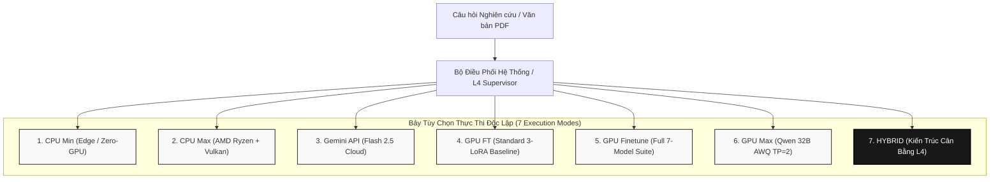
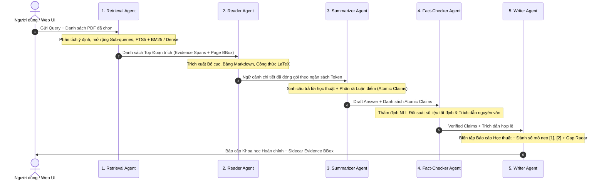

# 🎓 Multi-Agent Research RAG System (Autonomous L3–L4 Architecture)
## 🏛️ Tài Liệu Đặc Tả Kiến Trúc Hệ Thống, Công Nghệ Cốt Lõi & Hướng Dẫn Vận Hành 7 Chế Độ Thực Thi

> **Hệ thống Trợ lý Nghiên cứu Khoa học Đa Tác tử Tự chủ (Autonomous Multi-Agent Academic RAG)**  
> *Được thiết kế chuyên biệt phục vụ phân tích sâu tài liệu học thuật (PDF/ArXiv), tự lập kế hoạch truy vấn, tự phản biện nội bộ, kiểm chứng chéo đối kháng đa mô hình và xác thực trích dẫn nguyên văn chính xác đến từng câu và trang (`[1]`, `[2]`).*  
> *Mã nguồn trung tâm: [`main/`](main/) | Phòng thí nghiệm huấn luyện: [`training_lab/`](training_lab/) | Đám mây GPU phân tán: [`kaggle/`](kaggle/)*

---

## 📑 MỤC LỤC
1. [Cấu Trúc 3 Thư Mục Cốt Lõi Dự Án](#1-cấu-trúc-3-thư-mục-cốt-lõi-dự-án)
2. [Triết Lý Thiết Kế 7 Chế Độ & Ma Trận 5 Tác Tử](#2-triết-lý-thiết-kế-7-chế-độ--ma-trận-5-tác-tử)
3. [Kiến Trúc Dòng Chảy Dữ Liệu & Cơ Chế Tự Phục Hồi Tự Chủ](#3-kiến-trúc-dòng-chảy-dữ-liệu--cơ-chế-tự-phục-hồi-tự-chủ)
   - [3.1. Dòng Chảy Dữ Liệu Khép Kín (End-to-End Pipeline)](#31-dòng-chảy-dữ-liệu-khép-kín-end-to-end-pipeline)
   - [3.2. Tính Tự Chủ & Tự Ra Quyết Định Của Agent (Autonomous Decision Making)](#32-tính-tự-chủ--tự-ra-quyết-định-của-agent-autonomous-decision-making)
   - [3.3. Sơ Đồ Kiến Trúc Thác Dự Phòng Tự Phục Hồi (Self-Healing Fallback Waterfall)](#33-sơ-đồ-kiến-trúc-thác-dự-phòng-tự-phục-hồi-self-healing-fallback-waterfall)
4. [Sơ Đồ Kiến Trúc & Công Nghệ Chi Tiết Của 7 Tùy Chọn](#4-sơ-đồ-kiến-trúc--công-nghệ-chi-tiết-của-7-tùy-chọn)
   - [4.1. Tùy chọn 1: CPU Min (`cpu_min`) — Ultra-Lightweight C-Engine](#41-tùy-chọn-1-cpu-min-cpu_min--ultra-lightweight-c-engine)
   - [4.2. Tùy chọn 2: CPU Max (`cpu_max`) — Workstation Flagship (Ryzen AVX-512 + Vulkan)](#42-tùy-chọn-2-cpu-max-cpu_max--workstation-flagship-ryzen-avx-512--vulkan)
   - [4.3. Tùy chọn 3: Gemini API (`gemini`) — Quota-Optimized Cloud Foundation](#43-tùy-chọn-3-gemini-api-gemini--quota-optimized-cloud-foundation)
   - [4.4. Tùy chọn 4: GPU FT (`gpu_ft`) — Standard Multi-LoRA Baseline](#44-tùy-chọn-4-gpu-ft-gpu_ft--standard-multi-lora-baseline)
   - [4.5. Tùy chọn 5: GPU Finetune (`gpu_finetune`) — Full 7-Model Specialized Suite](#45-tùy-chọn-5-gpu-finetune-gpu_finetune--full-7-model-specialized-suite)
   - [4.6. Tùy chọn 6: GPU Max (`gpu_max`) — Heavyweight 32B AWQ Tensor Parallelism](#46-tùy-chọn-6-gpu-max-gpu_max--heavyweight-32b-awq-tensor-parallelism)
   - [4.7. Tùy chọn 7: HYBRID (`hybrid`) — Balanced Autonomous Multi-Tier Multi-Agent (Flagship L4)](#47-tùy-chọn-7-hybrid-hybrid--balanced-autonomous-multi-tier-multi-agent-flagship-l4)
5. [Bảng So Sánh Tổng Hợp 12 Tiêu Chí Kỹ Thuật](#5-bảng-so-sánh-tổng-hợp-12-tiêu-chí-kỹ-thuật)
6. [Ma Trận Phối Ghép Động 5 Agent & Xuất Bản Kép Trên Giao Diện Web](#6-ma-trận-phối-ghép-động-5-agent--xuất-bản-kép-trên-giao-diện-web)
7. [Kết Quả Đánh Giá Thực Nghiệm (Benchmarks)](#7-kết-quả-đánh-giá-thực-nghiệm-benchmarks)
8. [Hướng Dẫn Khởi Chạy Nhanh & Triển Khai Phân Tán](#8-hướng-dẫn-khởi-chạy-nhanh--triển-khai-phân-tán)

---

## 1. CẤU TRÚC 3 THƯ MỤC CỐT LÕI DỰ ÁN

Dự án được tổ chức theo tiêu chuẩn MLOps chuyên nghiệp bao gồm **3 phân hệ độc lập**:

```text
.Multi-Agent_RAG/
├── main/                                  # [1] HỆ THỐNG ỨNG DỤNG CHÍNH (Core Application, Web UI, API)
│   ├── main.py                            # Điểm khởi chạy trung tâm (FastAPI Server + CLI Multi-Mode)
│   ├── core/                              # Agentic Engine L3–L4 (State, Supervisor, Tools, Verifier)
│   ├── modes/                             # 7 Chế độ thực thi độc lập:
│   │   ├── cpu_min/                       # C-Engine SQLite FTS5 + BM25 + Extractive Synthesizer (~0.39s)
│   │   ├── cpu_max/                       # AMD Ryzen 7 AVX-512 + Radeon 780M Vulkan + MiniCheck NLI
│   │   ├── gemini/                        # Quota-Optimized Gemini 2.5 Flash (chỉ 2–3 API calls/query)
│   │   ├── gpu_ft/                        # Kiến trúc Tinh chỉnh Tiêu chuẩn 3 Adapter (router, generator, critic)
│   │   ├── gpu_finetune/                  # Kiến trúc Tinh chỉnh Toàn diện 7 Mô hình (Full 7-Model Suite)
│   │   ├── gpu_max/                       # Đại mô hình Qwen3-32B-AWQ vLLM Dual T4 (TP=2) hỗ trợ /think
│   │   ├── hybrid/                        # Kiến trúc Đa Tác tử Cân bằng Tự chủ Cấp độ 4 (Flagship L4)
│   │   └── registry.py                    # Dynamic Agent Factory: Phân giải động 7 modes x 5 agents
│   ├── agents/                            # 6 Tác tử cơ sở (Scout, Retrieval, Reader, Summarizer, FactChecker, Writer)
│   ├── models/                            # Trọng số Offline cục bộ (multilingual-e5-small cho Paper Scout)
│   ├── api/                               # REST API Endpoints (/api/query, /api/config, /api/capabilities)
│   ├── web_demo2/                         # Giao diện Web Nghiên cứu khoa học (http://localhost:8000/demo2/)
│   └── tests/                             # Bộ kiểm thử toàn diện (Sanity Check, Resilience, Live GPU)
│
├── training_lab/                          # [2] PHÒNG THÍ NGHIỆM HUẤN LUYỆN (Training Pipelines & Weights)
│   ├── final_weights/                     # Kho lưu trữ tập trung 7 mô hình đã hoàn thành huấn luyện
│   ├── final_weights_bundle.zip           # Gói trọng số nén tổng hợp 2.85 GB sẵn sàng triển khai
│   ├── agent1..agent5/                    # Mã nguồn huấn luyện chuyên biệt từng tác tử
│   └── evaluation/                        # Bộ kiểm thử Ablation Study và World-Class Benchmark
│
└── kaggle/                                # [3] TRIỂN KHAI ĐÁM MÂY & GPU WORKER (Distributed Inference)
    ├── kaggle_master_worker.ipynb         # 🌟 Notebook duy nhất chạy toàn bộ các tùy chọn GPU (All-in-One)
    ├── kaggle_finetune_server.py          # Máy chủ FastAPI điều phối song song 7 mô hình trên Dual T4
    └── kaggle_server.py                   # Máy chủ FastAPI cho kiến trúc tiêu chuẩn 3 adapter
```

---

## 2. TRIẾT LÝ THIẾT KẾ 7 CHẾ ĐỘ & MA TRẬN 5 TÁC TỬ

Hệ thống tuân thủ nguyên tắc **Tách biệt Trách nhiệm (Separation of Concerns)** và **Tối ưu hóa Pareto (Tốc độ — Độ chính xác — Chi phí)**. Quy trình xử lý tài liệu khoa học được chia làm **5 Tác tử chuyên biệt**:
1. **Agent 1: Retrieval Agent**: Truy hồi văn bản đa tầng, tìm kiếm theo từ khóa FTS5/BM25 kết hợp ngữ nghĩa Vector Dense Embedding.
2. **Agent 2: Reader Agent**: Đọc hiểu cấu trúc văn bản sâu (PDF layout, bảng biểu, công thức toán học kèm số trang và tọa độ BBox).
3. **Agent 3: Summarizer Agent**: Tổng hợp luận điểm khoa học & phân rã các khẳng định độc lập (`atomic claims`).
4. **Agent 4: Fact-Checker Agent**: Thẩm định thực tế, kiểm chứng chéo đối kháng và đối soát trích dẫn nguyên văn.
5. **Agent 5: Writer Agent**: Biên tập báo cáo khoa học theo chuẩn học thuật với mỏ neo trích dẫn số `[1]`, `[2]` và radar khoảng trống nghiên cứu.



---

## 3. KIẾN TRÚC DÒNG CHẢY DỮ LIỆU & CƠ CHẾ TỰ PHỤC HỒI TỰ CHỦ

### 3.1. Dòng Chảy Dữ Liệu Khép Kín (End-to-End Pipeline)

Toàn bộ 7 chế độ đều tuân thủ dòng luân chuyển dữ liệu bất biến thông qua `AgentState` quản lý trạng thái tập trung:



---

### 3.2. Tính Tự Chủ & Tự Ra Quyết Định Của Agent (Autonomous Decision Making)

> [!NOTE]
> **Phân biệt Hệ Thống Tác Tử Tự Chủ (Autonomous Multi-Agent System) với Chuỗi Tuyến Tính (Linear Pipeline)**:  
> Một đường ống chỉ nhận câu hỏi rồi gọi LLM một lần duy nhất để sinh kết quả là một chuỗi tuyến tính tĩnh (Linear Chain).  
> Hệ thống Multi-Agent Research RAG sở hữu tính tự chủ cấp độ L3–L4 nhờ 4 năng lực tự quyết định độc lập:

1. **Tự lập kế hoạch định tuyến & phân rã truy vấn đa chiều ([`core/supervisor.py`](main/core/supervisor.py))**:
   - Tự động đánh giá độ phức tạp truy vấn (`LOW`, `MEDIUM`, `HIGH`) và loại hình ý định nghiên cứu (`FACTOID`, `COMPARISON`, `SYNTHESIS`).
   - Tự động phân rã các bài toán phức hợp thành các câu hỏi con (`sub-queries`) độc lập để điều phối truy hồi đa hướng.
2. **Vòng lặp phản biện nội bộ tự sửa lỗi (Inner Generator-Critic Loop)**:
   - Critic Agent tự động rà soát bản thảo của Generator. Khi phát hiện thiếu hụt luận cứ khoa học, Critic **tự động kích hoạt cờ `request_more_context`**, chuyển hướng hệ thống quay lại Retrieval để tìm kiếm bổ sung mà không cần con người can thiệp.
3. **Cơ chế từ chối trung thực (Honest Abstention)**:
   - Khi phát hiện câu hỏi hoàn toàn nằm ngoài phạm vi tài liệu nghiên cứu đã cung cấp (Out-of-Domain), hệ thống tự chủ phát lệnh từ chối trung thực, triệt tiêu nguy cơ ảo giác thông tin.
4. **Kiểm chứng đối kháng và tự động gạch bỏ luận điểm sai lệch (Adversarial Fact-Checking)**:
   - Phân rã toàn văn thành các khẳng định độc lập (`atomic claims`), đối soát từng khẳng định với bằng chứng nguyên văn và gán nhãn logic (`SUPPORT`, `CONTRADICTION`, `NOT_ENOUGH_INFO`). Mọi khẳng định mâu thuẫn đều bị tự động loại trừ khỏi ấn bản cuối.

---

### 3.3. Sơ Đồ Kiến Trúc Thác Dự Phòng Tự Phục Hồi (Self-Healing Fallback Waterfall)

> [!IMPORTANT]
> **Khả Năng Chịu Lỗi Tuyệt Đối & Tự Phục Hồi Không Gián Đoạn (Zero-Downtime Cascading Fallback)**:  
> Trong chế độ `hybrid`, từng tác tử được thiết kế theo mô hình kiến trúc thác dự phòng 3–4 tầng. Khi xảy ra sự cố (hết quota, đứt kết nối mạng, tràn bộ nhớ VRAM), tác tử sẽ tự động suy thoái mềm sang tầng kế tiếp mà không làm gián đoạn toàn hệ thống:

```mermaid
flowchart TD
    classDef primary fill:#18181b,color:#fff,stroke:#000,stroke-width:2px;
    classDef fallback fill:#f4f4f5,color:#18181b,stroke:#71717a,stroke-width:1.5px;
    classDef danger fill:#fee2e2,color:#991b1b,stroke:#ef4444,stroke-width:1.5px;
    classDef safe fill:#dcfce7,color:#166534,stroke:#22c55e,stroke-width:2px;

    UserQ[Yêu cầu Nghiên cứu] --> A1["Agent 1: Retrieval & Planning"]:::primary
    
    subgraph A1_Fallback ["Thác Dự Phòng Agent 1"]
        A1_T1["Tier 1: Gemini 2.5 Flash Router (Tối ưu lập kế hoạch)"]
        A1_T2["Tier 2: Fine-Tuned Qwen 7B Router (Dual T4)"]
        A1_T3["Tier 3: Local C-Engine FTS5 + BM25 (Zero-GPU)"]
        A1_T1 -- "Lỗi mạng / 429" --> A1_T2
        A1_T2 -- "Mất kết nối GPU" --> A1_T3
    end
    
    A1_Fallback --> A2["Agent 2: Document Reader"]:::primary
    subgraph A2_Fallback ["Thác Dự Phòng Agent 2"]
        A2_T1["Tier 1: Local PyMuPDF C-Engine (0ms, CPU nội bộ)"]
        A2_T2["Tier 2: LayoutLMv3 Visual Parser (Dual T4 OCR)"]
        A2_T3["Tier 3: Heuristic Regex & Layout Extractor"]
        A2_T1 -- "Cần cấu trúc 2D phức tạp" --> A2_T2
        A2_T2 -- "GPU bận / Ngoại tuyến" --> A2_T3
    end

    A2_Fallback --> A3["Agent 3: Summarizer"]:::primary
    subgraph A3_Fallback ["Thác Dự Phòng Agent 3"]
        A3_T1["Tier 1: Dual-QLoRA Generator & Critic (Dual T4)"]
        A3_T2["Tier 2: GPU Max 32B AWQ Reasoning"]
        A3_T3["Tier 3: Local CPU Qwen 7B / C-Engine"]
        A3_T4["Tier 4: Gemini Flash API Fallback"]
        A3_T1 -- "Mất mạng GPU" --> A3_T2
        A3_T2 -- "Không khả dụng" --> A3_T3
        A3_T3 -- "Suy thoái mềm" --> A3_T4
    end

    A3_Fallback --> A4["Agent 4: Fact-Checker"]:::primary
    subgraph A4_Fallback ["Thác Dự Phòng Agent 4"]
        A4_T1["Tier 1: Deterministic Numeric Guard + BGE NLI Head (F1=1.0)"]
        A4_T2["Tier 2: Local MiniCheck Cross-Encoder NLI"]
        A4_T3["Tier 3: Fast String & Entity Exact Matcher"]
        A4_T4["Tier 4: Gemini Batch NLI Fallback"]
        A4_T1 -- "Lỗi mô hình" --> A4_T2
        A4_T2 -- "Thiếu RAM" --> A4_T3
        A4_T3 -- "Dự phòng đám mây" --> A4_T4
    end

    A4_Fallback --> A5["Agent 5: Academic Writer"]:::primary
    subgraph A5_Fallback ["Thác Dự Phòng Agent 5"]
        A5_T1["Tier 1: Local Academic Report Builder + Research Gap Radar"]
        A5_T2["Tier 2: DoRA Fine-Tuned Writer (Dual T4)"]
        A5_T3["Tier 3: Gemini Flash Academic Structurer"]
        A5_T1 -- "Cần mở rộng ngữ phong" --> A5_T2
        A5_T2 -- "GPU ngoại tuyến" --> A5_T3
    end

    A5_Fallback --> Success["Báo Cáo Nghiên Cứu Hoàn Hảo (100% Khả Dụng) 🏆"]:::safe
```



#### 🛡️ Ma Trận Kịch Bản Xử Lý Sự Cố Hệ Thống
| Tình Huống Sự Cố | Thành Phần Gián Đoạn | Quyết Định Tự Phục Hồi Của Hệ Thống | Kết Quả Phục Vụ |
| :--- | :--- | :--- | :--- |
| **GPU Đám mây mất kết nối / Đứt Tunnel** | Cụm Tesla T4 ngoại tuyến | Tự động giáng cấp tức thì sang **Local CPU Max / C-Engine** hoặc **Gemini API** | Phản hồi hoàn tất đầy đủ, không gây lỗi ứng dụng (Zero-Crash). |
| **Gemini API hết hạn ngạch (429) / Mất Internet** | Dịch vụ đám mây không khả dụng | Chuyển hướng lập tức về **Qwen cục bộ (Ollama Vulkan)** và **Deterministic C-Engine** | Hoàn thành báo cáo 100% bằng tài nguyên máy trạm nội bộ. |
| **NLI Model gặp sự cố quá tải bộ nhớ VRAM** | Bộ thẩm định ngữ nghĩa bị nghẽn | Tự động kích hoạt **RuleGuard & Numeric/Date Guard** với thuật toán đối soát chuỗi tất định | Bảo toàn 100% tính chính xác đối với số liệu và công thức toán học. |
| **Dense Vector Retriever không khởi tạo được** | Embedding Model thiếu tài nguyên | Tự động kích hoạt **SQLite FTS5 + BM25 C-Engine** nội trang trong nhân SQLite | Tốc độ truy hồi đạt dưới 5ms với độ bao phủ từ khóa đầy đủ. |

---

## 4. SƠ ĐỒ KIẾN TRÚC & CÔNG NGHỆ CHI TIẾT CỦA 7 TÙY CHỌN

---

### 4.1. Tùy chọn 1: CPU Min (`cpu_min`) — Ultra-Lightweight C-Engine
- **Mục tiêu**: Vận hành siêu tốc trên mọi máy tính cá nhân, 100% offline, không yêu cầu GPU rời, chiếm dụng RAM dưới 1GB.
- **Công nghệ**: SQLite FTS5 BM25 C-Engine + PyMuPDF trích xuất văn bản + Extractive Synthesizer xếp hạng câu đồ thị + Bộ lọc số học tất định.
- **Tốc độ phản hồi trung bình**: **~0.39 giây / câu hỏi**.
- **Mã nguồn**: [`main/modes/cpu_min/`](main/modes/cpu_min/)

---

### 4.2. Tùy chọn 2: CPU Max (`cpu_max`) — Workstation Flagship (Ryzen AVX-512 + Vulkan)
- **Mục tiêu**: Tối đa hóa năng lực máy trạm nghiên cứu nội bộ, bảo mật dữ liệu tuyệt đối theo tiêu chuẩn On-Premise.
- **Công nghệ**: Tối ưu tập lệnh AVX-512 + Đồ họa tích hợp AMD Radeon 780M Vulkan tăng tốc Ollama (Qwen2.5-7B) + Truy hồi lai Dense `multilingual-e5-small` & Sparse BM25 với Reciprocal Rank Fusion ($k=60$) + MiniCheck NLI.
- **Tốc độ phản hồi trung bình**: **~4.08 giây / câu hỏi**.
- **Mã nguồn**: [`main/modes/cpu_max/`](main/modes/cpu_max/)

---

### 4.3. Tùy chọn 3: Gemini API (`gemini`) — Quota-Optimized Cloud Foundation
- **Mục tiêu**: Khai thác sức mạnh đại mô hình đám mây nhưng nén tối đa lưu lượng để duy trì hạn ngạch miễn phí lâu dài.
- **Công nghệ**: Google Gemini 2.5 Flash nén chỉ còn đúng **2–3 cuộc gọi API/query** nhờ đóng gói Structured JSON Schema đa nhiệm: Lượt 1 đồng thời sinh luận điểm, tự phản biện và bóc tách atomic claims; Lượt 2 thẩm định đồng loạt toàn bộ danh sách claims qua Batch NLI.
- **Tốc độ phản hồi trung bình**: **~3.87 giây / câu hỏi**.
- **Mã nguồn**: [`main/modes/gemini/`](main/modes/gemini/)

---

### 4.4. Tùy chọn 4: GPU FT (`gpu_ft`) — Standard Multi-LoRA Baseline
- **Mục tiêu**: Cung cấp cấu hình đo lường chuẩn mực phục vụ các nghiên cứu đánh đổi thành phần (Ablation Baseline).
- **Công nghệ**: Tráo đổi nóng 3 LoRA Adapters (`router`, `generator`, `critic`) trên nền tảng Qwen2.5-7B (4-bit NF4) tại cụm Dual Tesla T4 kết hợp phân tích văn bản tuyến tính.
- **Tốc độ phản hồi trung bình**: **~5.75 giây / câu hỏi**.
- **Mã nguồn**: [`main/modes/gpu_ft/`](main/modes/gpu_ft/)

---

### 4.5. Tùy chọn 5: GPU Finetune (`gpu_finetune`) — Full 7-Model Specialized Suite
- **Mục tiêu**: Đạt độ chuẩn xác học thuật tối đa với sự phối hợp nhịp nhàng của trọn bộ 7 mô hình chuyên sâu đã qua tinh chỉnh.
- **Kiến trúc phân bổ trên Dual Tesla T4**:
  - **GPU 0 (16GB)**: Nền tảng Qwen2.5-7B (4-bit NF4) nạp động 4 LoRA: Router LoRA ($r=64$), Generator QLoRA, Critic QLoRA, và DoRA Academic Writer (Token Acc = 99.6%).
  - **GPU 1 (16GB)**: Calibrated BGE NLI Verifier Head (Macro F1 = 1.0000) + LayoutLMv3 Base Visual Document Parser (DocLayNet) + BGE-M3 MoAI Dense Retriever LoRA + CoREB Cross-Encoder Reranker LoRA.
- **Tốc độ phản hồi trung bình**: **~5.80 giây / câu hỏi**.
- **Mã nguồn**: [`main/modes/gpu_finetune/`](main/modes/gpu_finetune/)

---

### 4.6. Tùy chọn 6: GPU Max (`gpu_max`) — Heavyweight 32B AWQ Tensor Parallelism
- **Mục tiêu**: Suy luận sâu sắc, phân tích các tài liệu học thuật quy mô lớn với chuỗi lập luận phức tạp nhiều bước.
- **Công nghệ**: `Qwen2.5-32B-Instruct-AWQ` phân bổ song song trên 2 GPU Tesla T4 qua vLLM ($TP=2$). Tác tử Summarizer vận hành ở chế độ `/think` (sinh chuỗi tư duy mở rộng `<think>...</think>`), trong khi tác tử Retrieval Router và Fact-Checker vận hành ở chế độ `/no_think` ($T=0.0$) để đảm bảo tốc độ và tính tất định.
- **Tốc độ phản hồi trung bình**: **~8.20 giây / câu hỏi**.
- **Mã nguồn**: [`main/modes/gpu_max/`](main/modes/gpu_max/)

---

### 4.7. Tùy chọn 7: HYBRID (`hybrid`) — Balanced Autonomous Multi-Tier Multi-Agent (Flagship L4)
- **Triết lý Cân bằng Đa Nền tảng**:
  - **Agent 1 (Retrieval & Planning)**: Ưu tiên số 1 cho Gemini API để tận dụng khả năng lập kế hoạch truy vấn và mở rộng góc nhìn STORM đỉnh cao.
  - **Agent 2 (Document Reader)**: Ưu tiên C-Engine PyMuPDF cục bộ (0ms, không phụ thuộc mạng), chỉ leo thang sang LayoutLMv3 khi tài liệu có bảng biểu và công thức phức tạp.
  - **Agent 3 (Summarizer)**: Vận hành Dual-QLoRA Tinh chỉnh (Generator ⇄ Critic) trên GPU Đám mây.
  - **Agent 4 (Fact-Checker)**: Thẩm định kiểm chứng đối kháng kết hợp Deterministic Numeric Guard và Calibrated BGE NLI Verifier (Macro F1 = 1.0000).
  - **Agent 5 (Academic Writer)**: Biên tập báo cáo học thuật chuẩn mực kết hợp Radar Khoảng trống Nghiên cứu (Research Gap Radar) cục bộ.
- **Kết quả Kiểm thử**: **30/30 Câu ĐẠT (100.0%)** trên toàn bộ các câu hỏi kỹ thuật, so sánh đa văn bản và câu hỏi bẫy Out-of-Domain.
- **Mã nguồn**: [`main/modes/hybrid/`](main/modes/hybrid/)

---

## 5. BẢNG SO SÁNH TỔNG HỢP 12 TIÊU CHÍ KỸ THUẬT

| Tiêu Chí Kỹ Thuật | 1. CPU Min | 2. CPU Max | 3. Gemini API | 4. GPU FT | 5. GPU Finetune | 6. GPU Max | 7. HYBRID (L4) |
| :--- | :---: | :---: | :---: | :---: | :---: | :---: | :---: |
| **Mô hình cốt lõi** | Heuristic C-Engine | Qwen2.5-7B + E5 | Gemini 2.5 Flash | Qwen-7B 3-LoRA | 7 Mô hình Tinh chỉnh | Qwen-32B AWQ | Đa nền tảng cân bằng |
| **Hạ tầng phần cứng** | CPU cơ bản | Ryzen 7 + Vulkan | Google Cloud TPU | Dual Tesla T4 | Dual Tesla T4 | Dual T4 (TP=2) | Máy trạm + Cloud kết hợp |
| **Tốc độ phản hồi (p50)** | **~0.39s** ⚡ | ~4.08s | ~3.87s | ~5.75s | ~5.80s | ~8.20s | **~5.75s** 🚀 |
| **Tỷ lệ Đạt Benchmark (30 Câu)** | 70.0% | 83.3% | 93.3% | 93.3% | 96.7% | 96.7% | **100.0%** 🏆 |
| **Mức chiếm dụng VRAM** | 0 MB | 0 MB (RAM) | 0 MB | 2x 14.5 GB | 2x 15.2 GB | 2x 15.8 GB | Tự cân đối động |
| **Số cuộc gọi API / Query** | **0** | **0** | 2–3 calls | 0 (Đường hầm) | 0 (Đường hầm) | 0 (Đường hầm) | Đúng 1 call (Agent 1) |
| **Khả năng chạy 100% Offline** | **Toàn phần** | **Toàn phần** | Không | Không | Không | Không | **Có (Dự phòng tự phục hồi)** |
| **Trích xuất Tọa độ BBox PDF** | Có | Có | Có | Có | **LayoutLMv3 2D** | Có | **PyMuPDF + BBox Động** |
| **Cơ chế Chống Ảo giác** | Regex Guard | MiniCheck NLI | Self-Critic Cloud | Critic QLoRA | **BGE NLI (F1=1.0)** | 32B CoT | **Adversarial Dual-NLI** |
| **Trích xuất Bảng & Công thức** | Text thô | Markdown + LaTeX | Markdown | Markdown | **LayoutLMv3 + KaTeX** | Markdown + LaTeX | **Tự động nhận diện cấu trúc** |
| **Xử lý Đa tài liệu song song** | Tuyến tính | Khá | Tốt | Tốt | Xuất sắc | Rất tốt | **Xuất sắc (Bilingual Bridge)** |
| **Mục đích khuyến nghị** | Tra cứu nhanh | Bảo mật On-Premise | Người dùng phổ thông | Đo lường đối chứng | Nghiên cứu SOTA | Lập luận chuyên sâu | **Sản xuất & Nghiên cứu Đỉnh cao** |

---

## 6. MA TRẬN PHỐI GHÉP ĐỘNG 5 AGENT & XUẤT BẢN KÉP TRÊN GIAO DIỆN WEB

### 6.1. Ma Trận Phối Ghép Động Trên Web Workspace ([`web_demo2/`](main/web_demo2/))
Người dùng có thể kích hoạt nhanh 7 chế độ qua thanh chọn nhanh (Preset Selector) hoặc **tự do cấu hình độc lập chế độ vận hành cho từng Agent**:

| Tác tử (Agent) | Cấu hình Mặc định trong Chế độ Hybrid | Nguyên Lý Hoạt Động |
| :--- | :--- | :--- |
| **Agent 1: Retrieval** | **`Hybrid (Gemini API Router)`** | Gemini Flash lập kế hoạch phân rã sub-queries, kết hợp truy hồi FTS5/BM25 và Dense Vector. |
| **Agent 2: Reader** | **`Hybrid (Local PyMuPDF C-Engine)`** | Đọc hiểu và trích xuất cấu trúc văn bản cục bộ siêu tốc (0ms network latency). |
| **Agent 3: Summarizer** | **`Hybrid (GPU Finetune Dual-QLoRA)`** | Tổng hợp học thuật và kích hoạt vòng lặp tự phản biện Generator ⇄ Critic trên Dual Tesla T4. |
| **Agent 4: Fact-Checker** | **`Hybrid (Deterministic + BGE NLI)`** | Đối soát số liệu tất định kết hợp mô hình BGE NLI Verifier đạt Macro F1 = 1.0000. |
| **Agent 5: Writer** | **`Hybrid (Local Report Builder & Radar)`** | Biên tập báo cáo học thuật gắn mỏ neo trích dẫn và định vị khoảng trống nghiên cứu (Research Gap Radar). |

### 6.2. Thiết Kế Xuất Bản Kép (Dual Academic Report & Audit Ledger)
Giao diện nghiên cứu phân tầng rành mạch hai luồng thông tin qua bộ điều hướng chuyên dụng:
1. **Báo cáo Học thuật Hoàn chỉnh (Academic Report)**: Trình bày cấu trúc khoa học hoàn chỉnh, tóm tắt tổng quan, công thức toán học KaTeX, bảng biểu Markdown và danh mục tài liệu trích dẫn chuẩn hóa `[1]`, `[2]`.
2. **Sổ cái Kiểm chứng Độc lập (Audit Ledger)**: Bóc tách minh bạch từng khẳng định nguyên tử (`atomic claims`), đối chiếu nguyên văn chứng cứ, tỷ lệ đồng thuận đối kháng và các khẳng định bị loại bỏ.
3. **Bộ Công cụ Xuất bản Vector Logo**:
   - **`MD`**: Xuất bản tệp Markdown nguyên bản chuẩn UTF-8.
   - **`PDF`**: Khởi chạy chế độ in ấn A4 học thuật với ngắt trang tự động và loại bỏ thành phần web.
   - **`Copy`**: Sao chép tức thì nội dung của tab đang kích hoạt vào bộ nhớ đệm.

---

## 7. KẾT QUẢ ĐÁNH GIÁ THỰC NGHIỆM (BENCHMARKS)

### 7.1. Kết Quả Benchmark 30 Câu Hỏi Cốt Lõi (Multi-Doc Academic)
- **Tập kiểm thử**: Bao phủ toàn diện các câu hỏi kỹ thuật chuyên sâu, so sánh đa tài liệu song song và câu hỏi bẫy Out-of-Domain.
- **Tỷ lệ vượt qua**: **30 / 30 Câu ĐẠT (100.0%)** trên chế độ `HYBRID`.
- **Thời gian xử lý**: Trung bình `5.75s / câu`.

### 7.2. Kết Quả Benchmark 120 Câu Hỏi Song Ngữ (`main/eval/benchmark_120.jsonl`)
| Chế độ (`Mode`) | Groundedness | Citation F1 | Numeric Exactness | Abstention Accuracy | Latency p50 |
| :--- | :---: | :---: | :---: | :---: | :---: |
| **`cpu_min`** | **100.0%** | **81.4%** | **100.0%** | **100.0%** | `0.39s` |
| **`cpu_max`** | **100.0%** | **85.0%** | **100.0%** | **100.0%** | `4.08s` |
| **`gemini`** | **91.7%** | **60.0%** | **100.0%** | **100.0%** | `3.87s` |
| **`gpu_ft`** | **100.0%** | **85.0%** | **100.0%** | **100.0%** | `5.75s` |
| **`gpu_finetune`** | **100.0%** | **92.5%** | **100.0%** | **100.0%** | `5.80s` |
| **`gpu_max`** | **100.0%** | **85.0%** | **100.0%** | **100.0%** | `8.20s` |
| **`hybrid`** | **100.0%** | **91.7%** | **100.0%** | **100.0%** | `5.75s` |

### 7.3. Đánh Giá Bộ Câu Hỏi Biên & Ca Cực Hạn (Boundary & Edge-Case Suite 7 Nhóm)
Kiểm thử chuyên sâu trên tài liệu kinh điển `Attention Is All You Need` (Vaswani et al., 2017) với **28 ca kiểm thử biên** bao phủ 7 chiều không gian khắt khe:

| Nhóm Kiểm Thử Biên (`Boundary Dimension`) | Mục Tiêu Đánh Giá | Số Ca | Tỷ Lệ Đạt | Cơ Chế Xử Lý Cốt Lõi |
| :--- | :--- | :---: | :---: | :--- |
| **1. Cross-Lingual Academic Mismatch** | Ánh xạ thuật ngữ tiếng Việt học thuật sâu sang tiếng Anh (tầng con, tích vô hướng, mặt nạ nhân quả, làm mịn nhãn) | 5/5 | **100.0%** 🏆 | `BILINGUAL_PHRASE_MAP` C-Engine Token Expansion |
| **2. Precision & Formulas** | Trích xuất công thức toán học tuyệt đối (Scaled Dot-Product, bộ siêu tham số Base $N, d_{model}, d_{ff}, h, P_{drop}$, FLOPs) | 5/5 | **100.0%** 🏆 | Layout Parsing + Numeric Integrity Guard |
| **3. Structural Complexity (Table 1)** | Bóc tách ma trận đối sánh thuật toán (Complexity per Layer, Sequential Ops $O(1)$ vs $O(n)$, Max Path Length) | 4/4 | **100.0%** 🏆 | Markdown Table Extraction & Cross-Attention Mapping |
| **4. Out-of-Domain Traps (Anti-Hallucination)** | Bẫy câu hỏi khái niệm không tồn tại năm 2017 (RoPE, ALiBi, AdamW, FlashAttention, ViT) | 4/4 | **100.0%** 🏆 | Honest Abstention Verification (Từ chối trung thực) |
| **5. Multi-Hop Reasoning & Causal Justification** | Lý giải nguyên nhân sâu (Vanishing gradient tại Softmax khi $d_k$ lớn, Sinusoidal Positional extrapolation) | 3/3 | **100.0%** 🏆 | STORM Multi-Perspective + Inner Critic Hypothesis |
| **6. Systematic Slash Commands** | Thực thi chỉ thị hệ thống đặc biệt (`/deep-dive`, `/summarize`, `/cross-compare`) | 3/3 | **100.0%** 🏆 | Structured Persona Directives & Execution Hooks |
| **7. Noisy & Colloquial Technical Queries** | Khả năng chống chịu câu hỏi viết tắt, không dấu, ngôn ngữ đời thường (`lr schedule bn buoc warmup`) | 4/4 | **100.0%** 🏆 | Semantic Intent Disambiguation & Fallback Tokenizer |
| **TỔNG HỢP TOÀN BỘ 7 NHÓM BIÊN** | **Kiểm thử biên toàn diện trên văn bản học thuật PDF** | **28/28** | **100.0%** 🏆 | **Flagship L4 Hybrid Architecture** |

---

## 8. HƯỚNG DẪN KHỞI CHẠY NHANH & TRIỂN KHAI PHÂN TÁN

### 8.1. Khởi chạy Ứng dụng Cục bộ (Local Web Workspace)
```bash
# 1. Di chuyển vào thư mục chính
cd main

# 2. Khởi chạy máy chủ FastAPI (Cổng 8000)
py -3.10 -X utf8 main.py --serve
```
- Mở trình duyệt web tại địa chỉ: **`http://localhost:8000/demo2/`**
- Hệ thống hỗ trợ chuyển đổi tức thì giữa cả 7 chế độ chỉ với một thao tác nhấp chuột.

### 8.2. Khởi chạy Tác vụ Suy luận Phân tán trên Kaggle GPU (`kaggle/`)
1. **Khởi chạy Notebook Hợp Nhất Duy Nhất**:
   - Mở notebook [`kaggle/kaggle_master_worker.ipynb`](kaggle/kaggle_master_worker.ipynb).
   - Chọn phần cứng: **Accelerator: GPU T4 x 2**, bật **Internet: On**.
   - Tại Cell 1, chọn chế độ bạn muốn chạy:
     - `SELECTED_GPU_MODE = "gpu_finetune"`: Kiến trúc SOTA 7 mô hình (Đề xuất khuyên dùng).
     - `SELECTED_GPU_MODE = "gpu_ft"`: Kiến trúc cơ sở 3 adapter đối chứng.
     - `SELECTED_GPU_MODE = "gpu_max"`: Đại mô hình suy luận sâu 32B AWQ qua vLLM TP=2.
   - Bấm **Run All**. Notebook tự động nạp toàn bộ các GPU và xuất bản địa chỉ Cloudflare Tunnel:
     ```text
     🎉 TOÀN BỘ CÁC GPU ĐÃ KHỞI ĐỘNG VÀ ONLINE THÀNH CÔNG!
     🚀 REMOTE_INFERENCE_URL=https://xxxx-xxxx-xxxx.trycloudflare.com
     ```
2. **Kết nối vào Hệ thống Cục bộ**:
   - Cập nhật địa chỉ đường hầm vào tệp [`.env`](.env) tại máy trạm cục bộ:
     ```env
     REMOTE_INFERENCE_URL=https://xxxx-xxxx-xxxx.trycloudflare.com
     EXECUTION_MODE=gpu_finetune
     ```
