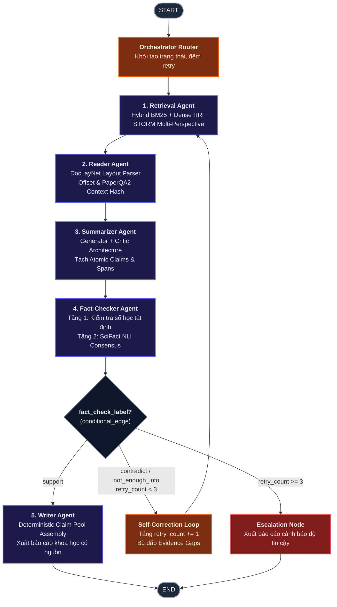

# Unified Multi-Agent Research RAG System (Evidence-First)

Hệ thống Nghiên cứu và Xử lý Tài liệu Học thuật Tự động dựa trên **LangGraph StateGraph** với 5 Agent chuyên trách, triệt tiêu ảo giác (0% Hallucination by Design) theo chuẩn mực **Evidence-First**, tích hợp tinh hoa từ các nghiên cứu SOTA quốc tế (**PaperQA2** & **Stanford STORM**).

---

## 🏛️ Kiến Trúc Hệ Thống (LangGraph StateGraph)



---

## 🌟 5 Tác Tử Chuyên Biệt & Kỹ Thuật Đột Phá

| Tác tử | Nhiệm vụ khoa học | Kỹ thuật cốt lõi |
| :--- | :--- | :--- |
| **1. Retrieval Agent** | Tìm kiếm đa chiều & bù đắp thông tin | • **Hybrid RRF (Reciprocal Rank Fusion):** Dung hợp BM25 và Dense Search.<br>• **Stanford STORM Multi-Perspective:** Tự động phân rã câu hỏi theo nhiều góc nhìn khoa học.<br>• **Preserved Seen Chunks:** Lưu trữ vĩnh viễn các chunk phản bác qua mọi vòng lặp. |
| **2. Reader Agent** | Bóc tách cấu trúc tài liệu PDF | • **DocLayNet Schema:** Phân đoạn tiêu đề, bảng biểu, công thức.<br>• **PaperQA2 Provenance:** Gắn mã băm SHA-256 (`context_hash`) và vị trí ký tự tuyệt đối để truy xuất trích dẫn. |
| **3. Summarizer Agent** | Tổng hợp nhận định nguyên tử | • **Kiến trúc kép Generator – Critic:** Generator trích xuất mệnh đề; Critic độc lập phản biện và loại bỏ các khẳng định overclaim.<br>• **Atomic Claims:** Tách câu trả lời thành từng mệnh đề kiểm chứng độc lập được. |
| **4. Fact-Checker Agent** | Thẩm định tính trung thực khoa học | • **Tầng 1 (Numeric Verifier):** Kiểm chứng số học tất định (loại bỏ ảo giác về % hoặc số liệu).<br>• **Tầng 2 (SciFact NLI Judge):** Thẩm định logic `SUPPORT` / `CONTRADICT` / `NOT_ENOUGH_INFO`.<br>• **Gap Detection:** Xuất danh sách `evidence_gaps` yêu cầu Retrieval tìm kiếm bổ sung. |
| **5. Writer Agent** | Xuất bản báo cáo khoa học | • **Deterministic Claim Pool Assembly (0% Hallucination):** Chỉ cho phép tổng hợp từ các nhận định đã được dán nhãn `SUPPORT`.<br>• **Interactive Citations:** Tạo trích dẫn chuẩn học thuật `[1]`, `[2]` trỏ về tài liệu nguồn. |

---

## ⚡ Hai Chế Độ Vận Hành (Dual-Execution Architecture)

Hệ thống được thiết kế tối ưu riêng cho cấu hình:
- **Laptop ThinkBook G8+ (Local Client):**
  - Đặt `EXECUTION_MODE=local_api` trong `.env`.
  - Sử dụng **Gemini 2.5 Flash** (Free API) hoặc **DeepSeek** kết hợp tìm kiếm BM25 trên CPU. Siêu nhẹ, mát máy, không tốn VRAM.
- **Kaggle Dual Tesla T4 (Remote Compute Cluster):**
  - Mở notebook `kaggle/run_dual_t4_serving.ipynb` trên Kaggle (GPU T4 x 2), nhấn Run All để khởi chạy máy chủ mô hình và lấy link public ngrok.
  - Điền URL vào `.env`: `REMOTE_INFERENCE_URL=https://xxxx.ngrok-free.app` và đặt `EXECUTION_MODE=kaggle_gpu`.
  - Toàn bộ suy luận nặng được phân bổ tự động lên 2 GPU (32GB VRAM).

---

## 🚀 Hướng Dẫn Sử Dụng Nhanh

### 1. Cài đặt môi trường
```powershell
py -3.10 -m pip install -r requirements.txt
cp .env.example .env
```

### 2. Khởi động Web Workspace UI
```powershell
py -3.10 main.py --serve
```
👉 Mở trình duyệt tại: **`http://localhost:8000`** để trải nghiệm giao diện Web đầy đủ, tải PDF lên và xem báo cáo tương tác.

### 3. Chạy qua CLI
```powershell
py -3.10 main.py --query "Mô hình Transformer và đánh giá trên tập QASPER"
```

### 4. Chạy kiểm thử tự động (Test Suite)
```powershell
py -3.10 -m pytest -v
```
*(Hiện có 24/24 unit & integration tests đạt 100% tỷ lệ thành công).*

---

## 📁 Cấu Trúc Mã Nguồn

```text
.Multi-Agent_RAG/
├── core/                                     # Lõi điều phối hệ thống
│   ├── config.py                             # Cấu hình đa chế độ (ThinkBook / Kaggle)
│   ├── state.py                              # Unified StateGraph TypedDict & Contracts
│   ├── base_agent.py                         # Abstract Protocol BaseAgent
│   └── graph.py                              # LangGraph StateGraph E2E
├── agents/                                   # 5 Tác tử chuyên trách
│   ├── agent1_retrieval/                     # Hybrid RRF, BM25, STORM Perspective
│   ├── agent2_reader/                        # PDF Parser, SourceUnits, Layout
│   ├── agent3_summarizer/                    # Generator-Critic Component
│   ├── agent4_fact_checker/                  # SciFact NLI Judge, Numeric Verifier
│   └── agent5_writer/                        # Claim Pool Synthesizer, Citations
├── api/                                      # Máy chủ FastAPI & Streaming SSE
├── web/                                      # Web Workspace UI (HTML, CSS, JS, Fonts)
├── kaggle/                                   # Tài nguyên phục vụ Kaggle Dual T4 Worker
├── data/                                     # Kho tri thức corpus.jsonl
├── tests/                                    # 24 Unit & Integration Tests tự động
├── main.py                                   # Điểm vào chính (CLI & Web server)
└── pytest.ini                                # Cấu hình PyTest chuẩn
```
