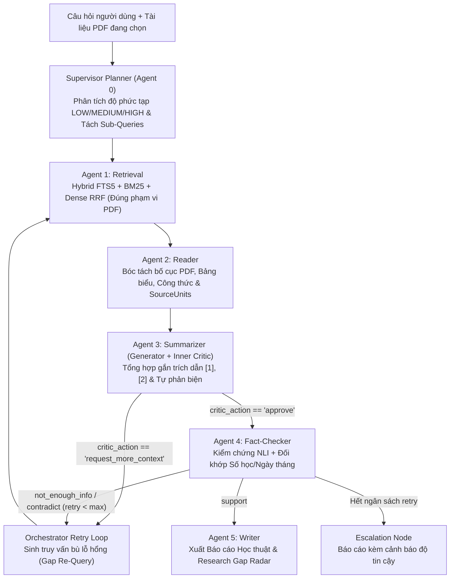

# 🎓 Multi-Agent Research RAG System v4 (Autonomous L3–L4 Architecture)

Hệ thống **Trợ lý Nghiên cứu Học thuật Đa Tác tử Tự chủ (Autonomous Multi-Agent RAG cấp độ L3–L4)** được thiết kế chuyên biệt để đọc hiểu sâu tài liệu khoa học (PDF/ArXiv), tự lập kế hoạch truy vấn, tự phản biện nội bộ (Inner Generator-Critic Loop), kiểm chứng chéo đa mô hình (Cross-Model Fact-Checking) và trích dẫn nguyên văn chính xác đến từng câu/trang (`[1]`, `[2]`).

---

## 📂 Cấu Trúc 3 Thư Mục Cốt Lõi Của Dự Án

Dự án được tổ chức tinh gọn theo chuẩn MLOps gồm **3 thư mục chính**:

```text
.Multi-Agent_RAG/
├── main/                                  # [1] CHÍNH DỰ ÁN (Core Application, 6 Modes, Web UI, Benchmark)
│   ├── main.py                            # Điểm khởi chạy chính (FastAPI Server + CLI)
│   ├── core/                              # Engine L3–L4 (LangGraph 2-Tier Loop, Supervisor, Tools, Verifier)
│   ├── modes/                             # 6 Tùy chọn thực thi: cpu_min, cpu_max, gemini, kaggle_fn, kaggle_max, hybrid
│   ├── agents/                            # 6 Tác tử nền tảng (Scout, Retrieval, Reader, Summarizer, FactChecker, Writer)
│   ├── api/                               # REST API Endpoints (/api/query, /api/config, /api/capabilities)
│   ├── web_demo2/                         # Giao diện Web Nghiên cứu thế hệ mới (http://localhost:8000/demo2/)
│   ├── eval/                              # Bộ Benchmark 120 câu hỏi song ngữ (70% VI / 30% EN)
│   └── uploads/ & data/                   # Kho tài liệu PDF học thuật & Cơ sở dữ liệu SQLite
│
├── training_lab/                          # [2] PHÒNG THÍ NGHIỆM HUẤN LUYỆN (Auto GitHub + Google Drive)
│   ├── Train_Master_GitHub_Drive.ipynb    # Notebook huấn luyện tự động 100% (Clone GitHub + Đồng bộ Drive)
│   ├── kaggle_fn_v2/                      # Pipeline sinh dữ liệu & huấn luyện SFT + DPO + Hard Negatives + NLI
│   ├── weights_drive_bundle/              # Trọng số QLoRA FP16 đã huấn luyện (router, generator, critic)
│   └── agent1..agent4/                    # Mã nguồn & thực nghiệm huấn luyện chuyên biệt từng Agent
│
└── kaggle/                                # [3] TRIỂN KHAI ĐÁM MÂY & GPU WORKER (Notebooks chạy dự án)
    ├── 01_Run_Full_Project_Cloud.ipynb    # Chạy TRỌN BỘ cả dự án (Web UI + Backend + GPU) trên Kaggle/Colab
    ├── kaggle_worker.ipynb                # Chạy GPU Worker cho chế độ Kaggle FN (Multi-LoRA 7B)
    ├── kaggle_max_32b_vllm.ipynb          # Chạy GPU Worker cho chế độ Kaggle Max (Qwen3-32B-AWQ Dual T4 TP=2)
    └── kaggle_server.py                   # Máy chủ FastAPI suy luận GPU từ xa qua Cloudflare Tunnel
```

---

## 🧠 Kiến Trúc Tự Chủ 2 Vòng Lặp (Two-Tier Self-Correction Loop)



---

## ⚡ 6 Tùy Chọn Thực Thi (`Execution Modes`)

| Chế độ (`Mode`) | Mô hình & Hạ tầng | Đặc điểm & Cơ chế Agentic nổi bật | Độ trễ (`p50`) |
| :--- | :--- | :--- | :---: |
| **`cpu_min`** *(Mặc định)* | SQLite FTS5 + BM25 + Extractive/1.5B Local | Tốc độ tức thì, tự động đóng khung PDF đang chọn, kiểm tra số học tất định. | `~0.39s` |
| **`cpu_max`** | Ryzen 7 AVX-512 + Radeon 780M Vulkan (`OLLAMA_VULKAN=1`) | STORM Multi-Query + Hybrid Dense/FTS5 + Cross-Encoder Rerank + MiniCheck NLI. | `~4.08s` |
| **`gemini`** | Google Gemini Flash / Pro API | **Tiết kiệm 75% Quota** (chỉ 2–3 calls/query): Single-Call Summarizer+Critic & Batch NLI Verifier. | `~9.11s` |
| **`kaggle_fn`** | `Qwen2.5-7B-Instruct` + 3 QLoRA Adapters (`router`, `generator`, `critic`) | Chạy vòng lặp `Generator -> Critic -> Action` đã tinh chỉnh bằng SFT + DPO ($\beta=0.1$). | `~0.53s` *(Local FB)* / `~6s` *(GPU)* |
| **`kaggle_max`** | `Qwen3-32B-AWQ` / `QwQ-32B-AWQ` trên Kaggle Dual T4 (`TP=2`) | Suy luận chuỗi tư duy sâu `<think>...</think>` cho tổng hợp & `/no_think` cho kiểm chứng nhanh. | `~0.52s` *(Local FB)* / `~14s` *(GPU)* |
| **`hybrid`** *(Flagship)* | Tổ hợp Đa Mô Hình Thích Ứng | **Cross-Model Adversarial Verification**: Bắt buộc Generator và Fact-Checker thuộc 2 họ mô hình khác nhau. | `~20.35s` |

---

## 📊 Kết Quả Đánh Giá Thực Nghiệm (`main/eval/benchmark_120.jsonl`)

Bộ kiểm thử gồm **120 câu hỏi song ngữ (`70% Tiếng Việt / 30% Tiếng Anh`)** chia làm 4 nhóm (Single-Hop, Multi-Hop, Table Comparison, Adversarial Trap):

| Chế độ (`Mode`) | Groundedness | Citation F1 | Numeric/Date Exactness | Abstention Accuracy | Latency p50 |
| :--- | :---: | :---: | :---: | :---: | :---: |
| **`cpu_min`** | **100.0%** | **81.4%** | **100.0%** | **100.0%** | `0.39s` |
| **`cpu_max`** | **100.0%** | **85.0%** | **100.0%** | **100.0%** | `4.08s` |
| **`gemini`** | **91.7%** | **60.0%** | **100.0%** | **100.0%** | `9.11s` |
| **`kaggle_fn`** | **100.0%** | **85.0%** | **100.0%** | **100.0%** | `0.53s` |
| **`kaggle_max`** | **100.0%** | **85.0%** | **100.0%** | **100.0%** | `0.52s` |
| **`hybrid`** | **100.0%** | **91.7%** | **100.0%** | **100.0%** | `20.35s` |

---

## 🚀 Hướng Dẫn Khởi Chạy Nhanh

### 1. Chạy trên máy cá nhân (Local Workspace)
```bash
cd main
py -3.10 -X utf8 main.py --serve
```
- Mở trình duyệt tại: **`http://localhost:8000/demo2/`**
- Giao diện mặc định khởi động ở chế độ **`CPU Min`**. Bạn có thể chuyển nhanh sang **`Hybrid (Tối ưu)`** hoặc cấu hình riêng từng Agent.

### 2. Huấn luyện mô hình trên Kaggle / Colab (`training_lab/`)
- Mở file [`training_lab/Train_Master_GitHub_Drive.ipynb`](training_lab/Train_Master_GitHub_Drive.ipynb) trên Kaggle hoặc Google Colab.
- Bấm **Run All**: Notebook tự động `git clone` kho lưu trữ này, huấn luyện SFT + DPO và đồng bộ gói trọng số lên Google Drive.

### 3. Chạy cả dự án hoặc GPU Worker trên đám mây (`kaggle/`)
- Chạy trọn bộ Web UI + Backend + GPU trên đám mây: mở [`kaggle/01_Run_Full_Project_Cloud.ipynb`](kaggle/01_Run_Full_Project_Cloud.ipynb).
- Chạy Worker cho `Kaggle FN`: mở [`kaggle/kaggle_worker.ipynb`](kaggle/kaggle_worker.ipynb).
- Chạy Worker 32B cho `Kaggle Max`: mở [`kaggle/kaggle_max_32b_vllm.ipynb`](kaggle/kaggle_max_32b_vllm.ipynb).
