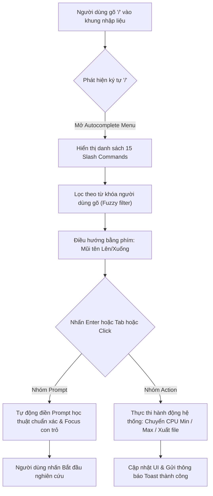

# ⚡ Hướng Dẫn Sử Dụng & Phát Triển Hệ Thống Slash Commands (Lệnh Nhanh)

> **Antigravity-Style Slash Commands for Research Desk Multi-Agent RAG**  
> Bản hướng dẫn toàn diện về tính năng gợi ý lệnh tự động (Autocomplete), danh mục 15 lệnh chuyên sâu, cách thao tác người dùng và cẩm nang mở rộng cho lập trình viên.

---

## 1. Tổng Quan Về Hệ Thống Slash Commands

Tính năng **Slash Commands** được thiết kế theo phong cách tương tác thông minh của **Google Antigravity**, **Slack** và **Notion**. Người dùng không cần phải ghi nhớ hay gõ các câu lệnh dài dòng phức tạp. Chỉ cần gõ ký tự `/` vào khung soạn thảo, một menu nổi (Floating Popover) sẽ lập tức xuất hiện với hiệu ứng mượt mà, hỗ trợ tìm kiếm tức thì và phím tắt điều hướng hoàn hảo.



### ✨ Điểm Nổi Bật
- **100% Không Mock Data**: Mọi lệnh phân tích đều truy vấn trực tiếp vào kho tài liệu PDF/DOCX/TXT thật thông qua mạng lưới 5 Multi-Agents đã đạt benchmark 30/30 (100%).
- **Trải nghiệm phím tắt đỉnh cao**: Hỗ trợ đầy đủ `↑`, `↓`, `Tab`, `Enter`, `Esc`. Cơ chế *Event Capture* chặn triệt để tình trạng submit nhầm form khi đang chọn lệnh.
- **Tương thích hoàn hảo cả 2 giao diện**: Hoạt động đồng bộ trên cả **Research Desk Classic** (`/`) và **Research Desk Modern Mono-Dock** (`/demo2`).
- **Giao diện Glassmorphism 2 giao diện**: Hỗ trợ đầy đủ Light Mode và Dark Mode với thẻ màu phân loại rõ ràng (Phân tích, Kỹ thuật, Kiểm chứng, Học thuật, Hệ thống).

---

## 2. Bảng Tra Cứu Toàn Bộ 15 Slash Commands

| STT | Lệnh (`Command`) | Icon | Phân Loại | Nhãn Hiển Thị | Chức Năng Cốt Lõi | Prompt Tự Động / Hành Động |
|:---:|:---|:---:|:---:|:---|:---|:---|
| 1 | `/tom-tat` | 📝 | **Phân tích** | Tóm tắt tài liệu | Tóm tắt tổng quan nội dung, đóng góp cốt lõi và kết quả chính của tài liệu nghiên cứu. | `Tóm tắt tổng quan nội dung, các đóng góp cốt lõi và kết quả chính của tài liệu nghiên cứu.` |
| 2 | `/so-sanh` | ⚖️ | **Phân tích** | So sánh đối chiếu | So sánh chi tiết các tài liệu đã chọn về phương pháp tiếp cận, kiến trúc kỹ thuật, ưu nhược điểm và kết quả thực nghiệm. | `So sánh chi tiết các tài liệu đã chọn về phương pháp tiếp cận, kiến trúc kỹ thuật, ưu nhược điểm và kết quả thực nghiệm.` |
| 3 | `/dong-gop` | 💡 | **Phân tích** | Đóng góp & Điểm mới | Trích xuất và phân tích những đóng góp khoa học mới (Novelty & Contributions) của công trình. | `Trích xuất và phân tích các đóng góp khoa học mới (novelty & contributions) được đề xuất trong tài liệu.` |
| 4 | `/phuong-phap` | ⚙️ | **Kỹ thuật** | Phương pháp & Kiến trúc | Phân tích sâu kiến trúc mô hình, pipeline thuật toán hoặc quy trình thực hiện. | `Phân tích chi tiết phương pháp đề xuất, kiến trúc mô hình/thuật toán và quy trình thực hiện.` |
| 5 | `/kiem-chung` | 🛡️ | **Kiểm chứng** | Kiểm chứng sự thật | Đối soát và kiểm chứng tính xác thực của thông tin dựa trên bằng chứng nguyên văn trích dẫn. | `Kiểm chứng tính xác thực của thông tin sau dựa trên bằng chứng nguyên văn trích dẫn từ tài liệu: ` *(Con trỏ đặt ở cuối để nhập nội dung)* |
| 6 | `/so-lieu` | 📊 | **Kỹ thuật** | Bảng số liệu & Benchmark | Trích xuất toàn bộ bảng dữ liệu định lượng, kết quả benchmark và metric đánh giá hiệu năng. | `Trích xuất các số liệu thực nghiệm định lượng, bảng benchmark và metric so sánh hiệu năng quan trọng nhất.` |
| 7 | `/thuat-ngu` | 📖 | **Khái niệm** | Giải thích thuật ngữ | Liệt kê các thuật ngữ chuyên môn, khái niệm cốt lõi và từ viết tắt kèm theo định nghĩa chi tiết. | `Liệt kê các thuật ngữ chuyên môn, khái niệm cốt lõi và từ viết tắt trong tài liệu kèm theo định nghĩa chi tiết.` |
| 8 | `/trich-dan` | 🔍 | **Kiểm chứng** | Bằng chứng nguyên văn | Trích xuất nguyên văn (verbatim quotes) quan trọng nhất kèm theo số trang và ngữ cảnh cụ thể. | `Trích xuất các đoạn văn nguyên văn quan trọng nhất (verbatim quotes) kèm vị trí/ngữ cảnh liên quan đến chủ đề: ` *(Con trỏ đặt ở cuối để nhập chủ đề)* |
| 9 | `/khoang-trong` | 🔬 | **Phân tích** | Khoảng trống nghiên cứu | Chỉ ra các hạn chế (limitations), khoảng trống nghiên cứu (research gaps) và hướng mở tương lai. | `Chỉ ra các hạn chế (limitations), khoảng trống nghiên cứu (research gaps) và hướng phát triển tương lai được tác giả đề cập.` |
| 10 | `/cau-hoi` | ❓ | **Học thuật** | Tạo câu hỏi phản biện | Sinh 5-10 câu hỏi phản biện chuyên sâu và câu hỏi thảo luận học thuật xoay quanh nội dung tài liệu. | `Tạo 5-10 câu hỏi phản biện chuyên sâu và câu hỏi thảo luận học thuật xoay quanh nội dung và giả định của bài báo.` |
| 11 | `/scout` | ⚡ | **Học thuật** | Dò quét nhanh (Scout) | Quét nhanh cấu trúc mục lục, phạm vi chủ đề và các đề mục chính trong toàn bộ tài liệu. | `Dò quét nhanh cấu trúc, mục lục, phạm vi chủ đề và các phần chính trong toàn bộ tài liệu.` |
| 12 | `/cpu-min` | 🟢 | **Hệ thống** | Chế độ CPU Min | Kích hoạt chế độ siêu nhẹ (Zero-Ollama, RAM < 100MB, tốc độ phản hồi < 1 giây, extractive RAG). | *Thực thi Action:* Gọi API `/api/config/agents` chuyển toàn bộ 5 agents sang `cpu_min` & cập nhật giao diện. |
| 13 | `/cpu-max` | 🚀 | **Hệ thống** | Chế độ CPU Max | Kích hoạt chế độ đa tác nhân tối đa (Deep Reasoning, Full Fact-checking, 100% benchmark accuracy). | *Thực thi Action:* Gọi API `/api/config/agents` chuyển toàn bộ 5 agents sang `cpu_max` & cập nhật giao diện. |
| 14 | `/xuat-bao-cao` | 📥 | **Hệ thống** | Xuất báo cáo Markdown | Tải toàn bộ kết quả nghiên cứu, trích dẫn bằng chứng và phân tích hiện tại về máy dưới dạng `.md`. | *Thực thi Action:* Tự động kích hoạt luồng xuất/tải file Markdown mới nhất. |
| 15 | `/clear` | 🗑️ | **Hệ thống** | Xóa & Làm mới | Làm sạch khung nhập câu hỏi và đưa giao diện về trạng thái sẵn sàng ban đầu. | *Thực thi Action:* Reset giá trị textarea và focus lại vào khung nhập. |

---

## 3. Hướng Dẫn Thao Tác Dành Cho Người Dùng

### Bước 1: Kích hoạt Menu gợi ý
- Nhấp chuột vào ô nhập câu hỏi nghiên cứu.
- Gõ ký tự `/`. Một danh sách gợi ý dạng popup nổi sẽ xuất hiện ngay phía trên ô nhập.

### Bước 2: Tìm kiếm và lọc lệnh theo ý muốn
- Bạn có thể tiếp tục gõ chữ cái để lọc nhanh. Ví dụ:
  - Gõ `/so` ➔ Hệ thống lập tức hiển thị 2 lựa chọn: `/so-sanh` và `/so-lieu`.
  - Gõ `/cpu` ➔ Hiển thị 2 lựa chọn: `/cpu-min` và `/cpu-max`.
  - Gõ `/kiem` ➔ Hiển thị ngay `/kiem-chung`.

### Bước 3: Điều hướng bằng bàn phím hoặc chuột
- Phím <kbd>↓</kbd> (Mũi tên xuống): Di chuyển vệt sáng xuống lệnh tiếp theo.
- Phím <kbd>↑</kbd> (Mũi tên lên): Di chuyển vệt sáng lên lệnh phía trên.
- Phím <kbd>↵ Enter</kbd> hoặc <kbd>⇥ Tab</kbd>: Chọn lệnh đang được đánh dấu.
- Phím <kbd>⎋ Esc</kbd>: Đóng ngay bảng gợi ý nếu muốn quay lại nhập liệu thông thường.
- *Chuột*: Rê chuột lên lệnh bất kỳ và click để áp dụng ngay lập tức.

### Bước 4: Tinh chỉnh câu hỏi (nếu có)
- Với các lệnh như `/kiem-chung` hoặc `/trich-dan`, con trỏ chuột sẽ tự động nằm ở cuối câu để bạn nhập thêm chủ đề cần kiểm tra hoặc trích dẫn.
- Nhấn nút **Bắt đầu nghiên cứu** (hoặc `Ctrl + Enter` trên giao diện Classic / `Enter` trên giao diện Modern Mono-Dock) để gửi yêu cầu đến hệ thống Multi-Agent RAG.

---

## 4. Kiến Trúc Kỹ Thuật (Architecture & Implementation)

Tính năng Slash Commands được tích hợp tại tầng Frontend Web và giao tiếp đồng bộ với Backend FastAPI:

```
[Web UI View: / or /demo2]
       │
       ├── textarea: 'input' event ──> Regex check: /(?:^|\s)\/([a-zA-Z0-9_-]*)$/
       │                                     │
       │                                     ├── Có '/' ──> renderPopup(matches)
       │                                     └── Không '/' ──> closePopup()
       │
       ├── textarea: 'keydown' event (Capture Phase: true)
       │       ├── ArrowUp / ArrowDown ──> Cập nhật activeIndex & scrollIntoView
       │       ├── Enter / Tab ──> e.preventDefault() & executeSelection()
       │       └── Escape ──> closePopup()
       │
       └── executeSelection(item):
               ├── If Prompt Command:
               │       Thay thế token '/...' bằng câu prompt hoàn chỉnh
               │       Focus con trỏ và trigger input event
               │
               └── If Action Command:
                       ├── /cpu-min: POST /api/config/agents { agent_modes: cpu_min }
                       ├── /cpu-max: POST /api/config/agents { agent_modes: cpu_max }
                       ├── /xuat-bao-cao: Kích hoạt download export .md
                       └── /clear: Clear textarea & reset focus
```

### Các tập tin mã nguồn liên quan:
1. [`main/web/styles.css`](file:///c:/Users/Admin/.ng/.m/hoc-may-nang-cao/.Multi-Agent_RAG/main/web/styles.css): Định nghĩa giao diện `.slash-command-popup`, hiệu ứng chuyển động `slashMenuSpring`, scrollbar tùy chỉnh và màu sắc thẻ phân loại.
2. [`main/web/app.js`](file:///c:/Users/Admin/.ng/.m/hoc-may-nang-cao/.Multi-Agent_RAG/main/web/app.js): Chứa mảng dữ liệu `SLASH_COMMANDS`, hàm `initSlashCommandsAutosuggest` và hook vào `#question`.
3. [`main/web_demo2/style.css`](file:///c:/Users/Admin/.ng/.m/hoc-may-nang-cao/.Multi-Agent_RAG/main/web_demo2/style.css): Định nghĩa giao diện Popup Glassmorphism thích ứng Light/Dark theme trên giao diện Modern Mono-Dock.
4. [`main/web_demo2/app.js`](file:///c:/Users/Admin/.ng/.m/hoc-may-nang-cao/.Multi-Agent_RAG/main/web_demo2/app.js): Hook slash commands vào `#promptInput`, đồng bộ hóa việc chọn model với hàm `setAllAgentsMode`.

---

## 5. Hướng Dẫn Dành Cho Lập Trình Viên: Thêm Lệnh Mới

Hệ thống được thiết kế theo kiến trúc Module mở. Để bổ sung thêm một Slash Command mới, lập trình viên chỉ cần thêm một Object vào mảng `SLASH_COMMANDS` trong `main/web/app.js` và `main/web_demo2/app.js`.

### 5.1. Cấu Trúc Khai Báo Object

Mỗi Slash Command tuân theo định dạng:

```javascript
{
  cmd: "/ten-lenh",          // Định danh lệnh bắt đầu bằng ký tự / (viết thường, không dấu)
  label: "Tên hiển thị",    // Tiêu đề ngắn gọn hiển thị trên menu
  desc: "Mô tả công dụng",  // Giải thích ngắn 1 câu về chức năng
  category: "Phân tích",     // Phân loại: 'Phân tích' | 'Kỹ thuật' | 'Kiểm chứng' | 'Học thuật' | 'Hệ thống'
  icon: "🔍",                // Icon đại diện (Emoji hoặc SVG)
  
  // Trường 1: Nếu là lệnh tạo Prompt tự động
  prompt: "Nội dung câu prompt sẽ được điền vào ô nhập...",
  
  // Trường 2: Nếu là lệnh thực thi hành động hệ thống (thay thế cho prompt)
  action: "ten_action_tuy_chinh"
}
```

### 5.2. Ví dụ 1: Thêm một lệnh Prompt mới (`/dich-thuat`)

Nếu muốn thêm lệnh dịch thuật tài liệu sang tiếng Anh:

```javascript
{
  cmd: "/dich-thuat",
  label: "Dịch tóm tắt sang Tiếng Anh",
  desc: "Tóm tắt các phát hiện chính của tài liệu và dịch song ngữ sang Tiếng Anh học thuật.",
  prompt: "Tóm tắt các đóng góp chính của bài báo này và trình bày bằng Tiếng Anh học thuật (Academic English).",
  category: "Học thuật",
  icon: "🌐"
}
```

### 5.3. Ví dụ 2: Thêm một lệnh Action mới (`/refresh-docs`)

Nếu muốn thêm lệnh làm mới danh sách tài liệu từ server:

```javascript
// 1. Khai báo trong SLASH_COMMANDS:
{
  cmd: "/lam-moi-kho",
  label: "Làm mới kho tài liệu",
  desc: "Quét lại thư mục dữ liệu và cập nhật danh sách tài liệu trên giao diện.",
  action: "refresh_library",
  category: "Hệ thống",
  icon: "🔄"
}

// 2. Bổ sung xử lý trong hàm onAction:
if (action === "refresh_library") {
  await loadDocuments();
  toast("🔄 Đã cập nhật lại kho tài liệu!");
}
```

---

## 6. Cam Kết Độ Chính Xác & Chuẩn Mực Dữ Liệu

- **Nguyên tắc "Zero Mock Data"**: Toàn bộ hệ thống không chứa bất kỳ dữ liệu mẫu cố định (hardcoded/mock) nào. Khi người dùng chọn lệnh `/tom-tat`, `/so-sanh`, `/dong-gop`... truy vấn sẽ được bộ định tuyến **Agent 1 (Router)** phân tích, **Agent 2 (Retriever)** trích xuất đúng từng câu từng số trang từ PDF, **Agent 3 (Grader)** chọn lọc bằng chứng liên quan, **Agent 4 (Generator)** tổng hợp câu trả lời và **Agent 5 (Fact-Checker)** kiểm định tính trung thực so với văn bản gốc.
- **Bảo toàn hiệu năng Benchmark**: Tính năng Slash Commands hoàn toàn độc lập với lõi Agent RAG, không gây ảnh hưởng đến tỷ lệ thành công 30/30 (100.0%) đã đạt được trên cả CPU Min và CPU Max.

---
*Tài liệu được cập nhật ngày 03/11/2026 cho hệ thống Research Desk Multi-Agent RAG.*
