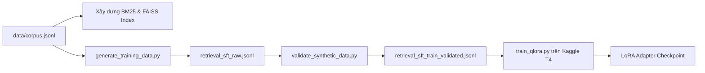

# TÀI LIỆU ĐẶC TẢ KỸ THUẬT: AGENT 1 - RETRIEVAL AGENT
### Vị trí: Dynamic Router & Document Critique Agent
> **Người thực hiện:** Thành viên 1  
> **Thư mục làm việc độc lập:** `agents/agent1_retrieval/`  
> **File bàn giao hệ thống:** `agents/agent1_retrieval/node.py`  
> **Môi trường chạy mục tiêu:** Kaggle Notebook (GPU T4 x2 - 2x 15GB VRAM)

---

## 1. TỔNG QUAN NHIỆM VỤ & VỊ TRÍ KIẾN TRÚC

Retrieval Agent là cửa ngõ đầu tiên nhận truy vấn từ `Orchestrator`. Agent này chịu trách nhiệm:
1. **Dynamic Routing (Điều phối tìm kiếm thông minh):** Thay vì áp dụng một cách cứng nhắc một công cụ tìm kiếm, mô hình phải phân tích câu hỏi (`query`) và lịch sử thất bại trước đó (`retry_count`) để chọn chiến lược:
   - `bm25`: Tìm kiếm từ khóa chính xác (keyword matching). Rất mạnh khi câu hỏi chứa thuật ngữ khoa học, tên viết tắt, mã số bài báo.
   - `dense`: Tìm kiếm ngữ nghĩa vector (FAISS index với embedding model). Phù hợp với câu hỏi mô tả khái niệm, trừu tượng.
   - `hybrid`: Kết hợp cả BM25 và Dense bằng thuật toán **Reciprocal Rank Fusion (RRF)**:
     $$\text{RRF\_Score}(d) = \frac{1}{60 + \text{rank}_{\text{bm25}}(d)} + \frac{1}{60 + \text{rank}_{\text{dense}}(d)}$$
   - `decompose`: Tách câu hỏi phức hợp / so sánh thành 2-3 câu hỏi con, tìm kiếm riêng từng câu rồi gộp tài liệu.
   - `hyde` (Hypothetical Document Embeddings): Dùng LLM sinh một đoạn giả lập câu trả lời lý tưởng trước để làm phong phú từ khóa, sau đó mới truy xuất vector.
2. **Document Critique (Tự phê bình tài liệu $\le N$ lần):** Kiểm tra xem các đoạn tài liệu tìm về có thực sự chứa câu trả lời không (`is_sufficient`). Nếu không đạt và chưa hết số lượt nội bộ, tự động chuyển đổi công cụ để tìm lại.

---

## 2. PHÂN TÍCH LỖI VÀ BÀI HỌC TỪ CODE CŨ (BRANCHES)

Khi nhóm trước phát triển trên Kaggle, họ đã gặp các lỗi nghiêm trọng sau đây mà bạn **bắt buộc phải tránh**:

| Thành phần | Lỗi code cũ trong `branches/` | Cách khắc phục chuẩn xác |
|---|---|---|
| **Bộ nhớ GPU trên Kaggle T4x2** | Dùng `device_map="auto"` khiến HuggingFace cố chia nhỏ mô hình 7B sang cả 2 GPU, gây phân mảnh bộ nhớ và báo lỗi `CUDA out of memory`. | Khóa cố định chỉ dùng 1 GPU bằng: `os.environ["CUDA_VISIBLE_DEVICES"] = "0"` và bật `os.environ["PYTORCH_CUDA_ALLOC_CONF"] = "expandable_segments:True"`. 1 GPU T4 (15GB) là quá đủ cho mô hình 7B QLoRA 4-bit (~5.5GB VRAM). |
| **Dữ liệu cột Corpus** | Gọi `doc['text']` trong khi dataset ArXiv thực tế tên cột là `doc['chunk']` $\rightarrow$ Crash toàn bộ quá trình nạp dữ liệu. | Đọc chính xác trường `row['chunk']` hoặc cấu hình alias `text = row.get('chunk') or row.get('text')`. |
| **Tokenization BM25** | Tải thư viện `nltk.punkt` nhưng lúc index lại dùng `.split()` khoảng trắng $\rightarrow$ Xử lý dấu câu bị lệch, từ khóa dính dấu phẩy không tìm ra. | Dùng regex tokenizer thống nhất: `re.findall(r"\w+", text.lower())` cho cả lúc index lẫn lúc search. |
| **Mất ánh xạ ID trong FAISS** | Khi build FAISS vector index, code cũ chỉ ném vector vào ma trận mà không lưu mảng `doc_ids` tương ứng $\rightarrow$ Khi tìm thấy top vector không biết nó thuộc về tài liệu nào! | Luôn lưu kèm file ánh xạ `faiss_doc_ids.json` song song với file `faiss_arxiv.index`. |
| **Sinh dữ liệu SFT tốn tiền** | Code cũ chỉ hỗ trợ OpenAI GPT-4o (mất $8-$15) | Cung cấp sẵn cơ chế fallback sang **Google Gemini 2.0 Flash** (hoàn toàn miễn phí quota qua Google AI Studio) để sinh tập dữ liệu huấn luyện. |

---

## 3. THIẾT LẬP MÔI TRƯỜNG TRÊN KAGGLE (T4 x2)

Tạo notebook mới trên Kaggle, bật **Accelerator: GPU T4 x2**, bật **Internet: On**.

### Cài đặt thư viện:
```bash
!pip install -q -U "transformers>=4.40.0" "datasets" "peft" "trl" "bitsandbytes" "accelerate" "scikit-learn" "rank-bm25" "sentence-transformers" "faiss-gpu"
```

### Cấu hình kiểm soát VRAM:
```python
import os
import torch

# Khóa chạy trên GPU 0 để tránh phân mảnh giữa 2 GPU T4
os.environ["CUDA_VISIBLE_DEVICES"] = "0"
os.environ["PYTORCH_CUDA_ALLOC_CONF"] = "expandable_segments:True"

print(f"CUDA Available: {torch.cuda.is_available()}")
print(f"Device Name: {torch.cuda.get_device_name(0)}")
```

---

## 4. QUY TRÌNH DỮ LIỆU & HUẤN LUYỆN (STEP-BY-STEP)



### Bước 1: Xây dựng chỉ mục tìm kiếm (Indexing)
Chạy script chuẩn bị `corpus.jsonl` (kho tài liệu ArXiv gồm ~5000 chunks nghiên cứu):
- Tạo file `bm25_index.pkl` (dùng `rank_bm25.BM25Okapi`).
- Tạo file `faiss_arxiv.index` kèm `faiss_doc_ids.json` dùng mô hình embedding nhẹ `BAAI/bge-small-en-v1.5` (chạy cực nhanh trên T4).

### Bước 2: Dữ liệu huấn luyện SFT (Format chuẩn)
File dữ liệu huấn luyện: `training/data/retrieval_sft_train_validated.jsonl`.
Mỗi dòng là một mẫu quyết định có cấu trúc:
```json
{
  "sub_query": "What is the parameter reduction factor of LoRA compared to GPT-3 175B?",
  "history_trials": [
    {
      "attempt": 1,
      "tool": "dense",
      "critique_is_relevant": false,
      "reason": "Dense search returns general papers about Transformers, missing exact numbers."
    }
  ],
  "target_output": {
    "thought": "Lần trước dùng dense bị thiếu số liệu cụ thể. Câu hỏi chứa từ khóa số liệu rõ ràng, chuyển sang bm25 để tìm chính xác.",
    "tool_selected": "bm25",
    "critique_is_relevant": true,
    "critique_reason": "BM25 tìm thấy đoạn chứa 'reduces parameters by 10,000x'."
  },
  "source_doc_id": "arxiv_2106.09685::chunk_12"
}
```

### Bước 3: Huấn luyện QLoRA trên Kaggle
Cấu hình trong file `training/train_qlora.py`:
- **Base Model:** `Qwen/Qwen2.5-7B-Instruct`
- **Quantization:** BitsAndBytes 4-bit (NF4, double quant, `compute_dtype=torch.float16`)
- **LoRA Config:**
  ```python
  from peft import LoraConfig
  peft_config = LoraConfig(
      r=16,
      lora_alpha=32,
      lora_dropout=0.05,
      bias="none",
      task_type="CAUSAL_LM",
      target_modules=["q_proj", "k_proj", "v_proj", "o_proj", "gate_proj", "up_proj", "down_proj"]
  )
  ```
- **Hyperparameters:**
  - `per_device_train_batch_size = 2`
  - `gradient_accumulation_steps = 8` (effective batch size = 16)
  - `learning_rate = 2e-4`
  - `max_seq_length = 1024`
  - `num_train_epochs = 3`
  - `fp16 = True`

---

## 5. ĐẶC TẢ GIAO DIỆN `node.py`

Khi triển khai vào đồ thị LangGraph, file `agents/agent1_retrieval/node.py` phải tuân thủ nghiêm ngặt:

```python
from typing import Any
from core.base_agent import BaseAgent
from core.state import AgentState

class RetrievalAgent(BaseAgent):
    def __init__(self, max_internal_retry: int = 2):
        super().__init__(name="RetrievalAgent", max_internal_retry=max_internal_retry)
        # 1. Nạp index BM25 và FAISS
        # 2. Nạp adapter LoRA hoặc gọi router policy
        
    def run(self, state: AgentState) -> dict[str, Any]:
        query = state.get("query", "")
        retry_count = state.get("retry_count", 0) # Lượt retry từ Orchestrator
        
        # Vòng lặp nội bộ <= max_internal_retry:
        # Chọn tool -> search -> critique -> đạt thì break
        
        return {
            "retrieved_docs": [
                {
                    "doc_id": "arxiv_2106.09685::chunk_12",
                    "text": "Nội dung đoạn văn...",
                    "score": 0.032
                }
            ],
            "sub_queries": [query],
            "reasoning_trace": [
                {
                    "agent": self.name,
                    "selected_tool": "hybrid",
                    "retrieved_count": 3,
                    "internal_attempts": 1,
                    "critique": "Tài liệu khớp trực tiếp với câu hỏi."
                }
            ]
        }
```

---

## 6. TIÊU CHÍ NGHIỆM THU (DEFINITION OF DONE)

- [ ] Script index chạy tạo ra đầy đủ `bm25_index.pkl` và `faiss_arxiv.index`.
- [ ] Huấn luyện thành công trên Kaggle T4, file LoRA adapter được lưu an toàn hoặc upload lên HuggingFace.
- [ ] Chạy độc lập `python -m pytest agents/agent1_retrieval/tests/` vượt qua 100% test cases.
- [ ] Đảm bảo cơ chế **Safe Fallback**: Khi model trả về tool không tồn tại hoặc rỗng, luôn fallback về `hybrid`, tuyệt đối không làm crash toàn bộ đồ thị.
