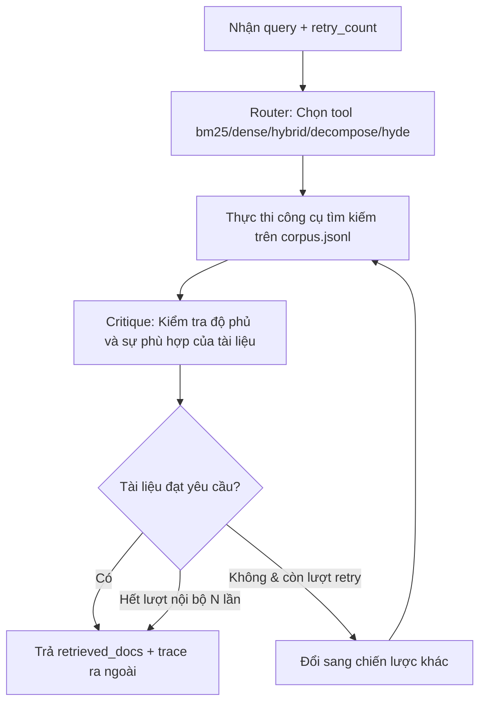

# TÀI LIỆU ĐẶC TẢ KỸ THUẬT: AGENT 1 - RETRIEVAL AGENT
### Vị trí: Dynamic Router & Document Critique Agent
> **Người thực hiện:** Thành viên 1  
> **Thư mục làm việc độc lập:** `agents/agent1_retrieval/`  
> **File bàn giao hệ thống:** `agents/agent1_retrieval/node.py`

---

## 1. TỔNG QUAN NHIỆM VỤ

Retrieval Agent đóng vai trò là "người trinh sát" đầu tiên trong hệ thống Multi-Agent RAG:
1. **Dynamic Routing (Điều phối tìm kiếm động):** Thay vì luôn dùng 1 công cụ cố định, Agent phải đọc câu truy vấn (`query`), lịch sử thất bại (`history_trials` / `retry_count`) để tự quyết định chiến lược tìm kiếm tối ưu:
   - `bm25`: Tìm kiếm từ khóa chính xác (phù hợp khi query chứa thuật ngữ viết tắt, mã số, tên riêng).
   - `dense`: Tìm kiếm ngữ nghĩa vector (phù hợp khi câu hỏi dài, mang tính diễn đạt ý niệm).
   - `hybrid`: Kết hợp cả BM25 và Dense bằng thuật toán **Reciprocal Rank Fusion (RRF)**.
   - `decompose`: Phân rã câu hỏi phức tạp thành nhiều câu hỏi con, tìm kiếm từng phần rồi gộp lại.
   - `hyde` (Hypothetical Document Embeddings): Tạo văn bản giả định trả lời câu hỏi để mở rộng từ khóa trước khi tìm kiếm.
2. **Document Critique (Tự phê bình tài liệu):** Sau khi có kết quả tìm kiếm, Agent tự đánh giá xem tài liệu tìm về có thực sự chứa câu trả lời cho truy vấn hay không (`is_sufficient`). Nếu chưa đạt, tự động thử lại bằng chiến lược khác (vòng lặp nội bộ $\le N$).

---

## 2. KIẾN TRÚC MÔ HÌNH & THƯ VIỆN

- **Mô hình nền (Base Model):** `Qwen/Qwen2.5-7B-Instruct`
- **Phương pháp huấn luyện:** QLoRA 4-bit (BitsAndBytes NF4, Double Quantization, `torch.float16`).
- **Cấu hình LoRA Adapter:**
  - Rank ($r$): `16`
  - Alpha ($\alpha$): `32` (tỷ lệ $\alpha / r = 2$)
  - LoRA Dropout: `0.05`
  - Target Modules: Cả Attention (`q_proj`, `k_proj`, `v_proj`, `o_proj`) và MLP (`gate_proj`, `up_proj`, `down_proj`).
- **Thư viện chính:** `peft`, `transformers`, `trl`, `bitsandbytes`, `scikit-learn`, `numpy`.

---

## 3. ĐẶC TẢ DỮ LIỆU HUẤN LUYỆN (TRAINING DATA)

- **Vị trí file:** `agents/agent1_retrieval/training/data/retrieval_sft_train_validated.jsonl`
- **Cấu trúc mỗi mẫu dữ liệu:**
  ```json
  {
    "sub_query": "Music RG là gì?",
    "history_trials": [],
    "target_output": {
      "thought": "Câu hỏi tra cứu thuật ngữ cụ thể, phù hợp keyword matching chính xác.",
      "tool_selected": "bm25",
      "critique_is_relevant": true,
      "critique_reason": "Kết quả BM25 khớp chính xác thuật ngữ được hỏi."
    },
    "source_doc_id": "2008.12348::chunk_54"
  }
  ```
- **Kịch bản có lịch sử thất bại (History Trials):**
  Nếu lượt trước dùng `bm25` mà bị critique từ chối (`is_relevant: false`), mô hình phải học cách đổi sang `decompose` hoặc `hyde` ở lượt sau.

---

## 4. GIAO KÈO INTERFACE TRONG `node.py`

File `node.py` là điểm duy nhất mà đồ thị LangGraph gọi vào. Bạn PHẢI tuân thủ:

### 📥 Dữ liệu đầu vào (Đọc từ `AgentState`):
- `state["query"]`: Chuỗi câu hỏi gốc từ người dùng (`str`).
- `state.get("retry_count", 0)`: Số lần Orchestrator đã quay lại tìm kiếm (`int`).

### 📤 Dữ liệu đầu ra (Bắt buộc trả về):
```python
return {
    "retrieved_docs": [
        {
            "doc_id": "arxiv_2305_lora",
            "text": "Nội dung đoạn văn bản tìm được...",
            "score": 0.0327  # Điểm RRF hoặc BM25
        },
        ...
    ],
    "sub_queries": ["câu_hỏi_1", "câu_hỏi_2"],  # Danh sách câu hỏi sau decompose
    "reasoning_trace": [{
        "agent": "RetrievalAgent",
        "selected_tool": "hybrid",
        "retrieved_count": 3,
        "internal_attempts": 1,
        "critique": "Lý do đánh giá chất lượng tài liệu"
    }]
}
```

---

## 5. THUẬT TOÁN & QUY TRÌNH THỰC THI CHI TIẾT



1. **Khởi tạo:** Nạp kho dữ liệu [`data/corpus.jsonl`](file:///c:/Users/Admin/ducmanh/DM_Multi-Agent_RAG/data/corpus.jsonl), lập chỉ mục sẵn BM25 và Dense TF-IDF/FAISS.
2. **Chọn tool:**
   - Nếu `retry_count == 0`: Mặc định ưu tiên `hybrid` (BM25 + Dense kết hợp RRF).
   - Nếu `retry_count == 1`: Tự động phân rã `decompose` (tách thành các khía cạnh nhỏ).
   - Nếu `retry_count >= 2`: Dùng `hyde` sinh văn bản giả định để mở rộng từ khóa.
3. **Cơ chế an toàn (Safe Fallback):** Nếu mô hình sinh ra tên tool không hợp lệ, tự động fallback về `hybrid`. Không bao giờ để script crash!

---

## 6. HƯỚNG DẪN HUẤN LUYỆN TRÊN KAGGLE (GPU T4 x2)

1. Nén thư mục `agents/agent1_retrieval/training/` thành file zip và upload lên Kaggle Notebook.
2. Cài đặt môi trường trên Kaggle:
   ```bash
   pip install -q -U transformers datasets peft trl bitsandbytes accelerate
   ```
3. Chạy script train:
   ```bash
   python train_qlora.py
   ```
   *Lưu ý:* Script đã được cấu hình sẵn `os.environ["CUDA_VISIBLE_DEVICES"] = "0"` để tránh lỗi OOM do phân mảnh bộ nhớ giữa 2 GPU T4.
4. Đánh giá độ chính xác của Router sau khi train:
   ```bash
   python eval_router_accuracy.py
   ```
5. Đẩy LoRA adapter lên Hugging Face Hub cá nhân:
   ```python
   model.push_to_hub("your-username/qwen25-7b-retrieval-router-lora")
   ```
6. Cập nhật đường dẫn Hugging Face vào `node.py` để chạy phục vụ người dùng.

---

## 7. TIÊU CHÍ NGHIỆM THU (DEFINITION OF DONE)

- [ ] File `node.py` chạy thành công độc lập mà không báo lỗi.
- [ ] Chạy lệnh `python -m pytest agents/agent1_retrieval/tests/` đạt 100% PASS.
- [ ] Router chọn đúng công cụ trong các tình huống: từ khóa rõ ràng $\rightarrow$ `bm25`, câu so sánh 2 ý $\rightarrow$ `decompose`, câu hỏi tổng quát $\rightarrow$ `hybrid`.
- [ ] Luôn trả về đúng các trường: `retrieved_docs`, `sub_queries`, `reasoning_trace`.
