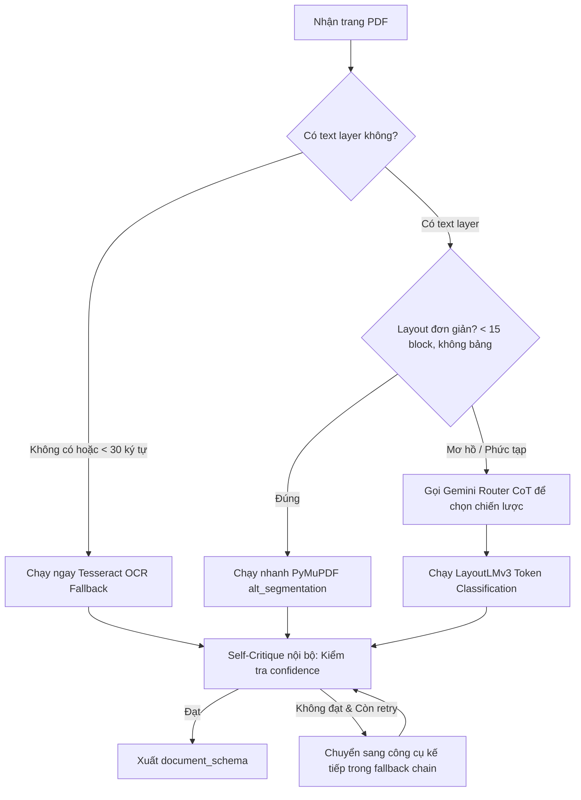

# TÀI LIỆU ĐẶC TẢ KỸ THUẬT: AGENT 2 - READER AGENT
### Vị trí: Document Layout Reader & Multi-modal Parser Agent
> **Người thực hiện:** Thành viên 2  
> **Thư mục làm việc độc lập:** `agents/agent2_reader/`  
> **File bàn giao hệ thống:** `agents/agent2_reader/node.py`

---

## 1. TỔNG QUAN NHIỆM VỤ

Reader Agent chịu trách nhiệm bóc tách các tài liệu nghiên cứu dạng **file PDF phức tạp** (bài báo 2 cột, bảng biểu khoa học, công thức toán học, hình vẽ kèm chú thích).

Thay vì trích xuất văn bản thô (Plain text làm mất cấu trúc thứ bậc), Agent kết hợp **3 công cụ bóc tách** cùng cơ chế **Heuristic Guardrails (tiết kiệm chi phí)** và **Gemini Chain-of-Thought**:
1. **PyMuPDF (`fitz`):** Trích xuất văn bản siêu tốc đối với tài liệu số có text layer đơn giản.
2. **Tesseract OCR:** Cơ chế dự phòng (Fallback) khi gặp tài liệu scan hoặc mờ không có text layer.
3. **LayoutLMv3 (Token Classification):** Mô hình thị giác ngôn ngữ đã fine-tune để gán nhãn cấu trúc không gian (Bảng biểu, Tiêu đề, Công thức, Chú thích hình).

---

## 2. KIẾN TRÚC MÔ HÌNH & 11 NHÃN LAYOUT

- **Mô hình thị giác:** `microsoft/layoutlmv3-base` (Chạy inference trên dòng chữ - Line-level, không phải từng từ riêng lẻ).
- **Tập dữ liệu huấn luyện:** `DocLayNet-base` (từ Hugging Face: `pierreguillou/DocLayNet-base`).
- **11 nhãn layout chuẩn khoa học:**
  1. `Title` (Tiêu đề chính)
  2. `Section-header` (Tiêu đề mục con)
  3. `Text` (Đoạn văn bản nội dung)
  4. `Table` (Bảng số liệu)
  5. `Picture` (Hình ảnh, sơ đồ)
  6. `Caption` (Chú thích hình / bảng)
  7. `Formula` (Công thức toán học)
  8. `Footnote` (Ghi chú chân trang)
  9. `List-item` (Mục danh sách gạch đầu dòng)
  10. `Page-header` (Tiêu đề đầu trang)
  11. `Page-footer` (Số trang / Chân trang)

> [!CAUTION]
> **Quy tắc tính toán Bounding Box (BBox):**
> Toàn bộ tọa độ BBox $(x_0, y_0, x_1, y_1)$ trong dataset phải chuẩn hóa về thang $0 - 1000$ dựa trên kích thước trang gốc (`original_width` và `original_height`), **tuyệt đối không dùng kích cỡ ảnh COCO (1025x1025)** vì sẽ làm sai lệch toàn bộ vị trí văn bản.

---

## 3. GIAO KÈO INTERFACE TRONG `node.py`

File `node.py` là điểm duy nhất mà đồ thị LangGraph gọi vào. Bạn PHẢI tuân thủ:

### 📥 Dữ liệu đầu vào (Đọc từ `AgentState`):
- `state["pdf_path"]`: Đường dẫn tới file PDF người dùng tải lên (`str` hoặc `None`).

### 📤 Dữ liệu đầu ra (Bắt buộc trả về):
```python
return {
    "document_schema": {
        "title": "Attention Is All You Need.pdf",
        "total_pages": 12,
        "pages": [
            {
                "page_no": 1,
                "needs_ocr": False,
                "sections": [
                    {
                        "type": "Title",
                        "bbox": [50.0, 45.2, 950.0, 80.5],
                        "text": "Attention Is All You Need"
                    },
                    {
                        "type": "Table",
                        "bbox": [100.0, 320.0, 900.0, 520.0],
                        "text": "Bảng 1: Kết quả BLEU score trên WMT 2014"
                    }
                ]
            }
        ]
    },
    "reasoning_trace": [{
        "agent": "ReaderAgent",
        "strategy": "pymupdf_fast",  # hoặc ocr_fallback, layoutlmv3
        "parsed_pages": 12,
        "status": "document_schema_ready"
    }]
}
```

---

## 4. QUY TRÌNH RA QUYẾT ĐỊNH & CƠ CHẾ GUARDRAIL

Để tránh tốn tiền gọi LLM API vô tội vạ, quy trình xử lý mỗi trang tuân theo:



- **Fallback chain mặc định:** `alt_segmentation` $\rightarrow$ `ocr_fallback` $\rightarrow$ `layoutlmv3`.
- **Giới hạn số lần thử lại:** Tối đa 3 lần cho mỗi trang, không bao giờ để script crash.

---

## 5. HƯỚNG DẪN HUẤN LUYỆN TRÊN KAGGLE (GPU T4)

Thư mục `training/notebooks/` chứa toàn bộ quy trình tiền xử lý và huấn luyện:

1. **Bước 1:** `00_inspect_doclaynet.py`:
   - Đọc nhánh `refs/convert/parquet` của dataset `pierreguillou/DocLayNet-base` để kiểm tra schema thực tế.
2. **Bước 2:** `01_process_doclaynet.py`:
   - Chuyển đổi tọa độ $(x, y, w, h) \rightarrow (x_0, y_0, x_1, y_1)$.
   - Chuẩn hóa về thang $0-1000$.
   - Lưu ra `/kaggle/working/doclaynet_processed/` kèm file `label_map.json`.
3. **Bước 3:** `01_train_layoutlmv3.py`:
   - Fine-tune mô hình `microsoft/layoutlmv3-base`.
   - Tham số: `fp16=True`, gradient accumulation steps để vừa VRAM 16GB của GPU T4.
   - Lưu checkpoint vào `/kaggle/working/layoutlmv3_doclaynet_model/`.
4. **Bước 4:** Nén thư mục model và tải về hoặc đẩy lên Hugging Face Hub:
   ```python
   model.push_to_hub("your-username/layoutlmv3-doclaynet")
   ```

---

## 6. TIÊU CHÍ NGHIỆM THU (DEFINITION OF DONE)

- [ ] File `node.py` chạy thành công khi truyền đường dẫn file PDF thật lẫn trường hợp file PDF không tồn tại (có fallback an toàn).
- [ ] Chạy lệnh `python -m pytest agents/agent2_reader/tests/` đạt 100% PASS.
- [ ] Bóc tách chính xác ít nhất 3 loại khối layout cơ bản: `Title`, `Text`, `Table`.
- [ ] Tự động nhận diện được file scan mờ và chuyển sang OCR mà không cần gọi LLM API.
