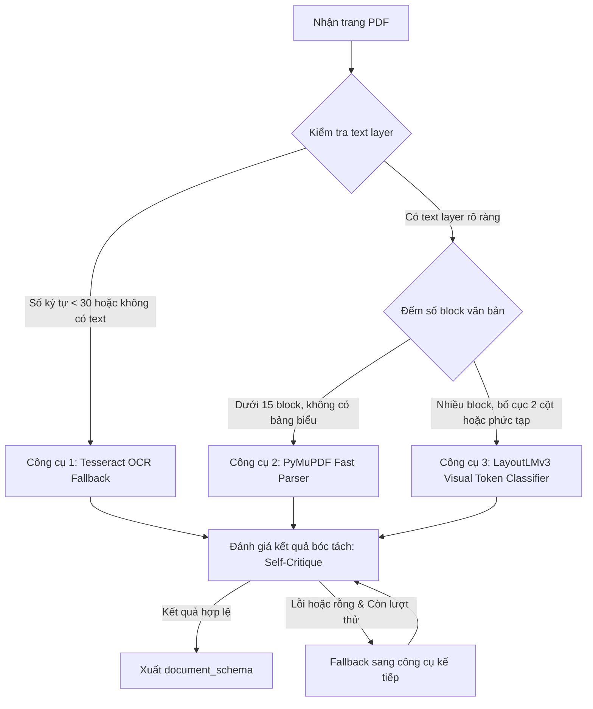

# TÀI LIỆU ĐẶC TẢ KỸ THUẬT: AGENT 2 - READER AGENT
### Vị trí: Document Layout Reader & Multi-modal Parser Agent
> **Người thực hiện:** Thành viên 2  
> **Thư mục làm việc độc lập:** `agents/agent2_reader/`  
> **File bàn giao hệ thống:** `agents/agent2_reader/node.py`  
> **Môi trường chạy mục tiêu:** Kaggle Notebook (GPU T4 x2) & Môi trường thực thi cục bộ

---

## 1. TỔNG QUAN NHIỆM VỤ & VỊ TRÍ KIẾN TRÚC

Reader Agent là thành phần chuyên xử lý các tài liệu khoa học dạng **file PDF phức tạp** (bài báo 2 cột, bảng biểu số liệu, công thức toán học, sơ đồ). 

Thay vì bóc tách text thô sơ (plain-text flatten làm mất hoàn toàn cấu trúc bảng biểu và mối liên kết đoạn), Reader Agent kết hợp:
1. **PyMuPDF (`fitz`):** Bóc tách siêu tốc các tài liệu dạng digital PDF có text layer sẵn có.
2. **Tesseract OCR Fallback:** Tự động phát hiện trang PDF dạng ảnh scan, tài liệu mờ hoặc không có text layer để chuyển sang OCR quang học.
3. **LayoutLMv3 (Token Classification):** Mô hình thị giác ngôn ngữ đã fine-tune trên tập `DocLayNet-base` để gán 11 nhãn cấu trúc không gian (Bảng, Tiêu đề, Đoạn văn, Công thức, Chú thích...).
4. **Heuristic Guardrails (Tiết kiệm chi phí):** Dùng các luật cố định về số lượng text block, tỉ lệ ảnh/chữ để tự quyết định công cụ mà không cần gọi LLM đắt tiền; chỉ gọi Gemini CoT Router khi gặp layout thực sự mơ hồ.

---

## 2. PHÂN TÍCH LỖI VÀ CẠM BẪY TỪ CODE CŨ (BRANCHES)

Nhánh `agent2-reader` cũ chứa các vấn đề kỹ thuật lớn cần đặc biệt chú ý khi chạy trên Kaggle:

| Vấn đề kỹ thuật | Cạm bẫy trong code cũ | Giải pháp chuẩn xác |
|---|---|---|
| **Lỗi tải dataset DocLayNet trên HuggingFace** | Repo `pierreguillou/DocLayNet-base` vẫn còn script cũ `DocLayNet-base.py`. Các bản `datasets` mới trên Kaggle chặn cơ chế này và báo lỗi `RuntimeError: Dataset scripts are no longer supported`. | **Bắt buộc** truy cập vào nhánh Parquet tự động convert: dùng tham số `revision="refs/convert/parquet"` khi gọi `load_dataset`. |
| **Cạm bẫy tọa độ Bounding Box (BBox)** | Một số đoạn code lấy kích thước ảnh COCO cố định `(1025x1025)` để chuẩn hóa BBox về `0-1000`, trong khi tọa độ gốc của text lại nằm theo kích thước trang thật `original_width` và `original_height` $\rightarrow$ Kết quả bbox bị méo lệch hoàn toàn so với dòng chữ! | Chuẩn hóa tọa độ theo đúng kích thước trang thật:<br>`x0_norm = int(1000 * x0 / original_width)`<br>`y0_norm = int(1000 * y0 / original_height)`. |
| **Cài đặt Tesseract OCR trên Kaggle / Linux** | Chỉ chạy `pip install pytesseract` là không đủ, sẽ bị lỗi `TesseractNotFoundError`. | Bắt buộc chạy lệnh hệ thống cài binary trước:<br>`!apt-get update && !apt-get install -y tesseract-ocr tesseract-ocr-vie`. |
| **Độ mịn của Token Classification** | Cố gắng đưa từng từ đơn lẻ vào LayoutLMv3 khiến chuỗi vượt quá `max_seq_length=512` của mô hình rất nhanh. | Gom các từ thành **Line-level** (từng dòng chữ) theo `(block_no, line_no)` của PyMuPDF trước khi infer qua LayoutLMv3. |

---

## 3. THIẾT LẬP TRÊN KAGGLE (GPU T4) & FINE-TUNE LAYOUTLMV3

Chạy notebook trên Kaggle với GPU T4:

### Cài đặt môi trường:
```bash
!apt-get update && !apt-get install -y tesseract-ocr
!pip install -q -U "transformers>=4.40.0" "datasets" "accelerate" "scikit-learn" "pillow" "pytesseract" "pymupdf"
```

### 11 Nhãn cấu trúc chuẩn khoa học của DocLayNet:
```python
LABEL_MAP = {
    0: "Caption",
    1: "Footnote",
    2: "Formula",
    3: "List-item",
    4: "Page-footer",
    5: "Page-header",
    6: "Picture",
    7: "Section-header",
    8: "Table",
    9: "Text",
    10: "Title"
}
```

### Cấu hình huấn luyện tối ưu cho VRAM 16GB (Kaggle T4):
- **Base Model:** `microsoft/layoutlmv3-base`
- **Max Length:** `512`
- **Batch Size:** `per_device_train_batch_size = 4`
- **Gradient Accumulation Steps:** `4` (effective batch size = 16)
- **Precision:** `fp16 = True`
- **Learning Rate:** `3e-5`
- **Epochs:** `3`

---

## 4. QUY TRÌNH RA QUYẾT ĐỊNH & THUẬT TOÁN ĐIỀU PHỐI



---

## 5. ĐẶC TẢ GIAO DIỆN `node.py`

File `agents/agent2_reader/node.py` phải tuân thủ nghiêm ngặt schema đầu ra:

```python
from typing import Any
import os
from core.base_agent import BaseAgent
from core.state import AgentState

class ReaderAgent(BaseAgent):
    def __init__(self, max_internal_retry: int = 2):
        super().__init__(name="ReaderAgent", max_internal_retry=max_internal_retry)
        # Nạp các công cụ: PyMuPDF, OCR wrapper, LayoutLMv3 pipeline
        
    def run(self, state: AgentState) -> dict[str, Any]:
        pdf_path = state.get("pdf_path")
        
        # 1. Kiểm tra an toàn: Nếu không truyền pdf_path hoặc file không tồn tại
        if not pdf_path or not os.path.exists(pdf_path):
            self.logger.warning("Không có file PDF hợp lệ, bỏ qua Reader Agent.")
            return {
                "document_schema": None,
                "reasoning_trace": [{"agent": self.name, "status": "skipped_no_pdf"}]
            }
            
        # 2. Xử lý từng trang PDF
        # Bóc tách cấu trúc -> Trả về DocLayNet schema chuẩn
        
        return {
            "document_schema": {
                "title": os.path.basename(pdf_path),
                "total_pages": 1,
                "pages": [
                    {
                        "page_no": 1,
                        "needs_ocr": False,
                        "sections": [
                            {"type": "Title", "bbox": [50, 40, 950, 80], "text": "Cơ chế Attention trong NLP"},
                            {"type": "Text", "bbox": [50, 90, 500, 300], "text": "Mô hình Transformer loại bỏ hoàn toàn hồi quy..."},
                            {"type": "Table", "bbox": [50, 320, 950, 600], "text": "Bảng 1: Kết quả thử nghiệm trên WMT 2014"}
                        ]
                    }
                ]
            },
            "reasoning_trace": [
                {
                    "agent": self.name,
                    "strategy": "pymupdf_fast",
                    "parsed_pages": 1,
                    "status": "document_schema_ready"
                }
            ]
        }
```

---

## 6. TIÊU CHÍ NGHIỆM THU (DEFINITION OF DONE)

- [ ] File `node.py` xử lý mượt mà cả trường hợp có file PDF thật lẫn trường hợp `pdf_path=None` (không bao giờ gây lỗi crash đồ thị).
- [ ] Khi đưa vào một ảnh PDF scan không có text, tự động chuyển sang Tesseract OCR.
- [ ] Bóc tách và gán nhãn được tối thiểu 3 thành phần chính: `Title`, `Text`, `Table`.
- [ ] Tọa độ BBox được chuẩn hóa đúng trong khoảng `0 - 1000`.
- [ ] Toàn bộ unit tests trong `agents/agent2_reader/tests/` đều vượt qua (100% PASS).
