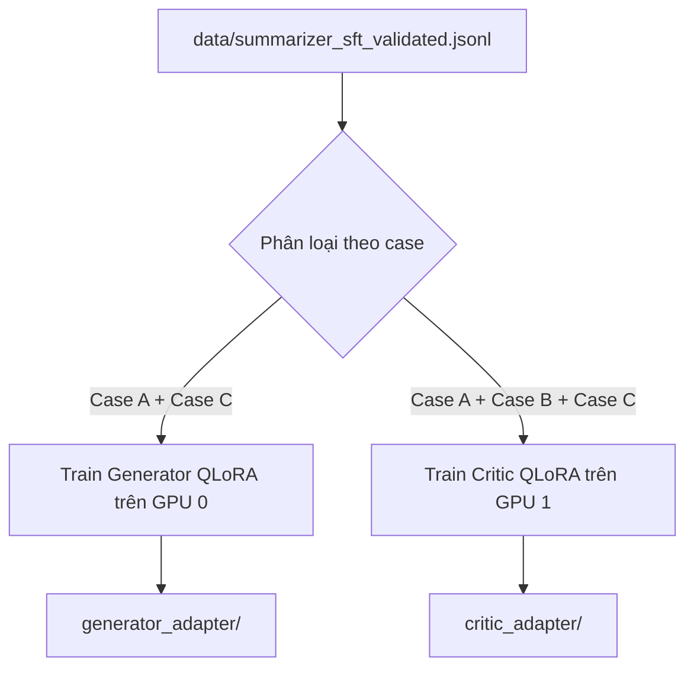

# TÀI LIỆU ĐẶC TẢ KỸ THUẬT: AGENT 3 - SUMMARIZER AGENT
### Vị trí: Grounded QA & Anti-Hallucination Summarization (Dual LoRA: Generator + Critic)
> **Người thực hiện:** Thành viên 3  
> **Thư mục làm việc độc lập:** `agents/agent3_summarizer/`  
> **File bàn giao hệ thống:** `agents/agent3_summarizer/node.py`  
> **Môi trường chạy mục tiêu:** Kaggle Notebook (GPU T4 x2 - 2x 15GB VRAM)

---

## 1. TỔNG QUAN NHIỆM VỤ & TRIẾT LÝ THIẾT KẾ CỐT LÕI

Summarizer Agent nhận danh sách tài liệu từ Retrieval Agent (`retrieved_docs`) và cấu trúc PDF (`document_schema`) để sinh câu trả lời nghiên cứu **tuyệt đối không bịa đặt (Anti-Hallucination)** và kèm trích dẫn nguyên văn (**Verbatim Evidence Spans**).

### 💡 Tại sao kiến trúc bắt buộc phải tách 2 mô hình độc lập?
Nếu dùng chung 1 mô hình vừa sinh câu trả lời vừa tự phê bình, LLM rất dễ rơi vào bẫy **Tự thỏa hiệp (Self-Confirmation Bias)**: tức là tự sinh ra câu trả lời rồi tự chấm "đạt" để tránh phải sửa.
Do đó, hệ thống chia thành 2 vai trò:
1. **Generator Model:** Tập trung tổng hợp ngữ cảnh và trích xuất nguyên văn các câu trong tài liệu làm chứng cứ (`evidence_spans`).
2. **Critic Model:** Đóng vai trò là một thanh tra độc lập, khắt khe rà soát xem từng ý trong câu trả lời có được chứng minh bởi chứng cứ hay không, có bị diễn dịch vượt quá tài liệu hay không.

---

## 2. PHÂN TÍCH LỖI VÀ CẠM BẪY TỪ CODE CŨ (BRANCHES)

| Vấn đề | Cạm bẫy trong code cũ | Cách giải quyết tối ưu trên Kaggle T4x2 |
|---|---|---|
| **VRAM khi chạy cùng lúc 2 mô hình 7B** | Code cũ trên Kaggle cố gắng load cả Generator và Critic cùng lúc trên 1 GPU duy nhất $\rightarrow$ Báo lỗi `CUDA out of memory` ngay lập tức! | **Tận dụng triệt để 2 GPU của T4x2:**<br>- Gán `Generator` chạy trên `cuda:0` (khoảng ~5.5GB VRAM 4-bit).<br>- Gán `Critic` chạy trên `cuda:1` (khoảng ~5.5GB VRAM 4-bit).<br>Hai mô hình chạy song song trên 2 card riêng biệt mà không bao giờ sợ OOM! |
| **Bằng chứng bị diễn đạt lại (Paraphrase)** | Khi sinh tập dữ liệu huấn luyện, LLM thường có xu hướng "diễn đạt lại gần đúng" thay vì copy y nguyên từng từ từ văn bản gốc $\rightarrow$ Làm mất tính xác thực khoa học. | Bắt buộc chạy script lọc `validate_evidence_span.py`: Chỉ chấp nhận **Exact Substring Match** hoặc **Fuzzy Match (SequenceMatcher ratio $\ge 0.9$)**. Bất kỳ mẫu nào bị diễn đạt lại đều bị loại bỏ ngay từ bước chuẩn bị data. |
| **Sử dụng sai tập dữ liệu giữa 2 mô hình** | Cho Generator học cả các mẫu có ảo giác (Case B). | **Quy tắc phân tách dữ liệu cứng:**<br>- **Generator chỉ được học:** Case A (`fully_grounded`) và Case C (`unanswerable` - dạy model biết nói "không có đủ thông tin").<br>- **Critic học cả 3 case:** Đặc biệt là Case B (`partial_grounding`) để học cách phát hiện ảo giác tinh vi! |
| **Vòng lặp vô hạn làm sập đồ thị** | Nếu Critic liên tục từ chối, node có thể bị lặp vô tận hoặc raise Exception. | **Nguyên tắc "Lối thoát an toàn":** Vòng lặp nội bộ chỉ chạy tối đa `MAX_INTERNAL_RETRY = 2`. Khi hết lượt, trả về kết quả tốt nhất hiện có kèm cờ `confidence = "low"`, nhường quyền quyết định cho Orchestrator. |

---

## 3. THIẾT LẬP TRÊN KAGGLE (T4 x2)

Kích hoạt 2 GPU T4 trên Kaggle Notebook:

```bash
!pip install -q -U "transformers>=4.40.0" "datasets" "peft" "trl" "bitsandbytes" "accelerate" "scikit-learn"
```

### Chiến lược nạp mô hình Dual LoRA tối ưu trên 2 GPU:
```python
import torch
from transformers import AutoModelForCausalLM, AutoTokenizer, BitsAndBytesConfig

bnb_config = BitsAndBytesConfig(
    load_in_4bit=True,
    bnb_4bit_quant_type="nf4",
    bnb_4bit_compute_dtype=torch.float16,
)

# Nạp Generator lên GPU 0
generator_model = AutoModelForCausalLM.from_pretrained(
    "Qwen/Qwen2.5-7B-Instruct",
    quantization_config=bnb_config,
    device_map={" ": 0} # hoặc cuda:0
)

# Nạp Critic lên GPU 1
critic_model = AutoModelForCausalLM.from_pretrained(
    "Qwen/Qwen2.5-7B-Instruct",
    quantization_config=bnb_config,
    device_map={" ": 1} # hoặc cuda:1
)
```

---

## 4. QUY TRÌNH HUẤN LUYỆN DUAL LORA TRÊN KAGGLE



### 3 Case dữ liệu huấn luyện:
1. **Case A (`fully_grounded`):** Câu trả lời hoàn toàn dựa vào context, có trích dẫn nguyên văn $\rightarrow$ Huấn luyện Generator trả lời chuẩn xác.
2. **Case B (`partial_grounding`):** Câu trả lời có chứa ảo giác (nói thêm thông tin ngoài lề) $\rightarrow$ Huấn luyện Critic phát hiện lỗi.
3. **Case C (`unanswerable`):** Câu hỏi không có câu trả lời trong tài liệu $\rightarrow$ Dạy Generator từ chối trả lời (`answer: "Tài liệu không cung cấp thông tin này"`), tránh bịa đặt.

### Hyperparameters tối ưu:
- **Base:** `Qwen/Qwen2.5-7B-Instruct`
- **LoRA Rank:** `16`, **Alpha:** `32`, **Dropout:** `0.05`
- **Target Modules:** `q_proj, k_proj, v_proj, o_proj, gate_proj, up_proj, down_proj`
- **Max Seq Length:** `1536` (dài hơn Agent 1 vì có cả context tài liệu nghiên cứu)
- **Batch Size:** `2` trên mỗi GPU, `gradient_accumulation_steps = 8`
- **Epochs:** `3`, **LR:** `2e-4`

---

## 5. ĐẶC TẢ GIAO DIỆN `node.py`

File `agents/agent3_summarizer/node.py` phải tuân thủ nghiêm ngặt hợp đồng I/O:

```python
from typing import Any
from core.base_agent import BaseAgent
from core.state import AgentState

class SummarizerAgent(BaseAgent):
    def __init__(self, max_internal_retry: int = 2):
        super().__init__(name="SummarizerAgent", max_internal_retry=max_internal_retry)
        # Nạp Generator trên cuda:0 và Critic trên cuda:1
        
    def run(self, state: AgentState) -> dict[str, Any]:
        query = state.get("query", "")
        retrieved_docs = state.get("retrieved_docs", [])
        document_schema = state.get("document_schema")
        
        # Vòng lặp nội bộ (tối đa 2 lần):
        # 1. Generator sinh câu trả lời + evidence spans
        # 2. Critic kiểm tra:
        #    - Nếu is_supported=True -> Chấp nhận kết quả, confidence="high"
        #    - Nếu False và còn retry -> Yêu cầu sinh lại
        # 3. Nếu hết số lần thử -> Trả về câu trả lời tốt nhất kèm confidence="low"
        
        return {
            "answer": "Theo kết quả nghiên cứu, cơ chế LoRA giảm tham số huấn luyện đi 10,000 lần...",
            "evidence_spans": [
                "LoRA can reduce the number of trainable parameters by 10,000 times."
            ],
            "confidence": "high",  # "high" | "low"
            "reasoning_trace": [
                {
                    "agent": self.name,
                    "internal_attempts": 1,
                    "critic_verdict": True,
                    "critic_reason": "Luận điểm khớp hoàn toàn với evidence.",
                    "confidence": "high"
                }
            ]
        }
```

---

## 6. TIÊU CHÍ NGHIỆM THU (DEFINITION OF DONE)

- [ ] File `validate_evidence_span.py` chạy qua 100% mẫu dữ liệu, loại bỏ toàn bộ các bằng chứng diễn đạt lại.
- [ ] Huấn luyện thành công 2 LoRA adapter riêng biệt cho Generator và Critic.
- [ ] Phân bổ thành công 2 model trên 2 GPU riêng biệt trên Kaggle T4x2 mà không xảy ra hiện tượng OOM.
- [ ] `evidence_spans` sinh ra trong thực tế bắt buộc phải là chuỗi con có trong ngữ cảnh (`exact match in context`).
- [ ] Khi hết `MAX_INTERNAL_RETRY`, tự động hạ `confidence="low"`, không bao giờ làm gián đoạn đồ thị.
- [ ] Toàn bộ unit tests trong `agents/agent3_summarizer/tests/` đều vượt qua.
