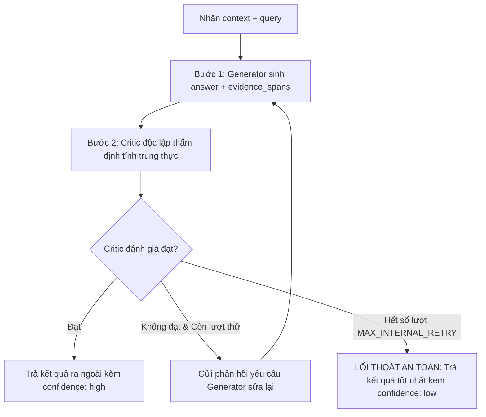

# TÀI LIỆU ĐẶC TẢ KỸ THUẬT: AGENT 3 - SUMMARIZER AGENT
### Vị trí: Grounded QA & Anti-Hallucination Summarization (Generator + Critic độc lập)
> **Người thực hiện:** Thành viên 3  
> **Thư mục làm việc độc lập:** `agents/agent3_summarizer/`  
> **File bàn giao hệ thống:** `agents/agent3_summarizer/node.py`

---

## 1. TỔNG QUAN NHIỆM VỤ

Summarizer Agent chịu trách nhiệm tổng hợp thông tin từ các đoạn tài liệu truy xuất (`retrieved_docs`) và cấu trúc tài liệu PDF (`document_schema`) để tạo ra câu trả lời **tuyệt đối bám sát ngữ cảnh và trích dẫn bằng chứng nguyên văn (Verbatim Evidence Spans)**.

Đây là "trái tim" chống ảo giác (Anti-Hallucination) của toàn bộ hệ thống.

---

## 2. QUYẾT ĐỊNH THIẾT KẾ CỐT LÕI: TÁCH BIỆT GENERATOR VÀ CRITIC ĐỘC LẬP

> [!IMPORTANT]
> **Tại sao không dùng 1 model đa nhiệm?**
> Nếu gộp cả sinh câu trả lời và tự phê bình vào chung 1 model/adapter, mô hình rất dễ rơi vào bẫy **"Tự thỏa hiệp" (Self-Confirmation Bias)**: tức là tự sinh ra câu trả lời rồi tự chấm đạt để tránh phải sửa.

Hệ thống của chúng ta tách thành **2 LoRA Adapter độc lập** (hoặc 2 prompt CoT riêng biệt):
1. **Generator Model:** Chuyên sinh câu trả lời và trích xuất đúng các đoạn câu văn gốc trong tài liệu làm `evidence_spans`.
2. **Critic Model:** Đóng vai trò là một người phản biện khắt khe, kiểm tra xem câu trả lời có bị suy diễn vượt quá tài liệu không và trích dẫn có đúng từng từ không.

---

## 3. ĐẶC TẢ DỮ LIỆU HUẤN LUYỆN (3 CASE TYPES)

- **Vị trí file:** `agents/agent3_summarizer/training/data/summarizer_sft_validated.jsonl`
- Dữ liệu được chia làm 3 kịch bản rõ ràng và được sử dụng **KHÁC NHAU** giữa 2 mô hình:
  1. **Case A (`fully_grounded`):** Câu trả lời đúng 100%, trích dẫn nguyên văn $\rightarrow$ **Dạy Generator trả lời chuẩn.**
  2. **Case B (`partial_grounding`):** Câu trả lời có ảo giác tinh vi (đúng hướng nhưng suy diễn thêm những ý không có trong bài) $\rightarrow$ **Dạy Critic cách bắt lỗi ảo giác!** (Generator KHÔNG được học case này).
  3. **Case C (`unanswerable`):** Câu hỏi gài bẫy, tài liệu không nhắc đến $\rightarrow$ **Dạy Generator biết từ chối (`answer: null`)**, tránh bịa đặt.

### 🛡️ Tiêu chuẩn trích dẫn nguyên văn (Verbatim Matching):
Toàn bộ dữ liệu train bắt buộc phải vượt qua script `validate_evidence_span.py`:
- **Exact match:** Chuỗi con chính xác trong context.
- **Fuzzy match:** Độ tương đồng ký tự `SequenceMatcher >= 0.9` (chỉ chấp nhận lệch khoảng trắng/dấu câu nhỏ, loại bỏ hoàn toàn diễn đạt lại/paraphrase).

---

## 4. GIAO KÈO INTERFACE TRONG `node.py`

File `node.py` là điểm duy nhất mà đồ thị LangGraph gọi vào. Bạn PHẢI tuân thủ:

### 📥 Dữ liệu đầu vào (Đọc từ `AgentState`):
- `state["query"]`: Câu hỏi nghiên cứu (`str`).
- `state.get("retrieved_docs", [])`: Danh sách các đoạn văn bản truy xuất được (`list[dict]`).
- `state.get("document_schema", {})`: Cấu trúc PDF bóc tách được (`dict`).

### 📤 Dữ liệu đầu ra (Bắt buộc trả về):
```python
return {
    "answer": "Theo tài liệu nghiên cứu được cung cấp, cơ chế Self-Attention...",
    "evidence_spans": [
        "We propose the Transformer, based solely on attention mechanisms.",
        "reducing trainable parameters by 10,000 times."
    ],
    "confidence": "high",  # "high" | "low"
    "reasoning_trace": [{
        "agent": "SummarizerAgent",
        "internal_attempts": 1,
        "critic_verdict": True,
        "critic_reason": "Toàn bộ luận điểm đều có chứng cứ nguyên văn hỗ trợ.",
        "confidence": "high"
    }]
}
```

---

## 5. THUẬT TOÁN ĐIỀU PHỐI NỘI BỘ (SAFE EXIT LOOP)



> [!CAUTION]
> **Nguyên tắc "Lối thoát an toàn":**
> Khi hết số lần thử nội bộ (`MAX_INTERNAL_RETRY = 2`), hàm `run()` **TUYỆT ĐỐI KHÔNG ĐƯỢC RAISE EXCEPTION** hay rơi vào vòng lặp vô hạn làm sập hệ thống. Phải trả về câu trả lời khả dĩ nhất và hạ `confidence = "low"` để Orchestrator tầng ngoài xử lý.

---

## 6. HƯỚNG DẪN HUẤN LUYỆN TRÊN KAGGLE (GPU T4 x2)

Toàn bộ script huấn luyện nằm trong `agents/agent3_summarizer/training/`:

1. **Sinh và kiểm duyệt dữ liệu (Chạy ở Local, không cần GPU):**
   ```bash
   export OPENAI_API_KEY=sk-...
   python generate_training_data.py
   python validate_evidence_span.py  # Bắt buộc lọc sạch bằng chứng không verbatim
   ```
2. **Huấn luyện trên Kaggle (GPU T4 x2, VRAM 16GB):**
   ```bash
   # Train Generator
   python train_generator_qlora.py
   
   # Train Critic
   python train_critic_qlora.py
   ```
3. **Đẩy 2 adapter lên Hugging Face Hub:**
   ```python
   generator_model.push_to_hub("your-username/qwen25-7b-summarizer-generator-lora")
   critic_model.push_to_hub("your-username/qwen25-7b-summarizer-critic-lora")
   ```

---

## 7. TIÊU CHÍ NGHIỆM THU (DEFINITION OF DONE)

- [ ] File `node.py` chạy độc lập thành công.
- [ ] Chạy lệnh `python -m pytest agents/agent3_summarizer/tests/` đạt 100% PASS.
- [ ] Mọi chuỗi trong `evidence_spans` phải là **chuỗi con nguyên văn (substring match)** trong tài liệu gốc.
- [ ] Khi hết số lượt retry nội bộ, không bao giờ gây crash graph mà tự động hạ `confidence = "low"`.
