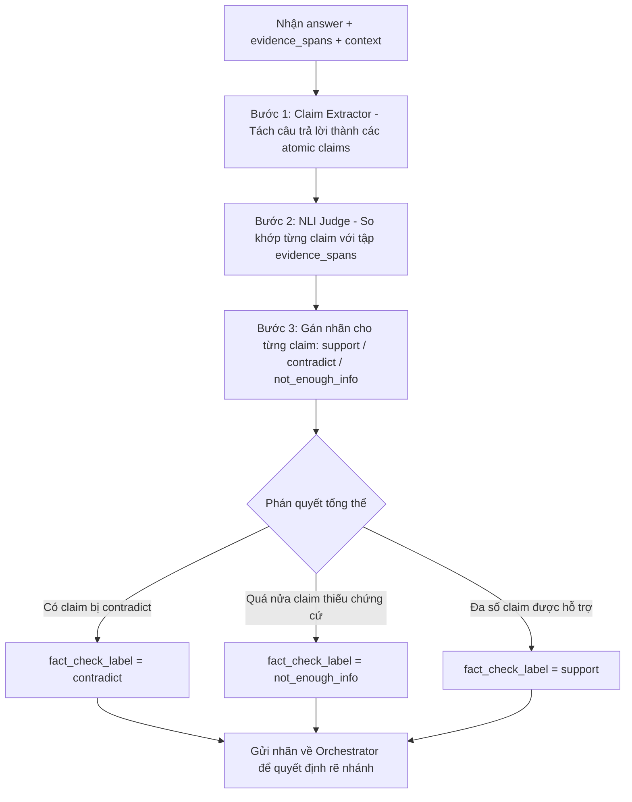

# TÀI LIỆU ĐẶC TẢ KỸ THUẬT: AGENT 4 - FACT-CHECKER AGENT
### Vị trí: Trọng tài thẩm định sự thật (Scientific Claim Verification & NLI Judge)
> **Người thực hiện:** Thành viên 4  
> **Thư mục làm việc độc lập:** `agents/agent4_fact_checker/`  
> **File bàn giao hệ thống:** `agents/agent4_fact_checker/node.py`

---

## 1. TỔNG QUAN NHIỆM VỤ

Fact-Checker Agent đóng vai trò là **"Vị thẩm phán độc lập"** trong đồ thị LangGraph. Agent này đứng giữa Summarizer và Writer để kiểm duyệt chất lượng câu trả lời trước khi cho phép xuất báo cáo.

Giá trị của Agent 4 nằm ở chỗ nó **quyết định trực tiếp nhánh rẽ (Conditional Edge) của Orchestrator**:
- Nếu thẩm định đạt (`support`): Cho phép chuyển tiếp sang **Agent 5 (Writer)** để viết báo cáo.
- Nếu thẩm định phát hiện mâu thuẫn hoặc thiếu chứng cứ (`contradict` hoặc `not_enough_info`): Đồ thị tăng `retry_count += 1` và **đẩy ngược quy trình về Agent 1 (Retrieval)** để tìm kiếm thêm dữ kiện.
- Nếu đã thử lại quá 3 lần: Kích hoạt **Escalation Node** để cảnh báo người dùng.

---

## 2. MÔ HÌNH SỬ DỤNG & 3 NHÃN PHÂN LOẠI (NLI)

Mô hình hoạt động dựa trên bài toán **Natural Language Inference (NLI)** với 3 nhãn chuẩn khoa học:
1. `support`: Luận điểm hoàn toàn có căn cứ và phù hợp với tài liệu gốc.
2. `contradict`: Luận điểm mâu thuẫn, phủ định hoặc đi ngược lại với tài liệu gốc.
3. `not_enough_info`: Tài liệu nguồn chưa cung cấp đủ dữ liệu để chứng minh luận điểm là đúng hay sai.

### Lựa chọn kỹ thuật:
- **Phương án 1 (Fine-tuned Encoder):** Mô hình **`SciBERT` (`allenai/scibert_scivocab_uncased`)** hoặc `DeBERTa-v3` fine-tune trên tập dữ liệu khoa học **SciFact**.
- **Phương án 2 (LLM-as-judge):** Sử dụng Prompt Chain-of-Thought trên LLM mạnh với bare-metal prompt so sánh `{claim, evidence}`.

---

## 3. GIAO KÈO INTERFACE TRONG `node.py`

File `node.py` là điểm duy nhất mà đồ thị LangGraph gọi vào. Bạn PHẢI tuân thủ:

### 📥 Dữ liệu đầu vào (Đọc từ `AgentState`):
- `state["answer"]`: Câu trả lời sơ bộ do Summarizer Agent sinh ra (`str`).
- `state.get("evidence_spans", [])`: Danh sách các trích dẫn nguyên văn (`list[str]`).
- `state.get("retrieved_docs", [])`: Danh sách tài liệu gốc để đối soát chéo (`list[dict]`).
- `state.get("retry_count", 0)`: Số lần retry hiện tại của đồ thị (`int`).

### 📤 Dữ liệu đầu ra (Bắt buộc trả về):
```python
return {
    "claims": [
        "LoRA giúp giảm nhu cầu bộ nhớ GPU đi 3 lần so với GPT-3 175B.",
        "LoRA không làm tăng độ trễ suy luận so với adapters."
    ],
    "verified_claims": [
        {
            "claim": "LoRA giúp giảm nhu cầu bộ nhớ GPU đi 3 lần so với GPT-3 175B.",
            "status": "support",          # "support" | "contradict" | "not_enough_info"
            "confidence": 0.95,
            "evidence": "LoRA can reduce ... GPU memory requirement by 3 times."
        },
        ...
    ],
    "fact_check_label": "support",        # Nhãn quyết định nhánh rẽ của Orchestrator!
    "reasoning_trace": [{
        "agent": "FactCheckerAgent",
        "fact_check_label": "support",
        "claims_count": 2,
        "supported_count": 2,
        "reasoning": "Toàn bộ 2/2 luận điểm đều có chứng cứ xác thực trực tiếp."
    }]
}
```

---

## 4. THUẬT TOÁN XỬ LÝ NỘI BỘ (STEP-BY-STEP)



### Logic phán quyết tổng thể (`fact_check_label`):
1. **Ưu tiên phát hiện lỗi sai:** Nếu phát hiện bất kỳ claim nào bị `contradict` $\rightarrow$ Nhãn tổng thể là `contradict`.
2. **Kiểm tra độ phủ chứng cứ:** Nếu tỷ lệ `not_enough_info` vượt quá 50% số lượng claims $\rightarrow$ Nhãn tổng thể là `not_enough_info`.
3. **Đạt chuẩn:** Khi toàn bộ hoặc phần lớn các claims cốt lõi đều đạt `support` $\rightarrow$ Nhãn tổng thể là `support`.

---

## 5. HƯỚNG DẪN HUẤN LUYỆN SCIBERT (NẾU DÙNG FINE-TUNE)

1. **Tập dữ liệu:** Tải tập dữ liệu **SciFact** từ AllenAI:
   ```bash
   pip install datasets
   ```
2. Cặp dữ liệu huấn luyện:
   - Premise: Đoạn văn bản nghiên cứu / Bằng chứng trích xuất.
   - Hypothesis: Luận điểm cần kiểm chứng.
   - Label: `0: CONTRADICT`, `1: NOT_ENOUGH_INFO`, `2: SUPPORT`.
3. Huấn luyện bằng `AutoModelForSequenceClassification`:
   ```python
   from transformers import AutoModelForSequenceClassification, AutoTokenizer
   model = AutoModelForSequenceClassification.from_pretrained("allenai/scibert_scivocab_uncased", num_labels=3)
   ```

---

## 6. TIÊU CHÍ NGHIỆM THU (DEFINITION OF DONE)

- [ ] File `node.py` chạy thành công độc lập.
- [ ] Chạy lệnh `python -m pytest agents/agent4_fact_checker/tests/` đạt 100% PASS.
- [ ] Tách được câu trả lời thành ít nhất 1-3 atomic claims độc lập.
- [ ] Dán nhãn chuẩn xác: Nhận diện được câu khẳng định có bằng chứng (`support`) và câu không có trong bài (`not_enough_info`).
- [ ] `fact_check_label` luôn là 1 trong 3 chuỗi: `"support"`, `"contradict"`, `"not_enough_info"`.
