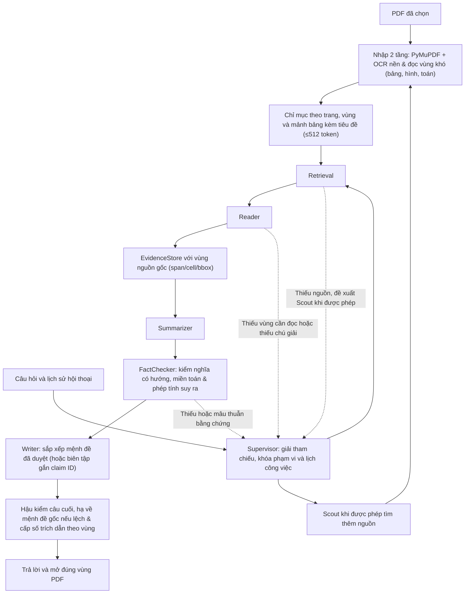

# Kế hoạch nâng cấp trợ lý nghiên cứu đa tác tử trên nhánh tatmanh

Cập nhật ngày 26/11/2026 · Mốc đối chiếu `5993b5aa760f508a93bc3143cea95f443d9c5f1d` · Python 3.11.9, Windows.

**Giữ FastAPI, LangGraph, sáu tác tử và sổ bằng chứng hiện có.** Thứ tự thực thi được khóa chặt: **(1)** sửa bộ chấm, cô lập cache và ghi nhận đúng model thực trả lời; **(2)** chặn câu sai lọt qua Writer và bảo toàn phủ định, vai trò chủ thể, biểu thức toán cùng phép tính suy ra từ nguồn; **(3)** bảo toàn bằng chứng theo vùng PDF và nối quyết định của tác tử vào đúng bước thực thi; **(4)** chỉ sau đó mới đo đối chứng các mô hình nền trên tập tài liệu chưa chạm và xét fine-tune thành phần thực sự yếu. Một mô hình đọc đúng trang vẫn có thể bị pipeline làm sai công thức, bác bỏ nhầm số suy ra đúng hoặc gắn nhầm trích dẫn ở bước cuối.

---

## 1. Kết quả kiểm tra và đối chiếu trên nhánh hiện tại

### Lỗi ảnh hưởng trực tiếp đến câu trả lời

| Ưu tiên | Ca kiểm tra và kết quả quan sát | Thay đổi thiết kế và phép thử hồi quy |
|---|---|---|
| P0 · Writer | Nguồn nói **12 layers**. Khi giả lập riêng phần sinh văn bản trả **999 layers**, `GeminiWriterAgent` xuất câu 999 kèm `[1]` dù audit trước Writer vẫn xác minh claim 12. Lỗi này ảnh hưởng cả `hybrid` khi `HybridWriterAgent` ủy quyền sang `GeminiWriterAgent`. | Không đưa `source_units` thô cho Writer. Ở M1, Writer chỉ sắp xếp các mệnh đề đã duyệt và code tất định tự gắn số trích dẫn theo từng `span`/vùng. Nếu bật chế độ diễn đạt lại ở giai đoạn sau, mỗi câu phải gắn `source_claim_ids`, qua kiểm tra ngữ nghĩa có hướng (bắt cả đảo chiều kiểu “A vượt B” → “B vượt A”, phủ định, số, đơn vị) và tự hạ về nguyên văn mệnh đề đã duyệt khi lệch, không mở vòng lặp quay lại FactChecker. Dùng chung một cửa kiểm tra cho API, stream, báo cáo và câu trả lời ngắn. [Gemini Writer](../modes/gemini/writer.py#L125) · [Hybrid Writer](../modes/hybrid/writer.py#L49) · [GPU Writer](../modes/gpu_finetune/writer.py#L24) · [Audit](../core/citation_audit.py#L219) |
| P0 · Phủ định, toán và số suy ra | Hai tác tử CPU thật xuất **Treatment works. [1]** từ câu **It is false that treatment works.**. Bộ so quote chấp nhận `x_2 = 4` khi nguồn là `x^2 = 4`. CPU Max làm mất dấu bất đẳng thức trong `x < 3 and y > 2`. Với nguồn `A = 81%, B = 92%`, câu đúng **“B cao hơn A 11 điểm phần trăm”** bị `verifier` đánh `CONTRADICT`; kể cả khi đặt `SUPPORT`, `citation_audit` vẫn trả `missing_numeric_evidence`, báo thiếu `11` và xóa sạch trích dẫn. | Phân biệt “tìm thấy chuỗi” với “câu nguồn xác nhận mệnh đề”. Kiểm tra phủ định, lượng từ, điều kiện và chiều quan hệ chủ thể–đối tượng trong cả câu. Giữ nguyên chỉ số, mũ, dấu, giả thiết và miền xác định (`x/x = 1` cần `x ≠ 0`) trong bản đối chứng. Bổ sung loại mệnh đề có phép tính (`derived_claim`): mỗi toán hạng phải gắn đúng `(đối tượng, chỉ số, tập đánh giá/điều kiện, đơn vị, vùng/ô nguồn)` và phép tính được Python kiểm chứng tất định để phân biệt **11 điểm phần trăm** với mức tăng tương đối **~13,58%** cũng như chặn trừ nhầm giữa tập Validation và Test. [Verifier](../core/verifier.py#L731) · [Kiểm số Verifier](../core/verifier.py#L786) · [Audit toán](../core/citation_audit.py#L53) · [Audit số](../core/citation_audit.py#L201) · [CPU Max Reader](../modes/cpu_max/reader.py#L32) |
| P0 · Ảnh và biểu đồ | PDF chỉ có ảnh ghi “Accuracy was 83 percent.” sinh **0 chunk**. Danh mục hình thấy một trang scan nhưng câu “What accuracy was reported?” chọn **0 hình**. Với nguồn `A = 81%, B = 92%`, đảo A/B trong kết quả thị giác vẫn được đánh dấu `corroborated`. | OCR trang scan ngay khi nhập. Truy hồi được nội dung dù câu hỏi không chứa từ “hình”. Xác minh bộ **đối tượng – hàng/cột hoặc series – giá trị – đơn vị – vùng ảnh**. Tách rõ số in trực tiếp trên hình và giá trị ước lượng từ trục. [Parser](../core/tools.py#L400) · [Chọn hình](../core/figure_qa.py#L40) · [Đối chiếu trị số](../core/figure_qa.py#L130) |
| P0 · Công thức | PDF thử có phân số xếp tầng `y = a/b` được trích thành `y = a`, ngữ cảnh `y = a b`, không có khung tọa độ. Trang 5 của PDF thực `1911.10635v2` trong workspace cũng cho các mảnh phương trình rời như `Qπ(s,a) = E` và `t≥0`. | Lưu ảnh vùng, số phương trình, LaTeX, câu định nghĩa biến/miền xác định và tọa độ trang. Đối chiếu tử/mẫu, chỉ số và cận trước khi dùng. Cho người đọc mở ảnh gốc ngay bên cạnh công thức. [Tách phương trình](../core/tools.py#L156) · [Chuyển sang SourceUnit](../agents/agent2_reader/tools/reader_pipeline.py#L99) |
| P1 · Việt–Anh | Hàm đoán ngôn ngữ nhận **This is a test** là tiếng Việt, nhưng **Ket qua o trang nao?** lại không được nhận ra. Đường tạo báo cáo trả thông báo tiếng Việt cho câu hỏi tiếng Anh ngoài tài liệu. | Giữ riêng ngôn ngữ hỏi, ngôn ngữ trả lời và ngôn ngữ nguồn. Cho phép người dùng chọn rõ ngôn ngữ. Kiểm tra truy vấn ngắn, không dấu, trộn thuật ngữ và ký hiệu Hy Lạp. Dùng một bộ thông điệp theo ngôn ngữ cho thành công, hỏi lại và từ chối. [Nhận diện](../agents/agent1_retrieval/tools/semantic_pipeline.py#L83) · [Báo cáo](../agents/agent5_writer/components/report_builder.py#L195) |
| P1 · Điều phối | LangGraph thật với tác tử giả lập ghi nhận Retrieval yêu cầu Scout và tăng số lượt thử, nhưng cạnh đồ thị và bước resume vẫn chạy tiếp Reader. Khi hai nhánh chờ và chỉ một nhánh có kết quả, bộ đồng bộ manifest có thể ghi cả hai hoàn tất. | Dùng chung một hàm quyết định chuyển việc cho chạy mới, retry và resume (bao gồm cả sau `retrieval_node`). Chỉ ghi hoàn thành từ sự kiện khớp đúng task ID. Test qua API với chế độ so sánh bật/tắt, có/không có quyền tìm ngoài tài liệu. [Chính sách chuyển việc](../core/coordination.py#L31) · [Resume graph](../core/graph.py#L296) · [Cạnh của graph](../core/graph.py#L754) · [Manifest](../core/research_dag.py#L861) |
| P1 · Mất thông tin nguồn | Với PDF hỏng và kết quả truy hồi cũ, GPU Reader tạo một `SourceUnit` dạng bảng chứa thông báo lỗi parser. Trong luồng báo cáo, nhiều bằng chứng cùng trang bị gộp chung một số trích dẫn trỏ tới vùng đầu tiên. | Tách kết quả trích xuất thất bại khỏi dữ liệu chứng minh. Cấp số trích dẫn định danh đến từng `span`/vùng hoặc ô bảng thay vì gộp theo `(doc_id, page)`. Kiểm tra nhấp vào hai phương trình cùng trang, PDF xoay và PDF scan. [Công cụ đọc bảng](../core/tools.py#L518) · [GPU Reader](../modes/gpu_finetune/reader.py#L108) · [Đánh số nguồn](../agents/agent5_writer/components/report_builder.py#L42) |

### Đo lường, bộ chấm, cache và vận hành

- **Toàn bộ test của nhánh.** Chạy pytest trên bản `git archive HEAD` cách ly, Windows/Python 3.11.9, pytest 8.4.2, tắt cấu hình key và remote: **432 đạt, 7 lỗi, 0 bỏ qua, 46 cảnh báo, 225,73 giây**. Cả 7 lỗi nằm ở `test_worker_manager.py`: ba ca giả định checkout có đủ checkpoint dưới `training_lab/final_weights`; ba ca lệch hợp đồng giữa test và worker về NLI thiếu model, mã lỗi JSON của Critic và HTTP 501/503 của reranker; ca cuối đã nhận ra tiến trình chết nhưng vượt ngưỡng 0,5 giây trên Windows. Cần tách fixture trọng số cho test offline, chốt trạng thái `unavailable` với client và đo timeout trên Linux/Kaggle trước khi kết luận về hiệu năng GPU. [Test manifest](../tests/test_worker_manager.py#L67) · [Test thời gian](../tests/test_worker_manager.py#L710) · [Hợp đồng endpoint](../tests/test_worker_manager.py#L820) · [Capability](../../kaggle/worker_manager.py#L1045)
- **Pilot CPU chạy lại** bằng `python main/eval/run_benchmark.py --pilot --modes cpu_min --limit-per-cat 0 --output-dir <thư-mục-tạm>` với `PYTHON_DOTENV_DISABLED=1`. Bốn câu hoàn tất, không lỗi thực thi: Retrieval recall **100%** trên các câu có nguồn chuẩn, Citation F1 **33,3%**, groundedness theo bộ chấm **50%**, độ đúng số liệu **33,3%**, abstention accuracy **75%**. Chỉ có hai câu VI và hai câu EN; đây mới là tín hiệu chẩn đoán cho CPU, chưa có số đo live cho Hybrid, Gemini hay T4×2 trong đợt này. [Dữ liệu pilot](benchmark_pilot.json) · [Trình chạy](run_benchmark.py#L232)
- **Đọc lại đáp án thô của pilot.** Hỏi tiếng Việt thí nghiệm kéo dài bao lâu, hệ thống trả thiếu bằng chứng dù trang 1 ghi 21 ngày. Hỏi tiếng Anh lượng nước tưới nhỏ giọt (đáp án chuẩn là 42 lít ở trang 2), hệ thống trả **21 ngày [1]**. Với câu hỏi bẫy về nitrat, hệ thống trả `INSUFFICIENT_EVIDENCE` phù hợp, nhưng bộ chấm chỉ nhận `NOT_FOUND_IN_DOCUMENT` là từ chối khi có `status`. Vì vậy chỉ số hallucination in ra ở pilot chưa phản ánh đúng tỷ lệ bịa thông tin. [Các ca và đáp án chuẩn](benchmark_pilot.json) · [Cách chấm trạng thái](metrics.py#L212)
- **Bộ chấm hiện tại có lỗi riêng.** Trên nguồn “The trial lasted exactly fourteen consecutive days.”, `compute_strict_groundedness` chấm bản dịch tiếng Việt đúng **0 điểm**, trong khi câu sai ngắn “It took 500 days.” lại được **1 điểm** vì hàm lọc bỏ câu `≤ 25` ký tự rồi trả `1.0` nếu danh sách câu rỗng. Báo cáo 30 câu có dùng hàm này. Trước khi chọn model, M0 phải dựng **bộ chấm ba lớp** (tất định cấu trúc/số/đơn vị/toán có điều kiện; NLI đa ngôn ngữ độc lập; và người chấm song ngữ chấm mù để hiệu chỉnh ngưỡng). [Strict metrics](strict_metrics.py#L157) · [Bộ chấm pilot](metrics.py)
- **Cache SQLite trong đánh giá và phục vụ.** Mỗi lần chạy CLI `run_benchmark.py` đã tạo SQLite tạm mới, còn `GeminiSummarizer` và `GeminiFactChecker` gọi thẳng `_call_gemini()`. Tuy nhiên: (1) các đường qua `llm_client.generate()` vẫn trúng cache trong cùng lần chạy; (2) một lệnh CLI chạy nhiều `--modes` dùng chung một tệp `workspace.db` tạm nên `hybrid` có thể trúng cache của `gemini` hoặc `gpu_finetune` chạy trước đó; và (3) đáng sửa nhất là phản hồi dự phòng bằng heuristic (`_offline_extractive_fallback`) cũng bị lưu vào `llm_cache` dưới cấu hình model ban đầu. Cần chặn tuyệt đối việc cache kết quả fallback/lỗi, cô lập DB theo `(mode, chế_độ_cache)` và đo tách bạch ba chế độ: **khởi động lạnh (cold)**, **model đã nạp nhưng tắt cache đáp án (warm, no answer cache)**, và **ứng dụng phục vụ lại từ cache (warm, cached)**. [Cache LLM](../utils/llm_client.py#L57) · [Cache fallback](../utils/llm_client.py#L164) · [Gemini Summarizer](../modes/gemini/summarizer.py#L80) · [Gemini FactChecker](../modes/gemini/fact_checker.py#L19) · [DB tạm trong runner](run_benchmark.py#L274)
- **Nhận dạng model thực trả lời ở cả Kaggle và Gemini.**
  - *Phía Kaggle:* Notebook chọn `Qwen3-32B-AWQ`, nhưng gateway vẫn gửi cứng tên `Qwen2.5-32B-Instruct-AWQ` cho một số request chuyển sang vLLM. Với profile `Qwen3-8B` nền (`QWEN_USE_BASE_INSTRUCT=true`) và NLI từ Hub, bộ đọc header ghi `unreported` cho cả `generator` (đòi hash adapter dù đã tắt LoRA) lẫn `verifier` (đòi SHA 64 ký tự trong khi Hub trả commit SHA 40 ký tự). [Notebook](../../kaggle/kaggle_master_worker.ipynb) · [Gateway](../../kaggle/kaggle_supervisor_gateway.py#L419) · [Worker](../../kaggle/kaggle_finetune_server.py#L652) · [Đọc header](../core/worker_observations.py#L81)
  - *Phía Gemini và Benchmark Runner:* `_call_gemini()` có log tên model thành công nhưng chưa trích `modelVersion` thực tế từ response JSON hay danh sách model đã thử và lý do fallback vào manifest theo từng lượt. `run_benchmark.py` gọi trực tiếp `app.invoke()` nên chưa bọc `capture_worker_observations()` và `capture_token_usage()`. Cần nối chung một bộ thu nhận quan sát cho cả API và CLI benchmark; khi công bố kết quả, giữ cả **điểm Hybrid thực nhận của người dùng** lẫn **điểm tách riêng theo từng đường chạy**. [Gemini client](../utils/llm_client.py#L391) · [Invoke trong runner](run_benchmark.py#L145) · [GenerateContent API](https://ai.google.dev/api/generate-content)
- **Bảo mật, khóa SHA và hợp đồng Layout trước trial live.** Notebook đang bật tunnel công khai, đặt cứng token trong mã và tải `boot.sh` theo tên nhánh `tatmanh` không khóa commit. Cần chuyển credential sang Kaggle Secrets, thay token đã lộ, tách quyền suy luận với quyền quản trị, đồng thời khóa **cả URL tải `boot.sh` lẫn commit SHA khi checkout**. Ngoài ra, GPU Reader hiện gửi `basename` của PDF cùng tối đa ba số trang tới `/api/reader/layout`, trong khi worker mới khai báo `LayoutRequest` chứ chưa đăng ký endpoint. Cần cài đặt handler nhận ảnh crop và/hoặc ảnh trang đầy đủ (khi cần đọc chú giải, tiêu đề trục), chạy qua một request thử thật có trả `bbox` rồi mới quảng bá capability sẵn sàng. [Notebook](../../kaggle/kaggle_master_worker.ipynb) · [Bootstrap](../../kaggle/boot.sh#L20) · [GPU Reader](../modes/gpu_finetune/reader.py#L81) · [Schema worker](../../kaggle/kaggle_finetune_server.py#L410) · [Worker capabilities](../../kaggle/worker_manager.py#L1061)
- **Trạng thái Gemini và hội thoại.** Cờ Gemini “online” đang dựa vào sự hiện diện của key và ngưỡng đếm cố định 1.480 lượt; một key vẫn có thể thiếu quyền với model đã chọn dù màn hình báo sẵn sàng. `GeminiSummarizer` đọc ba lượt hội thoại trước, nhưng `CHECKPOINT_STATE_KEYS` chưa lưu lịch sử hay bản giải tham chiếu khi resume. Cần kiểm thử quyền thực theo model và lưu câu hỏi đã giải tham chiếu cùng phạm vi tài liệu vào checkpoint. [Điều kiện online](../utils/local_vulkan_setup.py#L182) · [Lịch sử trong Summarizer](../modes/gemini/summarizer.py#L46) · [Trường checkpoint](../api/research_runs.py#L36)
- **Dữ liệu hiện có.** Bộ 120 câu trải trên 3 PDF (84 VI, 36 EN), nhiều câu sinh theo mẫu từ số/từ khóa của trang và thiếu đáp án tự do chuẩn; báo cáo tổng hợp lưu sẵn chỉ có 4 câu mỗi mode. Repo đã có retrieval dev/holdout 24/24, bộ 6 PDF/32 câu, QASPER 60 và 80 câu. Giữ nguyên các split theo họ tài liệu và kiểm tra trùng DOI/arXiv trước khi gộp số liệu. [Bộ sinh câu hỏi](generate_benchmark.py#L39) · [Báo cáo cũ](benchmark_report.md) · [Holdout đã có](retrieval_holdout_qasper/manifest.json)

---

## 2. Kiến trúc đích

### Nhập tài liệu một lần (hai tầng), tái sử dụng bằng chứng qua các câu hỏi

1. **Tiếp nhận và theo dõi tiến độ theo trang.** FastAPI nhận tệp, tính SHA-256, trả trạng thái tiếp nhận và theo dõi tiến độ từng trang: đã đọc lớp chữ, đang chờ OCR/xử lý vùng khó, hoặc đọc thất bại (thay vì báo `completed` ngay sau khi lưu tệp như hiện tại). Trang lỗi không làm hỏng các trang hợp lệ còn lại. [Upload](../api/app.py#L1360)
2. **Tách Ingest hai tầng theo độ khó của vùng.**
   - *Tầng nền (chạy ngay tại máy chủ ứng dụng, không phụ thuộc phiên GPU từ xa):* Dùng PyMuPDF lấy lớp chữ, hình vector, thứ tự đọc hai cột, khung bảng/hình/công thức trên từng trang và OCR nhẹ cho trang scan rõ.
   - *Tầng chuyên sâu (cho vùng khó hoặc khi có worker/API đa phương thức):* Render riêng vùng bảng phức tạp, biểu đồ, phương trình xếp tầng kèm ảnh trang đầy đủ khi crop làm mất tiêu đề, chú giải hoặc đơn vị. Các bài toán ghép bảng vắt nhiều trang và trích đồ thị nút–cạnh của sơ đồ được tách sang pha **M2b** sau khi hoàn tất luồng cốt lõi **M2a**.
3. **Định danh bằng chứng đến mức vùng/ô.** Mỗi đơn vị lưu `document_sha256, page, bbox, page_rotation, coordinate_space, unit_type, raw_text, normalized_text, extractor_version`, kèm cấu trúc riêng cho bảng (lưới ô, tiêu đề cột/hàng, đơn vị), công thức (LaTeX, số hiệu phương trình, câu định nghĩa biến/miền xác định, ảnh crop) và hình (crop hash, độ tin cậy, liên kết caption). Giữ tương thích ngược khi đọc `SourceUnit` và `EvidenceStore` cũ; lưu PDF/crop trên kho tệp và metadata/checkpoint trong SQLite. [Reader](../agents/agent2_reader/tools/reader_pipeline.py#L99) · [EvidenceStore](../core/evidence_store.py#L31) · [Trả citation](../api/citations.py#L149)
4. **Chỉ mục song ngữ khớp trần `512` token.** Tiền tính embedding và cache theo `(document_sha256, extractor_version, model, revision, chunk_config)`. Đưa chữ gốc, OCR, caption, tiêu đề bảng, số hiệu phương trình và câu định nghĩa biến vào chỉ mục. Vì embedder và reranker trên worker hiện cắt ở `512` token, các bảng rộng phải được tách thành nhóm hàng có **lặp lại tiêu đề cột và đơn vị** ở từng mảnh để không mất hàng cuối khi xếp hạng. Kết hợp lexical + dense trên truy vấn gốc và bản mở rộng VI↔EN, sau đó hợp nhất và rerank; riêng phương trình hỗ trợ truy tìm trực tiếp theo số hiệu và ký hiệu biến. [Dense retrieval](../agents/agent1_retrieval/tools/remote_dense.py) · [Giới hạn 512 token](../../kaggle/kaggle_finetune_server.py#L55)

### Sáu tác tử tự chuyển việc có kiểm soát

| Vai trò hiện có | Quyết định độc lập và hợp đồng đầu ra |
|---|---|
| Supervisor và Scout | Supervisor giải tham chiếu hội thoại, chốt ngôn ngữ trả lời, phạm vi tài liệu và điều kiện dừng của từng nhánh, lưu vào checkpoint để resume không mất ngữ cảnh. Scout chỉ tìm ngoài kho khi `auto_scout` cho phép, ghi rõ xuất xứ hoặc báo thiếu nguồn. |
| Retrieval | Tự chọn lexical, dense, mở rộng song ngữ hoặc tìm theo cấu trúc bảng/phương trình. Trả danh sách nguồn theo từng yêu cầu con, chỉ rõ khía cạnh còn trống và đề xuất gọi Scout (nếu được phép) hoặc chuyển sang Reader. |
| Reader | Tự chọn đọc chữ, bảng, crop ảnh, OCR hoặc formula OCR theo loại vùng; loại bỏ hoàn toàn thông báo lỗi parser khỏi `SourceUnit`. Nếu crop thiếu tiêu đề cột, chú giải màu/ký hiệu hoặc câu định nghĩa biến ở vùng lân cận, yêu cầu đọc bổ sung đúng vùng/trang đầy đủ. |
| Summarizer | Soạn câu trả lời ngắn trước, tách thành các mệnh đề đơn (`extractive_claim` hoặc `derived_claim`) và gắn mỗi mệnh đề với ID vùng bằng chứng. Giữ nguyên ngôn ngữ và ký hiệu toán trong `quote`, diễn giải theo ngôn ngữ yêu cầu. |
| FactChecker | Kiểm từng mệnh đề về phủ định, chiều quan hệ chủ thể–đối tượng, miền xác định của công thức và kiểu dữ liệu. Với `derived_claim`, kiểm từng toán hạng khớp đúng `(đối tượng, chỉ số, tập đánh giá, đơn vị, vùng/ô nguồn)` và xác nhận kết quả bằng phép tính tất định. Phân biệt rõ: thông tin nguồn nêu trực tiếp, kết quả tính từ nguồn, mâu thuẫn và thiếu dữ kiện; chuyển đúng phần lỗi cho tác tử có khả năng sửa. |
| Writer | Ở M1, sắp xếp các mệnh đề đã duyệt và để bộ render tất định gắn số trích dẫn theo từng `span`/vùng (không gộp chung một số cho nhiều vùng cùng trang). Nếu bật viết lại tự do ở giai đoạn sau, kiểm nghĩa từng câu đối chiếu với `source_claim_ids` và tự hạ câu lệch về mệnh đề đã duyệt. Mỗi lần nhấp trích dẫn mở đúng câu, ô bảng hoặc vùng ảnh. |

Tận dụng `AgentDecision`, `EvidenceGap`, `EvidenceStore` và checkpoint hiện có. Dùng **một hàm phân phối duy nhất** cho chạy mới, retry và resume; lưu đầy đủ dấu vết **đề xuất → chấp nhận/từ chối → đã nhận → kết quả** theo đúng task ID. Giới hạn mặc định hai vòng sửa và một ngân sách chung cho mỗi request, chỉ mở rộng khi thu thêm được bằng chứng mới. Kiểm thử đồng nhất cả lối vào UI (bật `parallel_retrieval`) và lối vào API mặc định. [Coordination](../core/coordination.py) · [Graph](../core/graph.py#L481) · [Run service](../api/research_runs.py#L136)

**Ví dụ nghiệm thu xuyên suốt.** Người dùng hỏi tiếng Việt: *“Trong Hình 3, phương pháp B hơn A bao nhiêu điểm phần trăm?”* trên PDF tiếng Anh. Retrieval tìm đúng Hình 3. Reader phát hiện crop ban đầu thiếu hộp chú giải (legend) nên tự yêu cầu đọc ảnh rộng hơn/trang đầy đủ. Khi đọc được `A = 81%`, `B = 92%` trên cùng trục và tập đánh giá, Summarizer tạo `derived_claim` gắn hai toán hạng tới đúng vùng Hình 3; FactChecker xác nhận đúng nhãn A/B, cùng đơn vị `%`, cùng điều kiện đánh giá và kiểm chứng tất định `92 − 81 = 11` (đơn vị `percentage_points`, phân biệt với mức tăng tương đối `13,58%`); `citation_audit` chấp nhận số `11` nhờ hồ sơ phép tính hợp lệ. Writer xuất **“B cao hơn A 11 điểm phần trăm”** kèm trích dẫn mở đúng vùng Hình 3. Nếu sau vòng đọc lại vẫn thiếu chú giải, hệ thống trả rõ hai giá trị đọc được nhưng từ chối gán nhãn A/B. Khi người dùng hỏi tiếp *“Còn trên tập test?”*, Supervisor kế thừa cặp phương pháp `(A, B)` từ lịch sử đã lưu trong checkpoint và hướng Retrieval tìm bảng/hình của tập test.

---

## 3. Cấu hình mô hình nền để thử trên Kaggle T4×2

| Hạng mục | Ứng viên chạy đầu tiên | Cách kiểm chứng và quyết định |
|---|---|---|
| Suy luận đa phương thức đối chứng | `gemini-4-carbon` làm mốc đối chứng cho hình khó, câu hỏi nhiều nguồn và diễn đạt tiếng Việt; giữ `gemini-3.8-flash` (hoặc model khả dụng của key) làm mốc so sánh chi phí/độ trễ. | Khi khởi động, gọi `models.list`, thử thật request text/ảnh/JSON. Trong mọi lượt chạy, ghi vào manifest: `requested_model`, `attempted_models`, `modelVersion` thực tế API trả về, token, lỗi và lý do fallback. [Carbon](https://ai.google.dev/gemini-api/docs/models/gemini-4-carbon) · [Models API](https://ai.google.dev/api/models) · [Gemini đọc PDF](https://ai.google.dev/gemini-api/docs/document-processing) |
| GPU 0 · sinh cục bộ | `Qwen/Qwen3-8B`, NF4, compute FP16, mô hình nền (`QWEN_USE_BASE_INSTRUCT=true`), tắt thinking cho đầu ra JSON ngắn. | Đo khi Gemini timeout/429 hoặc chế độ chỉ xử lý cục bộ. Sửa bộ đọc header để ghi nhận đúng model nền + commit SHA 40 ký tự khi không gắn LoRA. Chỉ thử 14B hoặc 32B (TP=2) khi chứng minh được 8B là nút thắt chất lượng sau khi đã sửa pipeline. [Qwen3-8B](https://huggingface.co/Qwen/Qwen3-8B) · [Worker GPU 0](../../kaggle/kaggle_finetune_server.py#L184) |
| GPU 1 · truy hồi và thẩm định | `BAAI/bge-m3` (`max_tokens=512`), `BAAI/bge-reranker-v2-m3` (`max_tokens=512`, `batch_size=4`), `MoritzLaurer/mDeBERTa-v3-base-xnli-multilingual-nli-2mil7` (NLI ba nhãn). | Giữ ngưỡng cắt `512` token và khóa `_retrieval_model_lock` hiện có cho embed/rerank; bổ sung kiểm soát đồng thời cho `/api/factcheck` trên cùng `cuda:1`. So sánh `sparse → hybrid → hybrid + rerank` trên cùng split. Hiệu chỉnh ngưỡng NLI riêng cho VI, EN và hai chiều chéo bằng tập người chấm ở M0. [BGE-M3](https://huggingface.co/BAAI/bge-m3) · [Reranker](https://huggingface.co/BAAI/bge-reranker-v2-m3) · [NLI](https://huggingface.co/MoritzLaurer/mDeBERTa-v3-base-xnli-multilingual-nli-2mil7) · [Khóa GPU 1](../../kaggle/kaggle_finetune_server.py#L729) |
| OCR, bảng và toán | So sánh tầng nền `PyMuPDF + OCR Việt/Anh nhẹ` với pipeline chuyên sâu `PaddleOCR-VL-1.6` (hoặc `Docling` có formula enrichment nếu hợp corpus hơn), đối chứng vùng khó với Gemini. | Tách hẳn pha ingest nặng khỏi pha trả lời trực tuyến; đo thực tế thời gian khởi động lạnh và đỉnh VRAM khi nạp OCR trên GPU. Cùng một tập crop/trang, chấm đồng thời nội dung (CER/LaTeX/TEDS), cấu trúc và độ lệch `bbox`. [PaddleOCR-VL](https://www.paddleocr.ai/latest/en/version3.x/pipeline_usage/PaddleOCR-VL.html) · [Docling](https://docling-project.github.io/docling/usage/enrichments/) |

Hai GPU T4 có **16 GB bộ nhớ mỗi thẻ**. Máy chủ ứng dụng giữ FastAPI, kho PDF/crop và SQLite/checkpoint; Kaggle đóng vai trò worker theo phiên (nếu chạy toàn bộ demo trên notebook thì phải xuất bản sao có phiên bản của chỉ mục, checkpoint và báo cáo ra ngoài phiên rồi kiểm thử khôi phục). Tách rõ ba profile worker: `ingest`, `qa_dual_gpu` và `32b_tp2`. Khóa cứng Git commit SHA của cả `boot.sh` lẫn mã nguồn, model revision (commit SHA 40 ký tự trên Hub hoặc SHA-256 của gói trọng số nội bộ), phiên bản thư viện và CUDA. Sau một request làm nóng cho từng endpoint, đo tải đồng thời 1 và 2 yêu cầu ở cả ba chế độ cache (**cold**, **warm tắt cache đáp án**, **warm có cache**), ghi nhận VRAM đỉnh **từng GPU**, p50/p95, OOM, tỷ lệ fallback, số token và chi phí **tính trên mỗi câu trả lời đúng có nguồn hợp lệ**. [Kaggle Notebooks](https://www.kaggle.com/docs/notebooks) · [Thông số NVIDIA T4](https://www.nvidia.com/en-us/data-center/tesla-t4/)

---

## 4. Lộ trình triển khai và điều kiện chuyển giai đoạn

Ước lượng ban đầu dành cho một lập trình viên đã quen repo và một người đọc song ngữ hỗ trợ gán nhãn bán thời gian. **Ngay trong M0, bấm giờ thực tế trên 10 câu đại diện đầu tiên** (đủ chữ, bảng, hình, công thức, câu bẫy) để hiệu chỉnh lại số ngày công của M2a và tổng giờ gán nhãn trước khi cam kết lịch chi tiết cho các chặng sau.

| Giai đoạn | Công việc chính | Điều kiện hoàn thành (Gate) |
|---|---|---|
| **M0** · 2–3 ngày | Chốt Git SHA; tách fixture trọng số offline cho 7 test lỗi ở `test_worker_manager.py`. Chặn lưu kết quả fallback vào `llm_cache`, tách SQLite theo `(mode, chế_độ_cache)` và nối bộ thu `provider_observations` (gồm cả `modelVersion` của Gemini, header 40/64 ký tự của Kaggle, token) vào `run_benchmark.py`. Xây **bộ chấm 3 lớp** và dựng **bộ 60 câu hồi quy cơ chế trên 8–10 PDF** (bấm giờ 10 câu đầu). Đưa unit/integration và pilot vào CI. | Một lệnh tái tạo kết quả offline, toàn suite test xanh trong checkout sạch. Manifest ghi đúng model thật/fallback, không rò cache giữa các mode. Bộ chấm và bộ đối chứng phân biệt đúng: **đổi chủ thể, sai đơn vị, số suy ra (`11 pp` vs `13,58%`), công thức có điều kiện miền xác định (`x ≠ 0`), bản dịch đúng và từ chối hợp lý** (khớp cả `status` lẫn nội dung hiển thị). [CI](../../.github/workflows/research-baseline.yml) |
| **M1** · 3–5 ngày | Nâng cấp `verifier` và `citation_audit`: kiểm phủ định, chiều quan hệ chủ thể–đối tượng, bảo toàn mũ/chỉ số/dấu/miền xác định và hỗ trợ `derived_claim` có kiểm chứng phép tính tất định. Khóa Writer (cả `gemini` và `hybrid`) ở chế độ sắp xếp mệnh đề đã duyệt + gắn nguồn tất định theo từng `span` (kèm cổng kiểm nghĩa + hạ về câu gốc nếu bật diễn đạt lại). Chuẩn hóa ngôn ngữ đầu ra và thông điệp trạng thái VI/EN. | 100% ca chặn P0 ở Mục 1 và các ca cơ chế tương ứng trong bộ 60 câu đều qua. Số bịa, đảo chiều “A hơn B”, phủ định ngược và công thức đổi chỉ số bị chặn hoàn toàn; câu tính đúng `92 − 81 = 11 điểm phần trăm` giữ đầy đủ trích dẫn. Kiểm chứng đi xuyên qua Writer, API và luồng stream. |
| **M2a** · 5–6 ngày *(hiệu chỉnh sau M0)* | Ingest hai tầng theo trang/vùng, OCR trang scan song ngữ, trích xuất bảng và công thức trong phạm vi một trang (tách mảnh bảng rộng có lặp tiêu đề cột/đơn vị vừa trần `512` token), hình có caption và crop. Cài đặt và thử thật endpoint `/api/reader/layout` nhận ảnh crop/trang đầy đủ trả `bbox`. Đánh số trích dẫn theo vùng/ô và nối tới PDF.js (kể cả trang xoay). Loại thông báo lỗi parser khỏi `SourceUnit`. | PDF scan trả lời được câu hỏi không nhắc từ “hình”. Hai công thức cùng trang nhận hai mã trích dẫn riêng và mở đúng hai vùng trên PDF.js. Đảo nhãn A/B hoặc đảo hai ô bảng bị phát hiện. Trang hỏng không chặn câu trả lời từ các trang hợp lệ. |
| **M3** · 4–6 ngày | Thử nghiệm `sparse → hybrid → hybrid + rerank` trên cùng split dev. Tích hợp mở rộng truy vấn VI↔EN, lưu câu hỏi đã giải tham chiếu hội thoại + phạm vi tài liệu vào checkpoint để phục vụ resume, hoàn thiện đường fallback có ghi vết. Chạy đối chiếu bốn tổ hợp ngôn ngữ hỏi/nguồn. | Đạt ngưỡng truy hồi theo vùng, đúng ngôn ngữ yêu cầu và độ đúng số liệu trên tập dev. Hoàn tất phân tích lỗi thủ công các ca còn trượt theo nguyên nhân gốc trước khi khóa cấu hình truy hồi. |
| **M4** · 3–5 ngày | Nối khép kín `AgentDecision` của cả sáu vai trò vào cạnh đồ thị và hàm resume (bao gồm `route_after_retrieval`), đồng bộ manifest chỉ theo đúng task ID, fan-out theo tài liệu, hợp nhất giữ nguyên lineage, giới hạn retry theo ngân sách. Thêm test ngắt worker giữa chừng, timeout và hai lượt chạy song song. | Mọi handoff được duyệt đều đến đúng tác tử nhận hoặc kết thúc bằng trạng thái lỗi tường minh. Resume không chạy lặp bước đã xong, không ghi hoàn tất nhầm nhánh đang chờ, không trộn tài liệu giữa hai phiên song song. |
| **M5** · 2–4 ngày + các phiên GPU | Chuyển token sang Kaggle Secrets, khóa URL `boot.sh` và `GIT_COMMIT_SHA`. Đánh giá trên **tập holdout gồm các họ tài liệu chưa từng dùng trong M0–M4**, so sánh: Gemini đọc trực tiếp PDF, pipeline cũ, Hybrid mới và cấu hình chỉ dùng Kaggle; đo đủ 3 chế độ (**cold**, **warm tắt cache đáp án**, **warm có cache**). Chấm mù câu trả lời và trích dẫn. | Tối thiểu hai phiên Kaggle khởi động độc lập tái tạo khớp manifest, qua được một ca resume sau ngắt kết nối và một ca mất Gemini. Công bố cả điểm Hybrid thực nhận và điểm tách theo đường chạy kèm khoảng tin cậy, độ trễ, VRAM đỉnh từng GPU và chi phí trên mỗi câu đúng có nguồn. Chốt mô hình nền phục vụ chính thức. |
| **M2b** · Mở sau M5 khi có nhu cầu thực | Ghép nối bảng kéo dài qua nhiều trang liên tiếp và trích xuất cấu trúc nút–cạnh cho sơ đồ quy trình/kiến trúc. | Chỉ kích hoạt nếu phân tích lỗi ở M3/M5 cho thấy bảng nhiều trang hoặc sơ đồ chiếm tỷ trọng lỗi đáng kể trên miền tài liệu mục tiêu. |

---

## 5. Bộ dữ liệu, kiến trúc bộ chấm 3 lớp, ngưỡng chất lượng và fine-tuning

### Hai tầng dữ liệu kiểm định và lưu ý thống kê

1. **Bộ cổng chặn hồi quy 60 câu trên 8–10 PDF (dùng xuyên suốt M0–M4).** Thiết kế có chủ đích để phủ đủ các bẫy cơ chế: scan tiếng Việt có dấu, bài hai cột, bảng nhiều tầng, biểu đồ dễ đảo nhãn, công thức xếp tầng/có điều kiện miền xác định, phép tính điểm phần trăm so với phần trăm tương đối, bốn chiều ngôn ngữ VI/EN và câu bẫy thiếu bằng chứng. *Lưu ý thống kê:* ngay cả khi đạt `60/60` trên 60 phép thử độc lập, cận dưới một phía ở mức tin cậy 95% mới đạt khoảng `95,1%` (và còn thấp hơn do tương quan nội cụm giữa các câu chung một PDF). Vì vậy, bộ 60 câu đóng vai trò **cổng bắt lỗi hồi quy cơ chế (bắt buộc 100% các chốt an toàn hoạt động đúng)**, không dùng làm thước đo cuối cùng để tuyên bố năng lực tổng quát hóa của mô hình.
2. **Tập kiểm định nội bộ ~40 PDF và 240 câu đã gán nhãn (chia dev/holdout cho M3 và M5).** Mở rộng song song sau khi bấm giờ 10 câu đầu ở M0. Mỗi mẫu ghi đầy đủ `answer_language, answerability, gold_answer, atomic_claims, derivation_spec (nếu là số suy ra), document_sha256/page/bbox, quote/cell/latex, domain_constraints, unit`. Chia `dev` và `holdout` **theo họ tài liệu** (bản dịch, bản scan, preprint arXiv và bản xuất bản của cùng một công trình phải nằm chung một phía; kiểm tra trùng DOI/arXiv với QASPER holdout sẵn có). Các tài liệu thuộc `holdout` được niêm phong hoàn toàn trong suốt quá trình sửa lỗi M1–M4 để đánh giá khách quan ở M5. Mỗi mẫu khó có hai người đọc song ngữ kiểm độc lập và phân xử bất đồng.

### Kiến trúc bộ chấm 3 lớp (triển khai ngay từ M0)

- **Lớp 1 · Kiểm chứng tất định (Deterministic Structural & Math Audit):**
  - *Từ chối và hỏi lại:* Đối chiếu đồng thời trường `answer_status` (`NOT_FOUND_IN_DOCUMENT`, `INSUFFICIENT_EVIDENCE`, `CLARIFICATION_NEEDED`) **và** văn bản thực sự hiển thị cho người đọc (đảm bảo không vừa gắn nhãn từ chối vừa in kèm số liệu bịa hoặc thực thể bẫy).
  - *Số liệu, đơn vị và phép tính suy ra:* Chuẩn hóa đơn vị, dấu thập phân và tiền tố; kiểm tra khớp từng bộ `(đối tượng, giá trị, đơn vị)` hoặc công thức nghiệm thu của `derived_claim`.
  - *Công thức toán học:* Đối sánh trên cây cú pháp chuẩn hóa bảo toàn cấu trúc kèm điều kiện miền xác định (`x ≠ 0`, `t ≥ 0`, cận tổng/tích phân), tuyệt đối không gọi rút gọn đại số tự do làm triệt tiêu điều kiện xác định.
  - *Vùng trích dẫn:* Tính giao trên hợp (`IoU`) hoặc quan hệ bao hàm giữa `bbox` được trích dẫn với `gold_bbox` trên đúng `(document_sha256, page)`.
- **Lớp 2 · Chấm mệnh đề đa ngôn ngữ bằng NLI độc lập:** Đối chiếu từng `atomic_claim` với câu trả lời của hệ thống qua mô hình NLI đa ngôn ngữ độc lập với họ mô hình sinh (tránh thiên vị tự chấm khi so sánh Gemini và Qwen).
- **Lớp 3 · Người chấm song ngữ chấm mù và hiệu chỉnh (Human Calibration & Blind Pairwise Eval):** Người đọc song ngữ chấm mù một tập đối chứng và các ca bất đồng để hiệu chỉnh ngưỡng Lớp 2 ở M0, đồng thời thực hiện chấm mù theo cặp (thắng/hòa/thua về độ đúng, đủ ý, diễn đạt tự nhiên và độ chuẩn xác khi bấm trích dẫn) ở M5.

### Ngưỡng nghiệm thu mục tiêu (chốt trên dev trước khi mở holdout M5)

Khi so sánh hai mô hình, giữ cố định câu hỏi, PDF, phạm vi tìm kiếm, ngân sách token và phiên bản parser; chạy kèm một lượt cấp thẳng vùng bằng chứng chuẩn (`oracle_evidence`) để tách lỗi đọc/truy hồi khỏi lỗi suy luận/kiểm chứng. Mọi chỉ số đều báo cáo kèm `số lỗi / tổng mẫu`, khoảng tin cậy theo cụm tài liệu, tách riêng từng chiều ngôn ngữ VI/EN và từng nhóm định dạng PDF.

| Nhóm đánh giá | Chỉ số và ngưỡng khởi điểm |
|---|---|
| Trích xuất (Ingest & Reader) | CER tiếng Việt `≤ 5%` trên trang scan rõ. Độ đúng công thức chuẩn hóa (giữ cấu trúc và miền xác định) `≥ 90%`, kèm kiểm tra của người gán nhãn. Table TEDS `≥ 0,90` và đúng bộ `(ô – tiêu đề – đơn vị)` `≥ 95%`. Báo cáo tách riêng trang mờ, xoay, hai cột và vùng không đọc được. |
| Truy hồi và trích dẫn | `Recall@5` theo đúng trang/vùng `≥ 90%`. `Precision` trích dẫn trên mệnh đề xuất cuối `≥ 98%`, độ phủ mệnh đề cần nguồn `≥ 95%`. `100%` ca hồi quy cố định về hai vùng cùng trang, `document_sha256` và khóa phạm vi tài liệu phải đạt. |
| Chất lượng câu trả lời | `≥ 95%` số liệu, phép tính suy ra và đơn vị đúng trên câu có đáp án số. `≥ 95%` từ chối đúng trên câu thực sự thiếu bằng chứng, đồng thời giữ tỷ lệ từ chối nhầm `≤ 5%` trên câu trả lời được. Đúng ngôn ngữ yêu cầu `≥ 98%`. Chấm mù theo cặp đối chứng với Gemini đọc trực tiếp cùng PDF. |
| Điều phối và vận hành | `100%` ca hồi quy chặn (handoff sau Retrieval/Reader/FactChecker, resume, khóa scope, đảo nhãn, số suy ra, hậu kiểm Writer, cấm cache fallback). Ghi nhận p50/p95, VRAM đỉnh từng GPU và chi phí theo loại câu hỏi ở cả 3 chế độ cache; theo dõi đồng thời độ phủ trả lời để ngăn việc tăng điểm độ chính xác bằng cách từ chối quá mức. |

### Dữ liệu và nguyên tắc cho giai đoạn fine-tuning (chỉ thực hiện sau M5)

Thư mục `training_lab/` hiện có trên máy làm việc nhưng được bỏ qua trên nhánh `tatmanh` (đang được theo dõi ở ref `origin/experiment/model-training`). Trước bất kỳ đợt huấn luyện nào, phải chốt một Git SHA của mã huấn luyện, lập manifest ghi rõ nguồn dữ liệu, giấy phép, split, hash tệp, cấu hình và revision của model nền; khử trùng lặp theo nội dung và họ tài liệu trước khi dịch hoặc sinh mẫu âm khó. [Quy tắc Git hiện tại](../../.gitignore#L24)

- **Retrieval và reranker.** Chỉ fine-tune nếu `Recall@5` theo vùng thấp sau M3/M5. Dùng câu hỏi thật kèm vùng dương và các mẫu âm khó từ **chính PDF đó** (cùng từ khóa nhưng khác cột, khác tập đánh giá Validation/Test hoặc khác đơn vị). Kết hợp QASPER train và UIT-ViQuAD, bảo vệ tuyệt đối các bài báo thuộc QASPER holdout sẵn có trong repo. [QASPER](https://huggingface.co/datasets/allenai/qasper) · [UIT-ViQuAD](https://aclanthology.org/2020.coling-main.233/)
- **FactChecker.** Nếu đã truy hồi đúng vùng bằng chứng nhưng hay xác nhận nhầm hoặc bác bỏ nhầm, hiệu chỉnh ngưỡng hoặc fine-tune NLI trước tiên. Khởi đầu từ SciFact và XNLI, bổ sung các cặp đối chứng tối thiểu từ tài liệu thực: đảo chủ thể (“A hơn B” ↔ “B hơn A”), đổi `<`/`>`, `±`, `%` so với điểm phần trăm, tiền tố đơn vị, chỉ số dưới/số mũ, điều kiện miền xác định và lệch hàng/cột bảng. [SciFact](https://github.com/allenai/scifact) · [XNLI](https://aclanthology.org/D18-1269/)
- **Reader và biểu đồ.** Nếu lỗi gốc nằm ở OCR hoặc đọc vùng, dùng OmniDocBench để chuẩn hóa cách đo cấu trúc bảng, công thức, thứ tự đọc và dùng ChartQA cho câu hỏi biểu đồ; bổ sung nhãn `crop – LaTeX`, `ô – tiêu đề` và scan tiếng Việt từ miền tài liệu thực tế, tách biệt hoàn toàn với tập kiểm định. [OmniDocBench](https://github.com/opendatalab/OmniDocBench) · [ChartQA](https://github.com/vis-nlp/ChartQA)
- **Qwen và điều phối.** Chỉ sau khi M5 hoàn tất, gom các ca lỗi trên tập `dev` đã được người đọc song ngữ sửa chuẩn để tạo dữ liệu SFT/QLoRA cho `Qwen3-8B` (gồm câu hỏi, vùng bằng chứng gốc, mệnh đề/phép tính, câu trả lời đúng ngôn ngữ và các ca cần hỏi lại/từ chối; với điều phối phải có đủ quyết định, tác tử nhận và kết quả thực thi). Kiểm tra điều khoản dịch vụ trước khi dùng đầu ra của bất kỳ API thương mại nào làm nhãn huấn luyện.

**Nguyên tắc khóa sổ khi thay thành phần:** Mỗi đợt chỉ thay một thành phần, lưu đầy đủ `(base_revision, dataset_manifest, adapter_sha256, seed)` và đo đối chứng với model nền trên cùng cấu hình. Chỉ đưa adapter vào phục vụ khi cải thiện rõ rệt nhóm lỗi mục tiêu, giữ nguyên `100%` các cổng chặn an toàn và luôn có cờ cấu hình quay về model nền tức thì.
