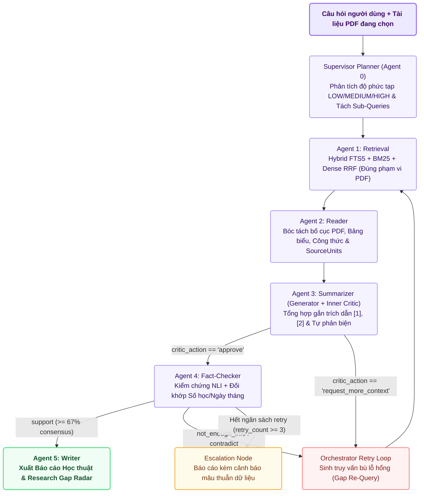

# 🧠 Kiến Trúc Tổng Thể Multi-Agent Research RAG: Two-Tier Self-Correction Loop & LangGraph Cyclic State Machine

> **Tiêu chuẩn Báo cáo Kỹ thuật Quốc tế**  
> **Dự án**: Multi-Agent Research RAG System  
> **Phiên bản**: v4.5 Enterprise Production Standard  
> **Tác giả / Nhóm phát triển**: Nghiên cứu & Huấn luyện Tác tử Khoa học  

---

## 1. Tóm Tắt Điều Hành (Executive Summary)

Các hệ thống **Retrieval-Augmented Generation (RAG)** truyền thống dạng đường ống tuyến tính (*Linear Pipeline*: Query $\rightarrow$ Retrieve $\rightarrow$ Generate) thường gặp phải các giới hạn nghiêm trọng khi đối mặt với tài liệu khoa học học thuật chuyên sâu:
1. **Ảo giác Thông tin (Hallucination)**: Mô hình ngôn ngữ tự suy diễn ngoài phạm vi bài báo nghiên cứu mà không có cơ chế đối soát độc lập.
2. **Đứt gãy trích dẫn (Citation Decay)**: Các chỉ số trích dẫn `[Doc1]`, `[Doc2]` bị gán sai vị trí mệnh đề hoặc trích dẫn các tài liệu không tồn tại.
3. **Mù cấu trúc phi văn bản (Structural Blindness)**: Không bóc tách được công thức toán học LaTeX, bảng biểu so sánh tham số thực nghiệm và chú thích hình ảnh.
4. **Thiếu khả năng tự sửa lỗi (No Self-Correction)**: Khi truy vấn ban đầu trả về ngữ cảnh nghèo nàn hoặc mâu thuẫn, hệ thống tuyến tính hoàn toàn bất lực.

Để khắc phục triệt để, hệ thống **Multi-Agent Research RAG** được thiết kế dưới dạng **Đồ thị Trạng thái Hữu hạn có Chu trình (Cyclic Stateful Graph)** trên nền tảng LangGraph, kết hợp **Cơ chế Tự chủ 2 Vòng Lặp (Two-Tier Self-Correction Loop)** điều phối 6 Tác tử chuyên biệt (`Agent 0` đến `Agent 5`).

---

## 2. Sơ Đồ Kiến Trúc Tự Chủ 2 Vòng Lặp (Mermaid Architecture Diagram)

---

## 3. Bản Chất Của Cơ Chế Tự Chủ 2 Vòng Lặp (Two-Tier Loop)

### Vòng lặp Cấp 1 (Tier 1: Inner Self-Reflection Loop tại Agent 3)
* **Thành phần**: Bộ đôi đối kháng `Generator` và `Critic` bên trong Agent 3.
* **Cơ chế**:
  1. `Generator` sinh bản thảo tóm tắt học thuật ban đầu kèm mảng trích xuất `evidence_spans`.
  2. `Critic` (được huấn luyện đối kháng trên dữ liệu Hard-Negatives) thực hiện kiểm định cục bộ:
     $$\text{Check}(c) = \begin{cases} \text{approve}, & \text{nếu } \forall s \in \text{spans}, s \subseteq \text{Context} \\ \text{rewrite}, & \text{nếu phát hiện suy diễn ngoài ngữ cảnh} \\ \text{request\_more\_context}, & \text{nếu bằng chứng thiếu hụt cục bộ} \end{cases}$$
  3. Nếu `Critic` phát hiện thiếu ngữ cảnh nghiêm trọng, nó lập tức kích hoạt luồng tái định tuyến để bổ sung dữ liệu trước khi chuyển tiếp.

### Vòng lặp Cấp 2 (Tier 2: Outer Fact-Checking Loop tại Agent 4)
* **Thành phần**: `Agent 4 (Fact-Checker)` kết nối với `Orchestrator Retry Loop`.
* **Cơ chế**:
  1. Tách bản thảo thành các mệnh đề nguyên tử $C = \{c_1, c_2, \dots, c_m\}$.
  2. Mỗi mệnh đề $c_i$ được kiểm định chéo độc lập bằng mạng Cross-Encoder NLI hoặc Hội đồng Giám khảo theo 3 nhãn: $\{\text{SUPPORT}, \text{CONTRADICT}, \text{NOT\_ENOUGH\_INFO}\}$.
  3. **Ngưỡng đồng thuận đa số $2/3$**:
     $$\frac{\sum \mathbb{I}(\text{Verdict}(c_i) == \text{SUPPORT})}{m} \ge 0.67$$
  4. Nếu không đạt ngưỡng, hệ thống kích hoạt **Orchestrator Gap Re-Query**: tự động bóc tách các mệnh đề chưa được chứng minh để tạo truy vấn mới và yêu cầu Agent 1 mở rộng phạm vi tìm kiếm (tối đa 3 chu kỳ). Nếu sau 3 chu kỳ vẫn bế tắc, lệnh được chuyển qua `Escalation Node` để cảnh báo minh bạch cho người dùng.

---

## 4. Bảng Ma Trận Nhiệm Vụ 6 Tác Tử (Agent 0 - Agent 5)

| Tác tử | Tên Gọi & Vị Trí | Mô Hình & Thuật Toán Nền Tảng | Trách Nhiệm Trọng Tâm |
| :--- | :--- | :--- | :--- |
| **Agent 0** | **Supervisor Planner** (`main/agents/agent0_scout/`) | Phân tích Ngữ nghĩa & Regex Phân loại | Nhận diện ngôn ngữ (VI/EN), đánh giá độ phức tạp truy vấn (LOW/MED/HIGH), phân rã câu hỏi đa bước (Sub-Queries). |
| **Agent 1** | **Retrieval Router** (`main/agents/agent1_retrieval/`) | Qwen2.5-7B (DoRA r=64) + Hybrid Dense-BM25 RRF + Rerank | Điều phối chiến lược truy xuất lai, tính điểm RRF với $k=60$, lọc dữ liệu nghiêm ngặt trong phạm vi tệp PDF chỉ định. |
| **Agent 2** | **Document Reader** (`main/agents/agent2_reader/`) | Microsoft LayoutLMv3-base (11-Class DocLayNet) | Bóc tách cấu trúc tài liệu không gian 2D, tách riêng Bảng biểu (Tables), Công thức (Formulas), Chú thích và Khối văn bản. |
| **Agent 3** | **Summarizer** (`main/agents/agent3_summarizer/`) | Qwen2.5-7B (SFT + RPO/DPO) & Critic Hard-Negatives | Tổng hợp câu trả lời học thuật, tự gắn thẻ bằng chứng `[1]`, `[2]` và tự phản biện triệt tiêu ảo giác nội tại. |
| **Agent 4** | **Fact-Checker** (`main/agents/agent4_fact_checker/`) | BGE-Reranker-v2-M3 / SciBERT NLI Verifier | Chia nhỏ mệnh đề, đối chiếu ma trận NLI 3 chiều, kiểm tra bảo toàn số học và ngày tháng, điều hành bỏ phiếu đồng thuận 2/3. |
| **Agent 5** | **Academic Writer** (`main/agents/agent5_writer/`) | Qwen2.5-7B (Two-Stage SFT + RPO Alignment) | Biên tập báo cáo khoa học hoàn chỉnh chuẩn IEEE/Markdown: Executive Summary, phân tích kỹ thuật, bảng đối chiếu và radar lỗ hổng. |

---

## 5. Tổng Quan 6 Tùy Chọn Thực Thi (Execution Modes)

Hệ thống được thiết kế theo nguyên lý tách rời giao diện (Interface Decoupling), hỗ trợ vận hành liền mạch qua 6 tùy chọn thực thi:
1. **`cpu_min`**: Dành cho môi trường không mạng, không GPU, RAM $< 1\text{GB}$ (BM25 Okapi + TF-IDF SVD/LSA + Đồ thị trích xuất).
2. **`cpu_max`**: Dành cho máy trạm cá nhân (Multilingual-E5-Small + Cross-Encoder MiniLM + Ollama `deepseek-r1:14b` / `qwen2.5`).
3. **`gemini`**: Dành cho giải pháp đám mây không cần GPU (Gemini 3 Flash JSON ép kiểu cấu trúc + Hội đồng giám khảo đa nhân cách).
4. **`kaggle_fn`**: Dành cho cụm Kaggle Dual T4 (Hoán đổi nóng 4 Adapter DoRA/rsLoRA trên Qwen2.5-7B + LayoutLMv3 + NLI Verifier).
5. **`kaggle_max`**: Khai thác tối đa 32GB VRAM Dual T4 (Xử lý song song bất đồng bộ `asyncio.gather` + Hội đồng 3 Giám khảo NLI).
6. **`hybrid`**: Kiến trúc kết hợp tối thượng (Định tuyến hạt mịn từng Agent + Cầu dao tự động 3 trạng thái chống sập 0ms).
