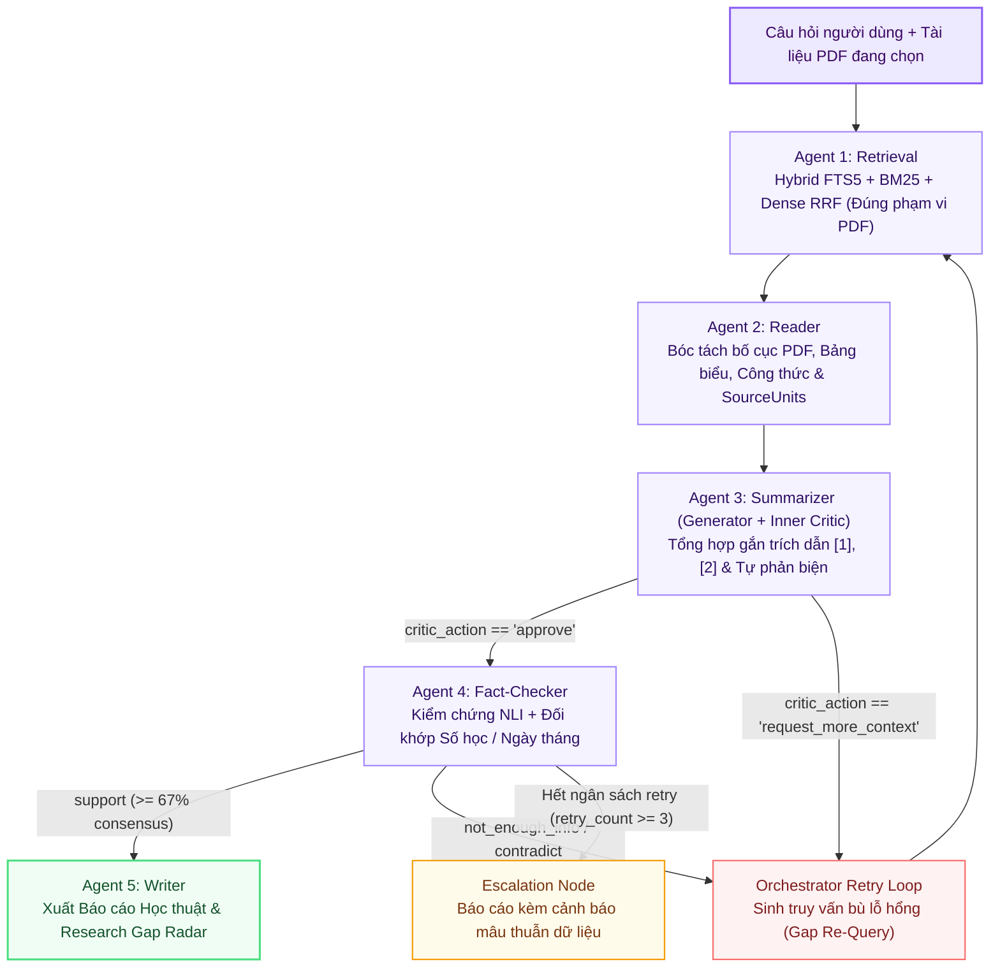

# 🧠 Kiến Trúc Tự Chủ 2 Vòng Lặp (Two-Tier Self-Correction Loop) & Đồ Thị Trạng Thái LangGraph

> **Báo Cáo Kiến Trúc Hệ Thống Chuẩn Quốc Tế**  
> **Dự án**: Multi-Agent Research RAG System  
> **Kiến trúc Cốt lõi**: 5 Tác Tử Chuyên Biệt (`Agent 1` đến `Agent 5`)  
> *(Ghi chú: Tiền xử lý Agent 0 đã được tách biệt hoàn toàn khỏi luồng suy luận trung tâm để bảo đảm tính toàn vẹn và độc lập của đồ thị tác tử).*

---

## 1. Sơ Đồ Kiến Trúc Tự Chủ 2 Vòng Lặp (Mermaid Flowchart)

---

## 2. Bản Chất Của Cơ Chế Tự Chủ 2 Vòng Lặp (Two-Tier Loop)

### Vòng lặp Cấp 1 (Tier 1: Inner Self-Reflection Loop tại Agent 3)
* **Thành phần**: Bộ đôi đối kháng `Generator` và `Critic` bên trong Agent 3.
* **Cơ chế**:
  1. `Generator` sinh bản thảo câu trả lời học thuật ban đầu kèm mảng trích xuất `evidence_spans`.
  2. `Critic` (huấn luyện đối kháng trên dữ liệu Hard-Negatives) thực hiện kiểm định cục bộ:
     $$\text{Check}(c) = \begin{cases} \text{approve}, & \text{nếu } \forall s \in \text{spans}, s \subseteq \text{Context} \\ \text{rewrite}, & \text{nếu phát hiện suy diễn ngoài ngữ cảnh} \\ \text{request\_more\_context}, & \text{nếu bằng chứng thiếu hụt cục bộ} \end{cases}$$
  3. Nếu `Critic` phát hiện thiếu ngữ cảnh nghiêm trọng, nó phát tín hiệu `request_more_context` kích hoạt `Orchestrator Retry Loop` để bổ sung dữ liệu từ Agent 1.

### Vòng lặp Cấp 2 (Tier 2: Outer Fact-Checking Loop tại Agent 4)
* **Thành phần**: `Agent 4 (Fact-Checker)` kết nối với `Orchestrator Retry Loop`.
* **Cơ chế**:
  1. Tách bản thảo thành các mệnh đề nguyên tử $C = \{c_1, c_2, \dots, c_m\}$.
  2. Mỗi mệnh đề $c_i$ được kiểm định chéo độc lập bằng mạng Cross-Encoder NLI hoặc Hội đồng Giám khảo theo 3 nhãn: $\{\text{SUPPORT}, \text{CONTRADICT}, \text{NOT\_ENOUGH\_INFO}\}$.
  3. **Ngưỡng đồng thuận đa số $2/3$**:
     $$\frac{\sum \mathbb{I}(\text{Verdict}(c_i) == \text{SUPPORT})}{m} \ge 0.67$$
  4. Nếu không đạt ngưỡng, hệ thống kích hoạt **Orchestrator Gap Re-Query**: tự động bóc tách các mệnh đề chưa được chứng minh để tạo truy vấn mới và yêu cầu Agent 1 mở rộng phạm vi tìm kiếm (tối đa 3 chu kỳ). Nếu sau 3 chu kỳ vẫn bế tắc, lệnh được chuyển qua `Escalation Node` để cảnh báo minh bạch cho người dùng.

---

## 3. Bảng Ma Trận 5 Tác Tử Cốt Lõi (Agent 1 đến Agent 5)

| Tác tử | Thư Mục Thực Thi (`main/`) | Thư Mục Huấn Luyện (`training_lab/`) | Mô Hình & Thuật Toán Cốt Lõi |
| :--- | :--- | :--- | :--- |
| **Agent 1: Retrieval** | `main/agents/agent1_retrieval/` | `training_lab/agent1_retrieval/` | Qwen2.5-7B (DoRA + rsLoRA r=64) + Hybrid Dense-BM25 RRF + Rerank. |
| **Agent 2: Reader** | `main/agents/agent2_reader/` | `training_lab/agent2_reader/` | Microsoft LayoutLMv3-base (11 nhãn DocLayNet, Multi-Class Focal Loss). |
| **Agent 3: Summarizer** | `main/agents/agent3_summarizer/` | `training_lab/agent3_summarizer/` | Generator (Two-Stage SFT + RPO/DPO) & Critic (Adversarial Hard-Negatives). |
| **Agent 4: Fact-Checker** | `main/agents/agent4_fact_checker/` | `training_lab/agent4_fact_checker/` | BGE-Reranker-v2-M3 Cross-Encoder NLI (Focal Loss + R-Drop + Temperature ECE). |
| **Agent 5: Writer** | `main/agents/agent5_writer/` | `training_lab/agent5_writer/` | Qwen2.5-7B (Two-Stage SFT + RPO) tổng hợp báo cáo chuẩn IEEE/Markdown + LaTeX. |

---

## 4. Tách Biệt Tiền Xử Lý (Agent 0 Fast-Scout)

Để đảm bảo hiệu năng và tính độc lập của đồ thị tác tử:
* **Agent 0 (Fast-Scout)** được tách ra thành một tầng tiền xử lý bên ngoài (Pre-Processing Filter).
* Nó chỉ đảm nhiệm việc kiểm tra định dạng tập tin, phát hiện ngôn ngữ người dùng (VI/EN) và gán cờ tài liệu trước khi kích hoạt Đồ thị Tác tử chính thức (`Agent 1` $
ightarrow$ `Agent 5`).
