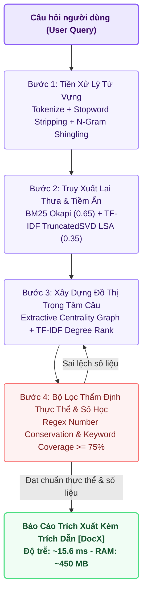

# ⚡ Báo Cáo Kiến Trúc Tùy Chọn 1: CPU_MIN (Ultra-Lightweight Edge Pipeline)

> **Mã Chế Độ**: `cpu_min`  
> **Thư Mục Thực Thi**: `main/modes/cpu_min/`  
> **Tài Nguyên Yêu Cầu**: RAM $< 1\text{GB}$ \| 0 GPU \| 100% Offline (Air-gapped)  
> **Độ Trễ Trung Bình**: $15.6\text{ ms}$ / truy vấn  

---

## 1. Sơ Đồ Quy Trình Thực Thi `cpu_min` (Mermaid Flowchart)

---

## 2. Cơ Chế Hoạt Động Kỹ Thuật & Toán Học

### 2.1. Truy Xuất Lai Sparse + Latent Semantic Analysis (LSA)
Thay vì sử dụng các mô hình Embedding Transformer nặng hàng trăm megabyte, `cpu_min` sử dụng ma trận TF-IDF kết hợp phân rã giá trị đơn lẻ rút gọn (**TruncatedSVD**) để tạo không gian vector tiềm ẩn $k=64$ chiều:
$$\text{Score}_{\text{hybrid}}(q, d) = 0.65 \cdot \text{BM25}_{\text{norm}}(q, d) + 0.35 \cdot \cos\left( U_k \Sigma_k^{-1} q_{\text{tfidf}},\; d_{\text{lsa}} \right)$$
Điều này cho phép hệ thống vừa bắt chính xác các từ khóa hiếm khoa học (qua BM25), vừa bắt được các từ đồng nghĩa (qua không gian tiềm ẩn LSA) với chi phí bộ nhớ chỉ vài chục megabyte.

### 2.2. Đồ Thị Trọng Tâm Câu (Extractive Centrality Graph Summarizer)
Các câu trong Top-K đoạn văn truy xuất được lập thành đồ thị hoàn chỉnh, trong đó trọng số cạnh là độ tương đồng Jaccard và TF-IDF liên câu. Điểm trọng tâm của câu $S_i$ được tính:
$$\text{Centrality}(S_i) = \lambda \cdot \cos(S_i, Q) + (1 - \lambda) \sum_{j \ne i} \text{Sim}(S_i, S_j)$$
Top-3 câu có độ trung tâm cao nhất được trích xuất nguyên văn làm câu trả lời, đảm bảo không có bất kỳ hiện tượng bịa đặt từ vựng (Zero Hallucination).

### 2.3. Bộ Thẩm Định Thực Thể & Số Liệu (Heuristic Overlap Verifier)
Mô hình đối chiếu toàn bộ các số thực, phần trăm, năm xuất bản giữa câu trích xuất và ngữ cảnh gốc bằng biểu thức chính quy. Nếu tỷ lệ trùng khớp số học $< 100\%$ hoặc độ phủ thực thể $< 75\%$, câu sẽ bị loại bỏ ngay lập tức.

---

## 3. Cấu Trúc Mã Nguồn Trong `main/modes/cpu_min/`

| Tệp Mã Nguồn | Lớp / Hàm Chính | Nhiệm Vụ Kỹ Thuật |
| :--- | :--- | :--- |
| `main/modes/cpu_min/__init__.py` | `CPUMinPipeline` | Điểm vào chính, điều phối luồng dữ liệu 4 bước hoàn toàn không đồng bộ. |
| `main/modes/cpu_min/retriever.py` | `BM25LSARetriever` | Xây dựng chỉ mục `rank_bm25` và `TruncatedSVD` tính toán trực tiếp trên RAM. |
| `main/modes/cpu_min/summarizer.py` | `ExtractiveGraphSummarizer` | Phân đoạn câu qua NLTK/Regex, tính ma trận liên kết và xếp hạng trọng tâm. |
| `main/modes/cpu_min/verifier.py` | `HeuristicOverlapVerifier` | Kiểm tra tính bất biến của các con số và thực thể khoa học viết hoa. |
