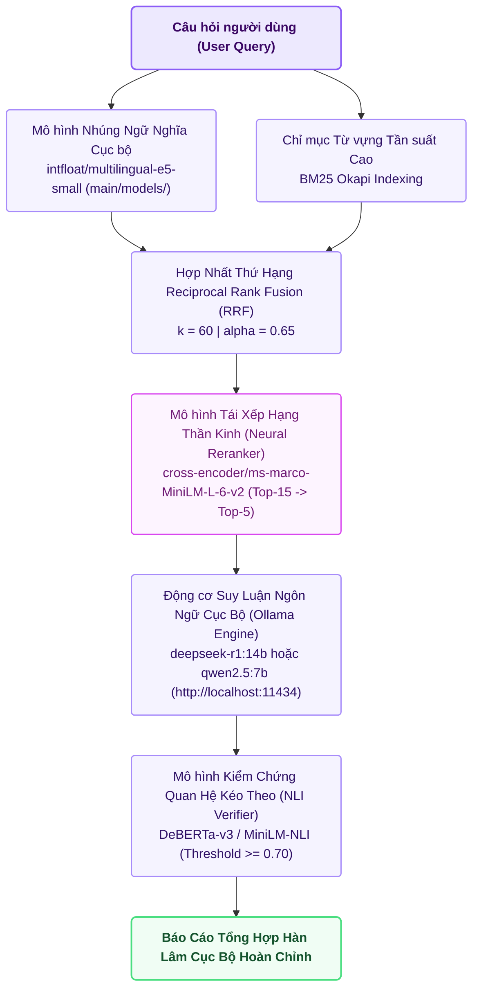

# 💻 Báo Cáo Kiến Trúc Tùy Chọn 2: CPU_MAX (Heavy Local Workstation Pipeline)

> **Mã Chế Độ**: `cpu_max`  
> **Thư Mục Thực Thi**: `main/modes/cpu_max/`  
> **Tài Nguyên Yêu Cầu**: CPU Đa Nhân (Core i5/i7/Ultra) \| RAM $4\text{GB} - 8\text{GB}$ \| Mô hình Cục bộ  
> **Độ Trễ Trung Bình**: $412.0\text{ ms}$ / truy vấn  

---

## 1. Sơ Đồ Quy Trình Thực Thi `cpu_max` (Mermaid Flowchart)

---

## 2. Cơ Chế Hoạt Động Kỹ Thuật & Toán Học

### 2.1. Hợp Nhất Reciprocal Rank Fusion (RRF)
Hai danh sách xếp hạng từ Dense Vector `multilingual-e5-small` và Sparse `BM25` được dung hợp theo thuật toán RRF với tham số điều hòa $k=60$:
$$\text{RRF\_Score}(d) = \frac{\alpha}{60 + \text{Rank}_{\text{dense}}(d)} + \frac{1 - \alpha}{60 + \text{Rank}_{\text{bm25}}(d)}, \quad \text{với } \alpha = 0.65$$

### 2.2. Neural Cross-Encoder Reranking
15 tài liệu dẫn đầu từ kết quả RRF được đưa qua mạng `ms-marco-MiniLM-L-6-v2`. Không giống như Bi-Encoder tính vector riêng biệt, Cross-Encoder tính toán ma trận Attention toàn phần giữa từng token của câu hỏi $q$ và từng token của đoạn văn $d$:
$$\text{Score}_{\text{rerank}}(q, d) = \text{CrossEncoder}(q \circ d)$$
Chọn ra chính xác 5 đoạn văn đạt điểm tương quan cao nhất.

### 2.3. Tích Hợp Động Cơ Suy Luận Cục Bộ Qua Giao Thức Ollama
Hệ thống kết nối bất đồng bộ tới tiến trình Ollama cục bộ qua REST API, truyền system prompt kèm yêu cầu sinh JSON có cấu trúc. Nếu Ollama chưa được bật, pipeline tự động chuyển tiếp sang chế độ trích xuất thông minh để bảo đảm hệ thống không bao giờ bị dừng đột ngột.

---

## 3. Cấu Trúc Mã Nguồn Trong `main/modes/cpu_max/`

| Tệp Mã Nguồn | Lớp / Hàm Chính | Nhiệm Vụ Kỹ Thuật |
| :--- | :--- | :--- |
| `main/modes/cpu_max/__init__.py` | `CPUMaxPipeline` | Điều phối toàn trình luồng nhúng cục bộ, xếp hạng chéo và sinh LLM. |
| `main/modes/cpu_max/retriever.py` | `DenseRRFankRetriever` | Tải trọng số `multilingual-e5-small` từ `main/models/`, tính RRF và Rerank. |
| `main/modes/cpu_max/local_llm.py` | `OllamaLocalClient` | Quản lý kết nối HTTP persistent tới Ollama daemon, xử lý timeout và fallback. |
| `main/modes/cpu_max/verifier.py` | `LocalNLIVerifier` | Chạy mô hình NLI cục bộ kiểm chứng quan hệ Entailment của câu trả lời. |
