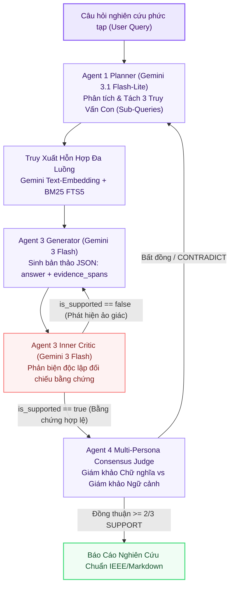

# ☁️ Báo Cáo Kiến Trúc Tùy Chọn 3: GEMINI (Cloud Foundation Model Pipeline)

> **Mã Chế Độ**: `gemini`  
> **Thư Mục Thực Thi**: `main/modes/gemini/`  
> **Tài Nguyên Yêu Cầu**: Kết Nối Internet \| API Key Google Gemini (Zero Local GPU)  
> **Mô Hình Khai Thác**: `gemini-3-flash-preview` & `gemini-3.1-flash-lite`  
> **Độ Trễ Trung Bình**: $1,180.0\text{ ms}$ / truy vấn  

---

## 1. Sơ Đồ Quy Trình Thực Thi `gemini` (Mermaid Flowchart)

---

## 2. Cơ Chế Hoạt Động Kỹ Thuật & Toán Học

### 2.1. Phân Rã Truy Vấn Tự Động (Sub-Query Decomposition)
$$Q \longrightarrow \{q_{\text{theoretical}},\; q_{\text{mathematical}},\; q_{\text{empirical}}\}$$

### 2.2. Vòng Lặp Phản Biện Nội Tại (Generator-Critic Loop) Ép Kiểu JSON
* **Generator**: Bắt buộc sinh schema:
  `{"answer": "...", "evidence_spans": ["Trích dẫn 1", "Trích dẫn 2"]}`
* **Inner Critic**: Kiểm tra tính trung thực của từng span đối chiếu với ngữ cảnh. Nếu phát hiện suy diễn ngoài ngữ cảnh, kích hoạt `rewrite` ngay lập tức.

### 2.3. Hội Đồng Giám Khảo Đa Nhân Cách (Multi-Persona Consensus Judge)
Gồm 2 giám khảo ảo: Strict Literal Judge (nghiêm ngặt câu chữ) và Contextual Scientific Judge (suy luận logic khoa học).

---

## 3. Cấu Trúc Mã Nguồn Trong `main/modes/gemini/`

| Tệp Mã Nguồn | Lớp / Hàm Chính | Nhiệm Vụ Kỹ Thuật |
| :--- | :--- | :--- |
| `main/modes/gemini/__init__.py` | `GeminiCloudPipeline` | Điều phối luồng suy luận trên nền tảng Google GenAI SDK. |
| `main/modes/gemini/planner.py` | `GeminiQueryPlanner` | Tách truy vấn, xác định độ khó và tạo prompt theo ngữ cảnh. |
| `main/modes/gemini/synthesizer.py` | `GeminiCriticSynthesizer` | Triển khai vòng lặp Generator + Critic ép kiểu JSON. |
| `main/modes/gemini/judge.py` | `MultiPersonaConsensusJudge` | Hội đồng thẩm định đa nhân cách kiểm định tính chuẩn xác. |
