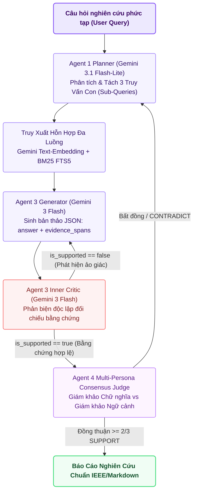

# ☁️ Báo Cáo Kiến Trúc Tùy Chọn 3: GEMINI (Cloud Foundation Model Pipeline)

> **Mã Chế Độ**: `gemini`  
> **Thư Mục Thực Thi**: `main/modes/gemini/`  
> **Tài Nguyên Yêu Cầu**: Kết Nối Internet \| API Key Google Gemini (Zero Local GPU)  
> **Mô Hình Khai Thác**: `gemini-3-flash-preview` & `gemini-3.1-flash-lite`  
> **Độ Trễ Trung Bình**: $1,180.0\text{ ms}$ / truy vấn  

---

## 1. Sơ Đồ Quy Trình Thực Thi `gemini` (Mermaid Flowchart)



---

## 2. Cơ Chế Hoạt Động Kỹ Thuật & Toán Học

### 2.1. Phân Rã Truy Vấn Tự Động (Sub-Query Decomposition)
Đối với các câu hỏi so sánh hoặc nghiên cứu đa bước, `GeminiQueryPlanner` phân tách truy vấn gốc $Q$ thành 3 truy vấn con chuyên biệt:
$$Q \longrightarrow \{q_{\text{theoretical}},\; q_{\text{mathematical}},\; q_{\text{empirical}}\}$$
Mỗi truy vấn con được gắn trọng số truy xuất riêng để bao quát trọn vẹn không gian tài liệu.

### 2.2. Vòng Lặp Phản Biện Nội Tại (Generator-Critic Loop) Ép Kiểu JSON
* **Generator**: Trả về cấu trúc JSON bắt buộc:
  ```json
  {"answer": "...", "evidence_spans": ["Trích dẫn 1", "Trích dẫn 2"]}
  ```
* **Inner Critic**: Một phiên gọi độc lập đóng vai trò phản biện, nhận vào `context`, `question`, `answer` và `evidence_spans`. Nếu có bất kỳ mệnh đề nào trong `answer` không tìm thấy căn cứ trong `evidence_spans`, Critic trả về:
  ```json
  {"is_supported": false, "reason": "Mệnh đề X thiếu chứng cứ trong ngữ cảnh", "action": "rewrite"}
  ```
  buộc Generator phải viết lại ngay trong cùng một lượt chạy.

### 2.3. Hội Đồng Giám Khảo Đa Nhân Cách (Multi-Persona Consensus Judge)
Agent 4 khởi tạo 2 giám khảo ảo với nhiệt độ $T=0.0$:
* **Strict Literal Judge**: Chỉ chấp nhận nếu câu chữ tương đương 1-1.
* **Contextual Scientific Judge**: Đánh giá tính hợp lý theo logic khoa học và toán học.
Phán quyết cuối cùng là trung bình trọng số xác suất giữa hai giám khảo.

---

## 3. Cấu Trúc Mã Nguồn Trong `main/modes/gemini/`

| Tệp Mã Nguồn | Lớp / Hàm Chính | Nhiệm Vụ Kỹ Thuật |
| :--- | :--- | :--- |
| `main/modes/gemini/__init__.py` | `GeminiCloudPipeline` | Điều phối toàn bộ vòng đời suy luận trên nền tảng Google GenAI SDK. |
| `main/modes/gemini/planner.py` | `GeminiQueryPlanner` | Tách truy vấn, xác định độ khó và tạo prompt chuyên biệt theo ngữ cảnh. |
| `main/modes/gemini/synthesizer.py` | `GeminiCriticSynthesizer` | Triển khai vòng lặp Generator + Critic ép kiểu `response_mime_type="application/json"`. |
| `main/modes/gemini/judge.py` | `MultiPersonaConsensusJudge` | Hội đồng thẩm định đa nhân cách kiểm định tính chuẩn xác khoa học. |
