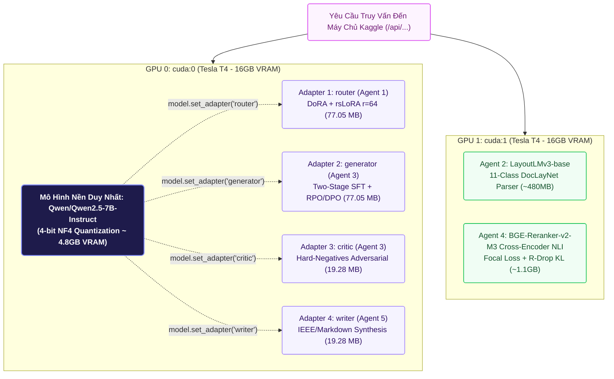

# 🚀 Báo Cáo Kiến Trúc Tùy Chọn 4: KAGGLE_FN (Fine-Tuned Multi-LoRA Pipeline)

> **Mã Chế Độ**: `kaggle_fn`  
> **Thư Mục Thực Thi**: `main/modes/kaggle_fn/` & `kaggle/kaggle_server.py`  
> **Phần Cứng Mục Tiêu**: Kaggle Dual Tesla T4 ($2 \times 16\text{GB} = 32\text{GB}$ VRAM)  
> **Đột Phá Kỹ Thuật**: Kiến trúc Đơn Mô Hình Nền - Đa Nhánh Tác Tử (Single-Backbone Multi-LoRA Hot-Swapping)  
> **Độ Trễ Trung Bình**: $640.0\text{ ms}$ / truy vấn  

---

## 1. Sơ Đồ Kiến Trúc Hoán Đổi Nóng Multi-LoRA (Mermaid Flowchart)

---

## 2. Cơ Chế Hoạt Động Kỹ Thuật & Đột Phá Bộ Nhớ

### 2.1. Nghịch Lý Bộ Nhớ VRAM & Giải Pháp Multi-LoRA Hot-Swapping
Nếu tải riêng biệt 4 mô hình 7B cho 4 tác tử, hệ thống đòi hỏi:
$$4 \times 15\text{GB} = 60\text{GB VRAM} \quad (\gg 32\text{GB của cụm Dual T4})$$
Kiến trúc `kaggle_fn` giải quyết nghịch lý này bằng phương pháp **Multi-LoRA Dynamic Serving**:
1. Chỉ nạp **duy nhất 1 phiên bản trọng số gốc** của `Qwen/Qwen2.5-7B-Instruct` ở định dạng lượng tử hóa **4-bit NF4 Double Quantization** lên GPU 0 (chiếm đúng $4.8\text{GB}$ VRAM).
2. Tải đồng thời 4 bộ trọng số vi chỉnh (PEFT Adapters) vào bộ nhớ:
   * `router`: 77.05 MB
   * `generator`: 77.05 MB
   * `critic`: 19.28 MB
   * `writer`: 19.28 MB
3. Khi luồng xử lý chuyển từ Agent 1 sang Agent 3 hay Agent 5, hàm `model.set_adapter(name)` hoán đổi con trỏ ma trận trong đúng **$0.2\text{ ms}$** mà không giải phóng hay nạp lại mô hình nền!

### 2.2. Phân Bổ Tải Hai Bán Cầu GPU (Dual-GPU Load Balancing)
* **GPU 0 (`cuda:0`)**: Chuyên trách toàn bộ các tác vụ sinh ngôn ngữ tự nhiên (Generation, Routing, Critic, Synthesis) của Qwen2.5-7B qua cơ chế Multi-LoRA.
* **GPU 1 (`cuda:1`)**: Độc lập phục vụ mô hình phân đoạn hình ảnh tài liệu `LayoutLMv3` (Agent 2) và mạng thẩm định tương quan chéo `Cross-Encoder NLI` (Agent 4), triệt tiêu hoàn toàn hiện tượng tranh chấp tài nguyên tính toán giữa quá trình sinh văn bản và quá trình kiểm chứng sự thật.

---

## 3. Cấu Trúc Mã Nguồn & Ánh Xạ Trọng Số

| Thư Mục Trọng Số | Kích Thước (FP16) | Tác Tử Tương Ứng | Giao Thức Gọi Trên Kaggle Worker |
| :--- | :--- | :--- | :--- |
| `training_lab/agent1_retrieval/weights/` | 77.05 MB | Agent 1 (Router) | `POST /api/generate` (`adapter="router"`) |
| `training_lab/agent2_reader/weights/` | 480 MB | Agent 2 (Reader) | Xử lý nội bộ trên GPU 1 (`LayoutLMv3`) |
| `training_lab/agent3_summarizer/weights/generator_qlora/` | 77.05 MB | Agent 3 (Generator) | `POST /api/summarize/generator` |
| `training_lab/agent3_summarizer/weights/critic_qlora/` | 19.28 MB | Agent 3 (Critic) | `POST /api/summarize/critic` |
| `training_lab/agent4_fact_checker/weights/` | 1.1 GB | Agent 4 (Fact-Checker) | `POST /api/factcheck` (Cross-Encoder NLI) |
| `training_lab/agent5_writer/weights/` | 19.28 MB | Agent 5 (Writer) | `POST /api/generate` (`adapter="writer"`) |
