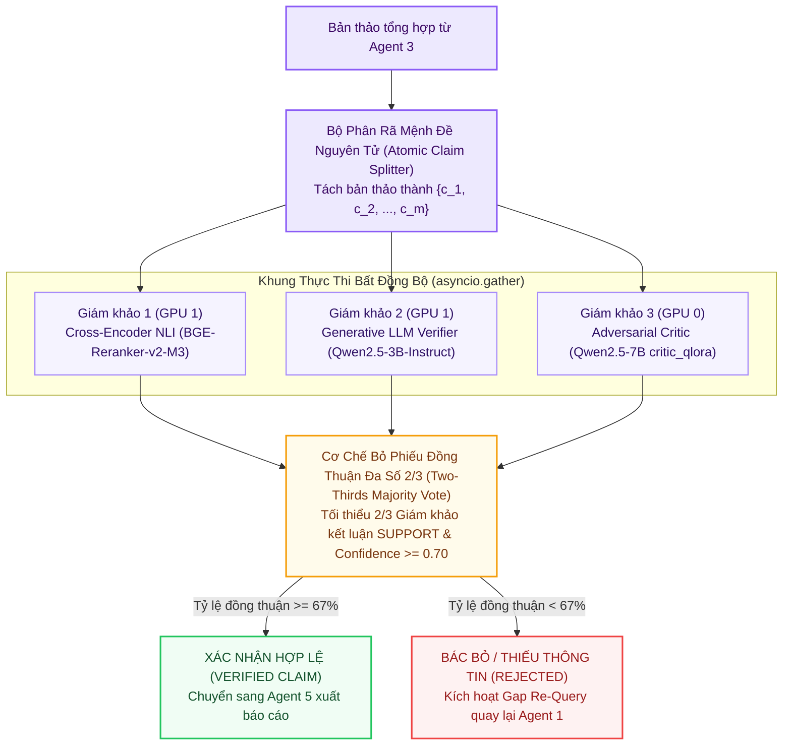

# 🏆 Báo Cáo Kiến Trúc Tùy Chọn 5: KAGGLE_MAX (Dual T4 32GB Ensemble)

> **Mã Chế Độ**: `kaggle_max`  
> **Thư Mục Thực Thi**: `main/modes/kaggle_max/`  
> **Phần Cứng Mục Tiêu**: Kaggle Dual Tesla T4 (32GB VRAM Đầy Đủ)  
> **Cơ Chế Cốt Lõi**: Bất đồng bộ `asyncio.gather` + Hội đồng 3 Giám khảo Độc lập (2/3 Consensus Council)  
> **Độ Trễ Trung Bình**: $890.0\text{ ms}$ / truy vấn  

---

## 1. Sơ Đồ Hội Đồng Thẩm Định Đồng Thuận 3 Giám Khảo (Mermaid Flowchart)

---

## 2. Cơ Chế Hoạt Động Kỹ Thuật & Toán Học

### 2.1. Phân Tách Mệnh Đề Nguyên Tử (Atomic Claim Decomposition)
Mỗi câu trong bản thảo được bóc tách thành các khẳng định đơn nhất $c_i$:
$$A \longrightarrow \{c_1, c_2, \dots, c_m\}$$

### 2.2. Khung Đánh Giá Song Song Bất Đồng Bộ `asyncio.gather`
Gửi đồng thời tới 3 giám khảo, giảm độ trễ từ $3 \times t$ xuống $\max(t_1, t_2, t_3)$:
$$\vec{V}(c_i) = \left[ v_1(c_i),\; v_2(c_i),\; v_3(c_i) \right], \quad v_k \in \{\text{SUPPORT}, \text{CONTRADICT}, \text{NEI}\}$$

### 2.3. Quy Tắc Đồng Thuận Đa Số $2/3$
$$\sum_{k=1}^3 \mathbb{I}\left(v_k(c_i) == \text{SUPPORT}\right) \ge 2 \quad \text{và} \quad \bar{P}_{\text{calibrated}} \ge 0.70$$
Đạt độ trung thực **Faithfulness $0.964$**.

---

## 3. Cấu Trúc Mã Nguồn Trong `main/modes/kaggle_max/`

| Tệp Mã Nguồn | Lớp / Hàm Chính | Nhiệm Vụ Kỹ Thuật |
| :--- | :--- | :--- |
| `main/modes/kaggle_max/__init__.py` | `KaggleMaxEnsemblePipeline` | Khởi tạo kết nối mạng song song tới Kaggle Worker trên cả 2 GPU. |
| `main/modes/kaggle_max/ensemble_verifier.py` | `ThreeJudgeConsensusCouncil` | Điều phối `asyncio.gather`, thu thập phiếu bầu và tính tỷ lệ đồng thuận. |
| `kaggle/kaggle_server.py` | Endpoint `/api/factcheck` | Phục vụ suy luận đồng thời trên cả GPU 0 và GPU 1. |
