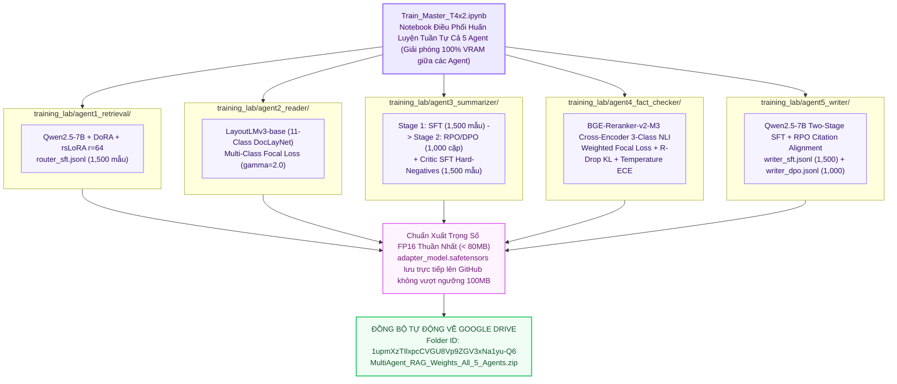

# 🔬 Báo Cáo Kiến Trúc Phòng Thí Nghiệm Huấn Luyện 5 Agent (TRAINING_LAB/)

> **Thư Mục Phòng Thí Nghiệm**: `training_lab/`  
> **Cấu Hình Mục Tiêu Tối Đa**: Kaggle Dual Tesla T4 ($2 \times 16\text{GB} = 32\text{GB}$ VRAM, Turing Architecture `sm_75`)  
> **Các Kỹ Thuật SOTA 2025/2026**: DoRA + rsLoRA + SDPA + RPO/DPO + Multi-Class Focal Loss + R-Drop KL Regularization  
> **Đồng Bộ Đám Mây**: Google Drive Tự Động (`1upmXzTIlxpcCVGU8Vp9ZGV3xNa1yu-Q6`)  

---

## 1. Sơ Đồ Kiến Trúc Huấn Luyện 5 Agent Độc Lập (Mermaid Flowchart)



---

## 2. Kiến Trúc Mô-Đun `src/` Chuẩn Mực Trong Từng Thư Mục Agent

Mỗi thư mục Agent được cấu trúc thành một gói mã nguồn hoàn chỉnh:
```text
training_lab/agentX/
├── src/
│   ├── __init__.py          # Khai báo interface của gói
│   ├── config.py            # Dataclass quản lý siêu tham số và phân bổ VRAM Dual T4 (14.5GiB/GPU)
│   ├── data_loader.py       # Nạp JSONL, kiểm định Schema, định dạng ChatML/BBox và chia 90/10 Train/Val
│   ├── model_builder.py     # Lượng tử hóa 4-bit NF4, SDPA Attention và gắn adapter DoRA/rsLoRA
│   ├── trainer.py           # Vòng lặp huấn luyện SOTA (RPO, Focal Loss, R-Drop) & ép kiểu FP16 (<80MB)
│   └── evaluator.py         # Kiểm định JSON compliance, Macro-F1 và hiệu chỉnh nhiệt độ xác suất
├── dataset/                 # Tệp dữ liệu huấn luyện JSONL
├── weights/                 # Trọng số FP16 đã huấn luyện sẵn sàng đẩy lên GitHub
├── train_agentX_t4x2.py     # CLI Entrypoint gọi vào package src.*
└── Train_AgentX_T4x2.ipynb  # Notebook độc lập cho người dùng muốn huấn luyện riêng lẻ từng Agent
```

---

## 3. Các Công Nghệ Huấn Luyện SOTA Khai Thác Kịch Trần Dual T4 (32GB VRAM)

1. **DoRA + rsLoRA**: Tách biên độ/hướng vector trọng số kết hợp hệ số ổn định $rac{lpha}{\sqrt{r}}$ cho phép đẩy hạng $r=64$ ổn định.
2. **SDPA Attention**: Khai thác nhân Scaled Dot-Product Attention của PyTorch 2.x cho Turing `sm_75`, mở rộng độ dài ngữ cảnh lên 3072 tokens.
3. **RPO (Regularized Preference Optimization)**: Bổ sung phạt NLL vào DPO với $lpha_{	ext{rpo}} = 0.1$, loại bỏ hiện tượng quên trích dẫn `[DocX]`.
4. **Multi-Class Focal Loss & R-Drop**: Tăng trọng số các nhãn khó (`Formula`, `Table`, `CONTRADICT`) và ép tính bất biến phân phối xác suất qua KL divergence.
