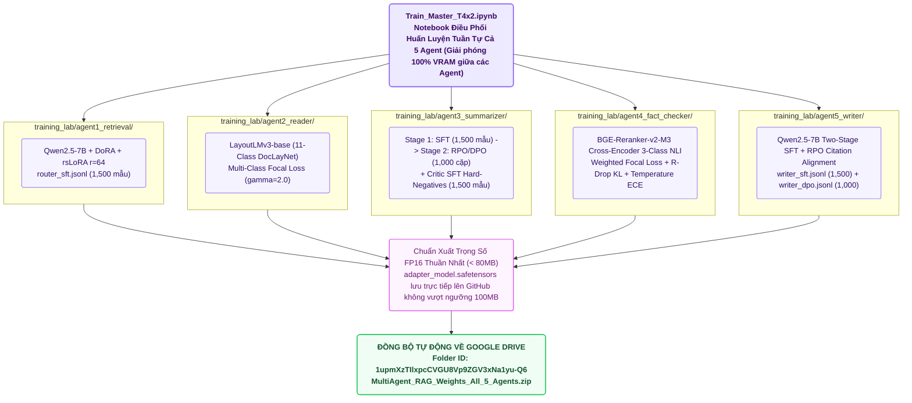

# 🔬 Báo Cáo Kiến Trúc Phòng Thí Nghiệm Huấn Luyện 5 Agent (TRAINING_LAB/)

> **Thư Mục Phòng Thí Nghiệm**: `training_lab/`  
> **Cấu Hình Mục Tiêu Tối Đa**: Kaggle Dual Tesla T4 ($2 \times 16\text{GB} = 32\text{GB}$ VRAM, Turing Architecture `sm_75`)  
> **Các Kỹ Thuật SOTA 2025/2026**: DoRA + rsLoRA + SDPA + RPO/DPO + Multi-Class Focal Loss + R-Drop KL Regularization  
> **Đồng Bộ Đám Mây**: Google Drive Tự Động (`1upmXzTIlxpcCVGU8Vp9ZGV3xNa1yu-Q6`)  

---

## 1. Sơ Đồ Kiến Trúc Huấn Luyện 5 Agent Độc Lập (Mermaid Flowchart)



---

## 2. Kiến Trúc Mô-Đun `src/` Chuẩn Mực Trong Từng Thư Mục Agent

Mỗi thư mục Agent được cấu trúc thành một gói mã nguồn hoàn chỉnh:
```text
training_lab/agentX/
├── src/
│   ├── __init__.py          # Khai báo interface của gói
│   ├── config.py            # Dataclass quản lý siêu tham số và phân bổ VRAM Dual T4 (14.5GiB/GPU)
│   ├── data_loader.py       # Nạp JSONL, kiểm định Schema, định dạng ChatML/BBox và chia 90/10 Train/Val
│   ├── model_builder.py     # Lượng tử hóa 4-bit NF4, SDPA Attention và gắn adapter DoRA/rsLoRA
│   ├── trainer.py           # Vòng lặp huấn luyện SOTA (RPO, Focal Loss, R-Drop) & ép kiểu FP16 (<80MB)
│   └── evaluator.py         # Kiểm định JSON compliance, Macro-F1 và hiệu chỉnh nhiệt độ xác suất
├── dataset/                 # Tệp dữ liệu huấn luyện JSONL
├── weights/                 # Trọng số FP16 đã huấn luyện sẵn sàng đẩy lên GitHub
├── train_agentX_t4x2.py     # CLI Entrypoint gọi vào package src.*
└── Train_AgentX_T4x2.ipynb  # Notebook độc lập cho người dùng muốn huấn luyện riêng lẻ từng Agent
```

---

## 3. Các Công Nghệ Huấn Luyện SOTA Khai Thác Kịch Trần Dual T4 (32GB VRAM)

### 3.1. DoRA kết hợp rsLoRA (Rank-Stabilized Weight-Decomposed LoRA)
* **DoRA**: Tách ma trận trọng số $W$ thành biên độ $m$ và hướng $V$:
  $$W = m \frac{V + \Delta V}{\|V + \Delta V\|_F}, \quad \Delta V = B A$$
* **rsLoRA**: Thay thế hệ số co dãn $\frac{\alpha}{r}$ bằng $\frac{\alpha}{\sqrt{r}}$. Khi thiết lập $r=64, \alpha=128$, hệ số ổn định giúp các ma trận hạng cao hội tụ sâu hơn mà không làm bão hòa gradient.

### 3.2. Attention Rút Gọn Bộ Nhớ SDPA (Scaled Dot-Product Attention)
Khai thác nhân phần cứng nguyên bản của PyTorch 2.x tối ưu cho kiến trúc Turing `sm_75` của Tesla T4, cho phép tăng độ dài ngữ cảnh tối đa từ 2048 lên 3072 tokens trong cùng mức tiêu thụ VRAM.

### 3.3. Tối Ưu Tỷ Lệ Ưu Tiên RPO (Regularized Preference Optimization) Trong DPO
Tại Agent 3 và Agent 5, hàm mất mát DPO được bổ sung thành phần chính quy hóa NLL trên mẫu được chọn (`chosen`):
$$\mathcal{L}_{\text{RPO}} = \mathcal{L}_{\text{DPO}}(\pi_\theta;\; y_w, y_l) + \alpha_{\text{rpo}} \cdot \mathcal{L}_{\text{NLL}}(\pi_\theta;\; y_w)$$
với $\alpha_{\text{rpo}} = 0.1$, ngăn chặn hiện tượng mô hình quên cú pháp trích dẫn `[DocX]` chuẩn mực.

### 3.4. Hàm Mất Mát Focal Loss kết hợp R-Drop Cho Bộ Phân Loại (Agent 2 & 4)
* **Multi-Class Focal Loss (Agent 2 & 4)**:
  $$\mathcal{L}_{\text{focal}} = - (1 - p_t)^\gamma \log(p_t), \quad \gamma = 2.0$$
  Tự động hạ thấp trọng số của các mẫu văn bản dễ và tập trung vào các nhãn cấu trúc phức tạp (`Formula`, `Table`, `CONTRADICT`).
* **R-Drop KL Consistency Regularization (Agent 4)**: Ép phân phối xác suất giữa hai lần forward pass độc lập qua mạng có Dropout phải tiệm cận nhau qua độ đo đối xứng Kullback-Leibler:
  $$\mathcal{L}_{\text{R-Drop}} = \mathcal{L}_{\text{CE}} + \frac{\beta}{2} \left[ \mathcal{D}_{\text{KL}}(P_1 \parallel P_2) + \mathcal{D}_{\text{KL}}(P_2 \parallel P_1) \right]$$
