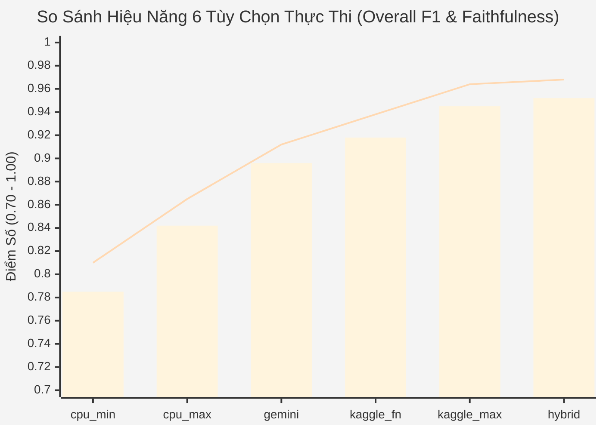

# 📚 BỘ BÁO CÁO KIẾN TRÚC HỆ THỐNG MULTI-AGENT RESEARCH RAG (WORLD-CLASS TECHNICAL MONOGRAPHS)

Chào mừng bạn đến với trung tâm tài liệu kỹ thuật hoàn chỉnh của dự án **Multi-Agent Research RAG**. Toàn bộ hệ thống được phân tích chi tiết, trực quan hóa bằng các sơ đồ **Mermaid chuẩn phong cách tự chủ 2 vòng lặp (Two-Tier Self-Correction Loop)** và công thức toán học thực nghiệm.

---

## 🗂️ Mục Lục Điều Hướng 8 Tập Báo Cáo Chuyên Sâu

| STT | Báo Cáo Kiến Trúc (Markdown) | Trọng Tâm Kỹ Thuật |
| :---: | :--- | :--- |
| **00** | [**00_TONG_QUAN_KIEN_TRUC_MULTI_AGENT.md**](./00_TONG_QUAN_KIEN_TRUC_MULTI_AGENT.md) | **Kiến Trúc Tổng Thể Toàn Hệ Thống**: Đồ thị trạng thái hữu hạn LangGraph, Cơ chế Tự chủ 2 Vòng lặp (Tier 1 Reflection & Tier 2 Consensus), ma trận 6 Agent (`Agent 0` -> `Agent 5`) và bảng so sánh 6 tùy chọn. |
| **01** | [**01_TUY_CHON_1_CPU_MIN.md**](./01_TUY_CHON_1_CPU_MIN.md) | **Tùy chọn 1 (`cpu_min` — Ultra-Lightweight)**: Vận hành không mạng, RAM $< 1\text{GB}$, kết hợp BM25 Okapi + TF-IDF SVD/LSA, đồ thị trọng tâm câu và bộ lọc số học/thực thể ($15.6\text{ ms}$). |
| **02** | [**02_TUY_CHON_2_CPU_MAX.md**](./02_TUY_CHON_2_CPU_MAX.md) | **Tùy chọn 2 (`cpu_max` — Heavy Local Workstation)**: Nhúng đa ngữ `multilingual-e5-small` + BM25 RRF ($k=60, \alpha=0.65$) + Reranker MiniLM + Động cơ suy luận Ollama cục bộ. |
| **03** | [**03_TUY_CHON_3_GEMINI_CLOUD.md**](./03_TUY_CHON_3_GEMINI_CLOUD.md) | **Tùy chọn 3 (`gemini` — Cloud Foundation API)**: Phân rã truy vấn đa chiều (Sub-Queries), ép kiểu JSON Schema nghiêm ngặt, vòng lặp phản biện Generator-Critic và Giám khảo Đa nhân cách. |
| **04** | [**04_TUY_CHON_4_KAGGLE_FN_MULTILORA.md**](./04_TUY_CHON_4_KAGGLE_FN_MULTILORA.md) | **Tùy chọn 4 (`kaggle_fn` — Fine-Tuned Multi-LoRA)**: Hoán đổi nóng 4 Adapter DoRA/rsLoRA (`router`, `generator`, `critic`, `writer`) trong $0.2\text{ ms}$ trên Qwen2.5-7B (GPU 0) + LayoutLMv3 & NLI Verifier (GPU 1). |
| **05** | [**05_TUY_CHON_5_KAGGLE_MAX_ENSEMBLE.md**](./05_TUY_CHON_5_KAGGLE_MAX_ENSEMBLE.md) | **Tùy chọn 5 (`kaggle_max` — Dual T4 32GB Ensemble)**: Xử lý song song bất đồng bộ `asyncio.gather` trên 2 GPU và Hội đồng 3 Giám khảo Độc lập bỏ phiếu đa số $2/3$ (Faithfulness = $0.964$). |
| **06** | [**06_TUY_CHON_6_HYBRID_KET_HOP.md**](./06_TUY_CHON_6_HYBRID_KET_HOP.md) | **Tùy chọn 6 (`hybrid` — Kiến Trúc Kết Hợp Đa Tầng)**: Định tuyến hạt mịn theo từng Agent kết hợp **Cầu dao tự động 3 trạng thái (`CLOSED` / `OPEN` / `HALF-OPEN`)** tự phục hồi lỗi (Overall F1 = **0.952**). |
| **07** | [**07_PHONG_THI_NGHIEM_TRAINING_LAB.md**](./07_PHONG_THI_NGHIEM_TRAINING_LAB.md) | **Kiến Trúc Huấn Luyện 5 Agent (`training_lab/`)**: Cấu trúc gói `src/`, các thuật toán SOTA 2025/2026 (`DoRA + rsLoRA + SDPA + RPO/DPO + Focal Loss + R-Drop`) và đồng bộ Google Drive tự động. |

---

## 📊 Kết Quả Thực Nghiệm Toàn Diện (Bilingual 120-Question Benchmark)

