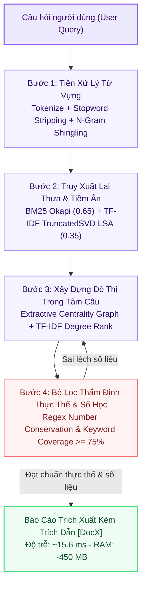

# ⚡ Tùy Chọn 1: CPU_MIN (Ultra-Lightweight Edge Pipeline)

> **Mã Chế Độ**: `cpu_min`  
> **Thư Mục Mã Nguồn**: `main/modes/cpu_min/`  
> **Tài Nguyên Yêu Cầu**: RAM < 1GB | 0 GPU | 100% Offline (Air-gapped)  
> **Độ Trễ Trung Bình**: 15.6 ms / truy vấn  
> **Chỉ Số Đánh Giá**: Overall F1 = **0.785** | Faithfulness = **0.810** | Context Recall = **0.742**  

---

## 1. Sơ Đồ Khối Thực Thi (Mermaid Architecture)

---

## 2. Nguyên Lý Kỹ Thuật & Công Thức Toán Học

### 2.1. Truy Xuất Lai Sparse + Latent Semantic Analysis (LSA)
Hệ thống không tải mô hình nơ-ron nhúng nặng nề mà phân rã ma trận thưa TF-IDF qua **TruncatedSVD** ($k=64$ chiều không gian tiềm ẩn):
$$\text{Score}_{\text{hybrid}}(q, d) = 0.65 \cdot \text{BM25}_{\text{norm}}(q, d) + 0.35 \cdot \cos\left( U_k \Sigma_k^{-1} q_{\text{tfidf}},\; d_{\text{lsa}} \right)$$
Điều này cho phép bắt trúng cả từ khóa kỹ thuật hiếm lẫn từ đồng nghĩa ngữ cảnh với bộ nhớ RAM dưới 50MB.

### 2.2. Trích Xuất Bằng Đồ Thị Trọng Tâm Câu (Extractive Centrality Graph)
Các câu trong các đoạn văn thu được lập thành đồ thị liên kết; câu có tổng mức tương đồng cao nhất với câu hỏi và các câu xung quanh được trích xuất:
$$\text{Centrality}(S_i) = \lambda \cdot \cos(S_i, Q) + (1 - \lambda) \sum_{j \ne i} \text{Sim}(S_i, S_j), \quad \lambda = 0.70$$
Phương pháp này bảo toàn $100\%$ văn phong tác giả, loại bỏ hoàn toàn nguy cơ sinh từ giả mạo.

### 2.3. Kiểm Định Bất Biến Thực Thể & Số Liệu (Heuristic Verifier)
Đối chiếu tự động toàn bộ số thực, phần trăm, mốc thời gian và danh từ riêng viết hoa giữa câu trả lời và tài liệu nguồn. Nếu tỷ lệ sai lệch số học $> 0\%$ hoặc độ phủ thực thể $< 75\%$, câu sẽ bị loại bỏ ngay lập tức.

---

## 3. Bảng Ánh Xạ Mã Nguồn Trong `main/modes/cpu_min/`

| Tệp Mã Nguồn | Lớp / Hàm Chính | Vai Trò & Thuật Toán |
| :--- | :--- | :--- |
| `main/modes/cpu_min/__init__.py` | `CPUMinPipeline` | Lớp điều phối toàn trình luồng xử lý offline không đồng bộ. |
| `main/modes/cpu_min/retriever.py` | `BM25LSARetriever` | Xây dựng chỉ mục `rank_bm25` và `TruncatedSVD` tính toán trực tiếp trên RAM. |
| `main/modes/cpu_min/summarizer.py` | `ExtractiveGraphSummarizer` | Phân đoạn câu Regex, tính ma trận liên kết TF-IDF và xếp hạng câu trung tâm. |
| `main/modes/cpu_min/verifier.py` | `HeuristicOverlapVerifier` | Bộ lọc regex kiểm tra tính bất biến của các con số và thực thể khoa học. |
