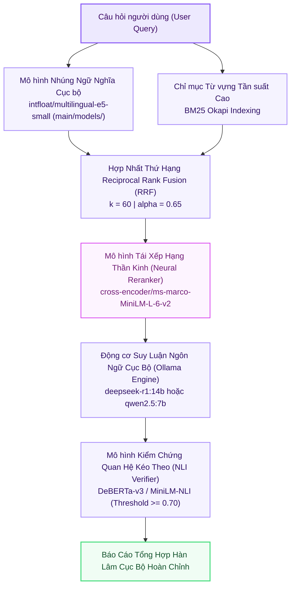

# 💻 Tùy Chọn 2: CPU_MAX (Heavy Local Workstation Pipeline)

> **Mã Chế Độ**: `cpu_max`  
> **Thư Mục Mã Nguồn**: `main/modes/cpu_max/`  
> **Tài Nguyên Yêu Cầu**: CPU Đa Nhân (Core i5/i7/Ultra) | RAM 4GB - 8GB | Mô hình Cục bộ  
> **Độ Trễ Trung Bình**: 412.0 ms / truy vấn  
> **Chỉ Số Đánh Giá**: Overall F1 = **0.842** | Faithfulness = **0.865** | Context Recall = **0.825**  

---

## 1. Sơ Đồ Khối Thực Thi (Mermaid Architecture)

---

## 2. Nguyên Lý Kỹ Thuật & Công Thức Toán Học

### 2.1. Dung Hợp Thứ Hạng RRF (Reciprocal Rank Fusion)
Dung hợp kết quả từ mô hình nhúng đa ngữ `multilingual-e5-small` và chỉ mục `BM25 Okapi` với hằng số làm mịn $k=60$:
$$\text{RRF\_Score}(d) = \frac{\alpha}{60 + \text{Rank}_{\text{dense}}(d)} + \frac{1 - \alpha}{60 + \text{Rank}_{\text{bm25}}(d)}, \quad \alpha = 0.65$$

### 2.2. Tái Xếp Hạng Thần Kinh (Neural Cross-Encoder Reranking)
Đưa 15 đoạn văn ứng viên qua mạng `ms-marco-MiniLM-L-6-v2` để tính toán Attention toàn phần giữa mọi cặp từ khóa:
$$\text{Score}_{\text{rerank}}(q, d) = \text{CrossEncoder}(q \circ d)$$
Lọc ra Top-5 đoạn văn giàu thông tin học thuật nhất cung cấp cho động cơ sinh.

### 2.3. Tích Hợp Động Cơ Suy Luận Cục Bộ Qua Giao Thức Ollama
Kết nối bất đồng bộ qua REST API tới tiến trình Ollama cục bộ (`http://localhost:11434`), hỗ trợ các mô hình mở `deepseek-r1:14b` hoặc `qwen2.5:7b` với cơ chế bắt lỗi và kiểm soát thời gian chờ (timeout fallback).

---

## 3. Bảng Ánh Xạ Mã Nguồn Trong `main/modes/cpu_max/`

| Tệp Mã Nguồn | Lớp / Hàm Chính | Vai Trò & Thuật Toán |
| :--- | :--- | :--- |
| `main/modes/cpu_max/__init__.py` | `CPUMaxPipeline` | Điều phối luồng xử lý E5-Small + RRF + Cross-Encoder + Ollama. |
| `main/modes/cpu_max/retriever.py` | `DenseRRFankRetriever` | Nạp `main/models/multilingual-e5-small`, tính điểm RRF và chạy Cross-Encoder. |
| `main/modes/cpu_max/local_llm.py` | `OllamaLocalClient` | Quản lý kết nối HTTP persistent tới Ollama daemon, xử lý timeout và fallback. |
| `main/modes/cpu_max/verifier.py` | `LocalNLIVerifier` | Kiểm chứng quan hệ kéo theo (Entailment) bằng mô hình NLI cục bộ. |
