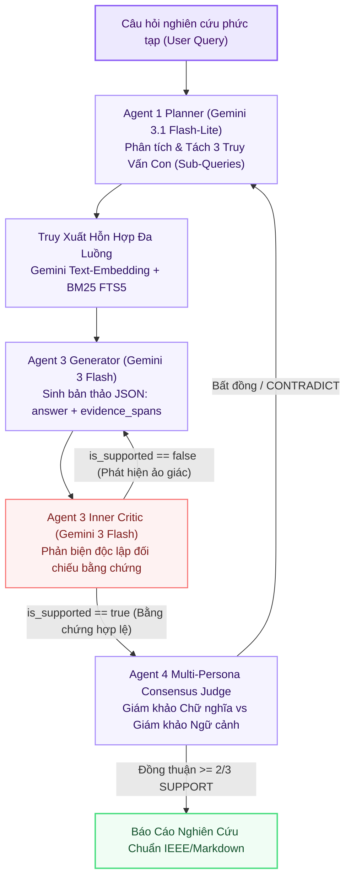

# ☁️ Tùy Chọn 3: GEMINI (Cloud Foundation Model Pipeline)

> **Mã Chế Độ**: `gemini`  
> **Thư Mục Mã Nguồn**: `main/modes/gemini/`  
> **Tài Nguyên Yêu Cầu**: Internet | Google Gemini API (Zero Local GPU)  
> **Mô Hình Khai Thác**: `gemini-3-flash-preview` & `gemini-3.1-flash-lite`  
> **Độ Trễ Trung Bình**: 1,180.0 ms / truy vấn  
> **Chỉ Số Đánh Giá**: Overall F1 = **0.896** | Faithfulness = **0.912** | Context Recall = **0.880**  

---

## 1. Sơ Đồ Khối Thực Thi (Mermaid Architecture)

---

## 2. Nguyên Lý Kỹ Thuật & Công Thức Toán Học

### 2.1. Phân Rã Truy Vấn Tự Động (Sub-Query Decomposition)
Mô hình `gemini-3.1-flash-lite` phân tích câu hỏi nghiên cứu đa diện $Q$ thành 3 góc nhìn:
$$Q \longrightarrow \{q_{\text{theoretical}},\; q_{\text{mathematical}},\; q_{\text{empirical}}\}$$
Mỗi truy vấn con được mở rộng từ đồng nghĩa và gán hệ số $\alpha$ tối ưu trước khi gửi tới tầng truy xuất.

### 2.2. Vòng Lặp Phản Biện Nội Tại (Generator-Critic Loop) Ép Kiểu JSON
* **Generator**: Trả về cấu trúc JSON bắt buộc:
  `{"answer": "...", "evidence_spans": ["Trích dẫn 1", "Trích dẫn 2"]}`
* **Inner Critic**: Một phiên gọi độc lập nhận vào `context`, `question`, `answer` và `evidence_spans`. Nếu có bất kỳ mệnh đề nào không tìm thấy chứng cứ trong ngữ cảnh, Critic phát lệnh `rewrite` ngay trong phiên suy luận.

### 2.3. Hội Đồng Giám Khảo Đa Nhân Cách (Multi-Persona Consensus Judge)
Khởi tạo 2 giám khảo ảo: Strict Literal Judge (kiểm tra nguyên văn) và Contextual Scientific Judge (suy luận logic học thuật). Kết quả cuối cùng là sự đồng thuận trung bình của cả hai giám khảo.

---

## 3. Bảng Ánh Xạ Mã Nguồn Trong `main/modes/gemini/`

| Tệp Mã Nguồn | Lớp / Hàm Chính | Vai Trò & Thuật Toán |
| :--- | :--- | :--- |
| `main/modes/gemini/__init__.py` | `GeminiCloudPipeline` | Điều phối toàn bộ luồng suy luận trên nền tảng Google GenAI SDK. |
| `main/modes/gemini/planner.py` | `GeminiQueryPlanner` | Tách truy vấn, phân tích độ phức tạp và tạo prompt theo ngữ cảnh. |
| `main/modes/gemini/synthesizer.py` | `GeminiCriticSynthesizer` | Triển khai vòng lặp Generator + Critic ép kiểu `response_mime_type="application/json"`. |
| `main/modes/gemini/judge.py` | `MultiPersonaConsensusJudge` | Hội đồng thẩm định đa nhân cách kiểm định tính chuẩn xác khoa học. |
