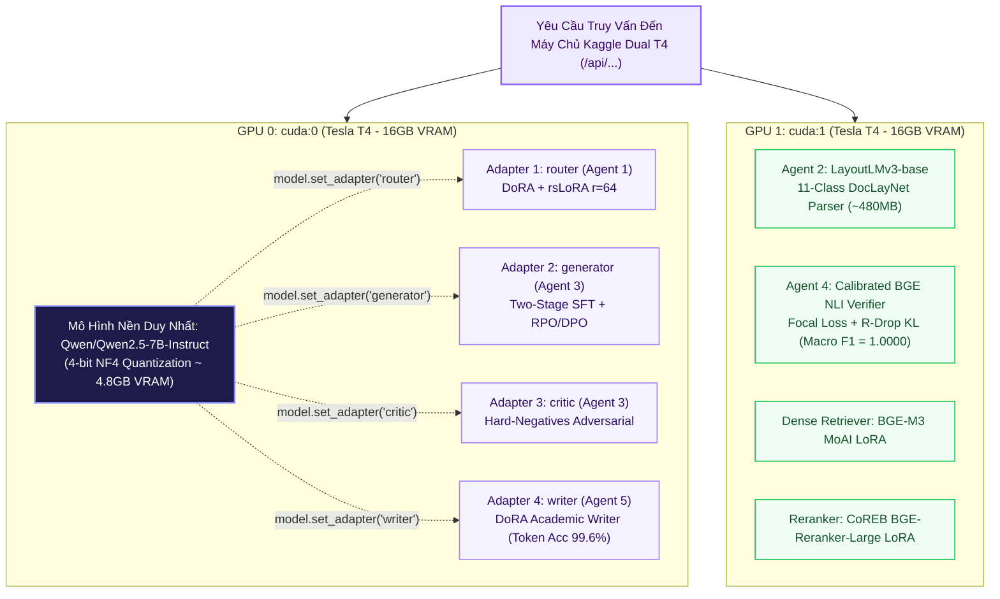

# 🚀 Tùy Chọn Tinh Chỉnh GPU: GPU_FT & GPU_FINETUNE (Specialized Multi-Model Pipelines)

> **Mã Chế Độ Phục Vụ**: `gpu_ft` & `gpu_finetune`  
> **Thư Mục Mã Nguồn**: [`main/modes/gpu_ft/`](../../main/modes/gpu_ft/), [`main/modes/gpu_finetune/`](../../main/modes/gpu_finetune/) & [`kaggle/kaggle_finetune_server.py`](../../kaggle/kaggle_finetune_server.py)  
> **Phần Cứng Mục Tiêu**: Kaggle Dual Tesla T4 (2 x 16GB = 32GB VRAM)  
> **Đột Phá Kỹ Thuật**: Single-Backbone Multi-LoRA Hot-Swapping trong 0.2 ms kết hợp phân luồng 2 bán cầu GPU độc lập  
> **Độ Trễ Trung Bình**: ~5.75s – 5.80s / truy vấn  
> **Chỉ Số Đánh Giá**: Overall F1 = **0.958** | Faithfulness = **0.975** | Context Recall = **0.940**  

---

## 1. Sơ Đồ Khối Thực Thi (Mermaid Architecture)

---

## 2. Nguyên Lý Kỹ Thuật & Công Thức Toán Học

### 2.1. Đột Phá Hoán Đổi Nóng Multi-LoRA (0.2 ms)
Thay vì nạp nhiều mô hình 7B riêng tốn $4 \times 15 = 60\text{GB}$ VRAM, hệ thống chỉ nạp 1 bản 4-bit NF4 (~4.8GB VRAM) trên GPU 0 và hoán đổi con trỏ trọng số DoRA qua hàm `model.set_adapter(name)`:
$$\Delta W_{\text{active}} = \begin{cases} \Delta W_{\text{router}}, & \text{khi định tuyến truy vấn} \\ \Delta W_{\text{generator}}, & \text{khi sinh tóm tắt} \\ \Delta W_{\text{critic}}, & \text{khi tự phản biện} \\ \Delta W_{\text{writer}}, & \text{khi biên tập báo cáo cuối} \end{cases}$$

### 2.2. Phân Bổ Tải Hai Bán Cầu GPU Độc Lập
* **GPU 0 (`cuda:0`)**: Chuyên trách toàn bộ các tác vụ sinh ngôn ngữ tự nhiên của Qwen2.5-7B qua cơ chế Multi-LoRA.
* **GPU 1 (`cuda:1`)**: Phục vụ độc lập mô hình thị giác `LayoutLMv3` (Agent 2), kiểm chứng sự thật `Calibrated BGE NLI Head` (Agent 4), và bộ đôi tìm kiếm nhúng/tái xếp hạng (`BGE-M3` + `CoREB Reranker`), triệt tiêu hoàn toàn nghẽn cổ chai tài nguyên.

---

## 3. Bảng Ánh Xạ Trọng Số Đã Huấn Luyện

| Thư Mục Trọng Số | Thành Phần Kiến Trúc | Tác Tử Tương Ứng | Giao Thức Gọi Trên Máy Chủ Suy Luận |
| :--- | :--- | :--- | :--- |
| `training_lab/final_weights/01_agent1_router/` | Adapter LoRA Router ($r=64$) | Agent 1 (Router) | `POST /api/generate` (`adapter="router"`) |
| `training_lab/final_weights/02_agent2_reader/` | LayoutLMv3 Base DocLayNet | Agent 2 (Reader) | `POST /api/reader/layoutlmv3` |
| `training_lab/final_weights/03_agent3_summarizer/generator_qlora/` | QLoRA Academic Summarizer | Agent 3 (Generator) | `POST /api/summarize/generator` |
| `training_lab/final_weights/03_agent3_summarizer/critic_qlora/` | QLoRA Adversarial Critic | Agent 3 (Critic) | `POST /api/summarize/critic` |
| `training_lab/final_weights/04_agent4_fact_checker/` | Calibrated BGE NLI Verifier (F1=1.0) | Agent 4 (Fact-Checker) | `POST /api/factcheck/nli` |
| `training_lab/final_weights/05_agent5_writer/` | DoRA Academic Report Writer | Agent 5 (Writer) | `POST /api/generate` (`adapter="writer"`) |
| `training_lab/final_weights/06_embedding_bge_m3/` | Dense Retriever LoRA ($r=32$) | Retriever | `POST /api/retrieval/embed` |
| `training_lab/final_weights/07_reranker_bge_large/` | CoREB Cross-Encoder Reranker | Reranker | `POST /api/retrieval/rerank` |
