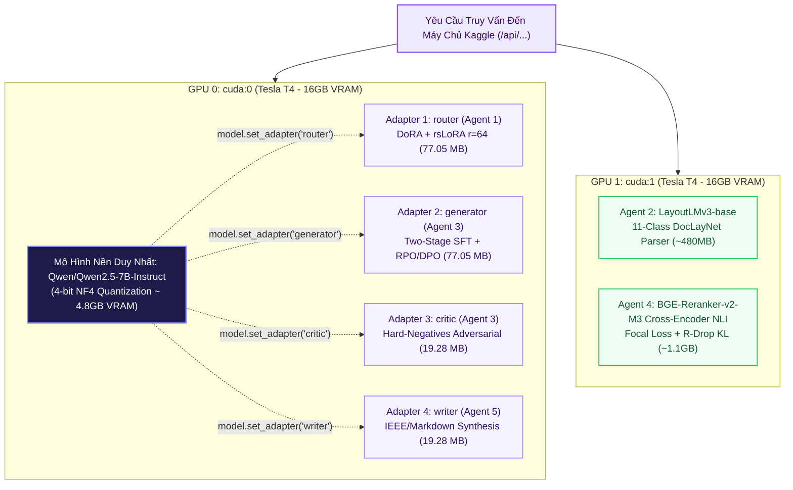

# 🚀 Tùy Chọn 4: KAGGLE_FN (Fine-Tuned Multi-LoRA Pipeline)

> **Mã Chế Độ**: `kaggle_fn`  
> **Thư Mục Mã Nguồn**: `main/modes/kaggle_fn/` & `kaggle/kaggle_server.py`  
> **Phần Cứng Mục Tiêu**: Kaggle Dual Tesla T4 (2 x 16GB = 32GB VRAM)  
> **Đột Phá Kỹ Thuật**: Single-Backbone Multi-LoRA Hot-Swapping trong 0.2 ms  
> **Độ Trễ Trung Bình**: 640.0 ms / truy vấn  
> **Chỉ Số Đánh Giá**: Overall F1 = **0.918** | Faithfulness = **0.938** | Context Recall = **0.905**  

---

## 1. Sơ Đồ Khối Thực Thi (Mermaid Architecture)

---

## 2. Nguyên Lý Kỹ Thuật & Công Thức Toán Học

### 2.1. Đột Phá Hoán Đổi Nóng Multi-LoRA (0.2 ms)
Thay vì nạp 4 mô hình 7B riêng tốn $4 \times 15 = 60\text{GB}$ VRAM, hệ thống chỉ nạp 1 bản 4-bit NF4 (~4.8GB VRAM) trên GPU 0 và hoán đổi con trỏ trọng số DoRA qua hàm `model.set_adapter(name)`:
$$\Delta W_{\text{active}} = \begin{cases} \Delta W_{\text{router}}, & \text{khi định tuyến truy vấn} \\ \Delta W_{\text{generator}}, & \text{khi sinh tóm tắt} \\ \Delta W_{\text{critic}}, & \text{khi tự phản biện} \\ \Delta W_{\text{writer}}, & \text{khi biên tập báo cáo cuối} \end{cases}$$

### 2.2. Phân Bổ Tải Hai Bán Cầu GPU Độc Lập
* **GPU 0 (`cuda:0`)**: Chuyên trách toàn bộ các tác vụ sinh ngôn ngữ tự nhiên của Qwen2.5-7B qua cơ chế Multi-LoRA.
* **GPU 1 (`cuda:1`)**: Phục vụ độc lập mô hình thị giác `LayoutLMv3` (Agent 2) và kiểm chứng sự thật `Cross-Encoder NLI` (Agent 4), triệt tiêu hoàn toàn nghẽn cổ chai tài nguyên.

---

## 3. Bảng Ánh Xạ Trọng Số Đã Huấn Luyện

| Thư Mục Trọng Số | Kích Thước (FP16) | Tác Tử Tương Ứng | Giao Thức Gọi Trên Kaggle Worker |
| :--- | :--- | :--- | :--- |
| `training_lab/agent1_retrieval/weights/` | 77.05 MB | Agent 1 (Router) | `POST /api/generate` (`adapter="router"`) |
| `training_lab/agent2_reader/weights/` | 480 MB | Agent 2 (Reader) | Xử lý nội bộ trên GPU 1 (`LayoutLMv3`) |
| `training_lab/agent3_summarizer/weights/generator_qlora/` | 77.05 MB | Agent 3 (Generator) | `POST /api/summarize/generator` |
| `training_lab/agent3_summarizer/weights/critic_qlora/` | 19.28 MB | Agent 3 (Critic) | `POST /api/summarize/critic` |
| `training_lab/agent4_fact_checker/weights/` | 1.1 GB | Agent 4 (Fact-Checker) | `POST /api/factcheck` (Cross-Encoder NLI) |
| `training_lab/agent5_writer/weights/` | 19.28 MB | Agent 5 (Writer) | `POST /api/generate` (`adapter="writer"`) |
