# 🏆 Tùy Chọn 6: GPU_MAX (Heavyweight 32B AWQ Tensor Parallelism)

> **Mã Chế Độ**: `gpu_max`  
> **Thư Mục Mã Nguồn**: [`main/modes/gpu_max/`](../../main/modes/gpu_max/) & [`kaggle/kaggle_max_32b_vllm.ipynb`](../../kaggle/kaggle_max_32b_vllm.ipynb)  
> **Phần Cứng Mục Tiêu**: Kaggle Dual Tesla T4 (2 x 16GB = 32GB VRAM Đầy Đủ)  
> **Cơ Chế Cốt Lõi**: Suy luận Song song Tensor Parallelism ($TP=2$) qua vLLM + Phân nhánh Chuỗi tư duy mở rộng (`/think` & `/no_think`)  
> **Độ Trễ Trung Bình**: ~8.20s / truy vấn  
> **Chỉ Số Đánh Giá**: Overall F1 = **0.945** | Faithfulness = **0.964** | Context Recall = **0.932**  

---

## 1. Sơ Đồ Khối Thực Thi (Mermaid Architecture)

```mermaid
flowchart TD
    DRAFT["Bản thảo tổng hợp từ Agent 3"]
    SPLIT["Bộ Phân Rã Mệnh Đề Nguyên Tử (Atomic Claim Splitter)<br/>Tách bản thảo thành {c_1, c_2, ..., c_m}"]

    subgraph GATHER ["Khung Thực Thi Bất Đồng Bộ (asyncio.gather)"]
        J1["Giám khảo 1 (GPU 1)<br/>Cross-Encoder NLI (BGE-Reranker-v2-M3)"]
        J2["Giám khảo 2 (GPU 1)<br/>Generative LLM Verifier (Qwen2.5-3B-Instruct)"]
        J3["Giám khảo 3 (GPU 0)<br/>Adversarial Critic (Qwen2.5-7B critic_qlora)"]
    end

    VOTE["Cơ Chế Bỏ Phiếu Đồng Thuận Đa Số 2/3 (Two-Thirds Majority Vote)<br/>Tối thiểu 2/3 Giám khảo kết luận SUPPORT & Confidence >= 0.70"]
    PASS["XÁC NHẬN HỢP LỆ (VERIFIED CLAIM)<br/>Chuyển sang Agent 5 xuất báo cáo"]
    FAIL["BÁC BỎ / THIẾU THÔNG TIN (REJECTED)<br/>Kích hoạt Gap Re-Query quay lại Agent 1"]

    DRAFT --> SPLIT
    SPLIT --> J1
    SPLIT --> J2
    SPLIT --> J3
    J1 --> VOTE
    J2 --> VOTE
    J3 --> VOTE
    VOTE -- "Tỷ lệ đồng thuận >= 67%" --> PASS
    VOTE -- "Tỷ lệ đồng thuận < 67%" --> FAIL

    classDef purple fill:#f5f3ff,stroke:#a78bfa,stroke-width:1.5px,color:#2e1065;
    classDef input fill:#ede9fe,stroke:#8b5cf6,stroke-width:2px,color:#3b0764;
    classDef pass fill:#f0fdf4,stroke:#22c55e,stroke-width:2px,color:#14532d;
    classDef fail fill:#fef2f2,stroke:#ef4444,stroke-width:2px,color:#991b1b;
    classDef vote fill:#fffbeb,stroke:#f59e0b,stroke-width:2px,color:#78350f;

    class DRAFT,SPLIT input;
    class J1,J2,J3 purple;
    class VOTE vote;
    class PASS pass;
    class FAIL fail;
```

---

## 2. Nguyên Lý Kỹ Thuật & Công Thức Toán Học

### 2.1. Phân Tách Mệnh Đề Nguyên Tử (Atomic Claim Decomposition)
Mỗi câu trong bản thảo được phân tách thành tập các khẳng định nguyên tử $c_i$:
$$A \longrightarrow \{c_1, c_2, \dots, c_m\}$$

### 2.2. Khung Đánh Giá Song Song Bất Đồng Bộ `asyncio.gather`
Mỗi mệnh đề $c_i$ được kiểm định đồng thời qua 3 giám khảo, giảm thời gian xử lý xuống $\max(t_1, t_2, t_3)$:
$$\vec{V}(c_i) = \left[ v_1(c_i),\; v_2(c_i),\; v_3(c_i) \right], \quad v_k \in \{\text{SUPPORT}, \text{CONTRADICT}, \text{NEI}\}$$

### 2.3. Quy Tắc Đồng Thuận Đa Số $2/3$ Có Hiệu Chỉnh Nhiệt Độ
Mệnh đề $c_i$ chỉ được chấp thuận khi:
$$\sum_{k=1}^3 \mathbb{I}\left(v_k(c_i) == \text{SUPPORT}\right) \ge 2 \quad \text{và} \quad \bar{P}_{\text{calibrated}} \ge 0.70$$
Đạt độ trung thực **Faithfulness 0.964**.

---

## 3. Bảng Ánh Xạ Mã Nguồn Trong `main/modes/gpu_max/`

| Tệp Mã Nguồn | Lớp / Hàm Chính | Vai Trò & Thuật Toán |
| :--- | :--- | :--- |
| `main/modes/gpu_max/__init__.py` | `GPUMaxPipeline` | Khởi tạo kết nối vLLM OpenAI API tới máy chủ GPU Dual T4 ($TP=2$). |
| `main/modes/gpu_max/summarizer.py` | `GPUMaxSummarizer` | Kích hoạt chuỗi tư duy chuyên sâu `/think` với tham số `temperature=0.6`. |
| `main/modes/gpu_max/fact_checker.py` | `GPUMaxFactChecker` | Thẩm định lô mệnh đề ở chế độ `/no_think` ($T=0.0$) để đảm bảo tính tất định. |
| `kaggle/kaggle_max_32b_vllm.ipynb` | Worker vLLM | Khởi chạy máy chủ vLLM `Qwen2.5-32B-Instruct-AWQ` qua đường hầm Cloudflare Tunnel. |
