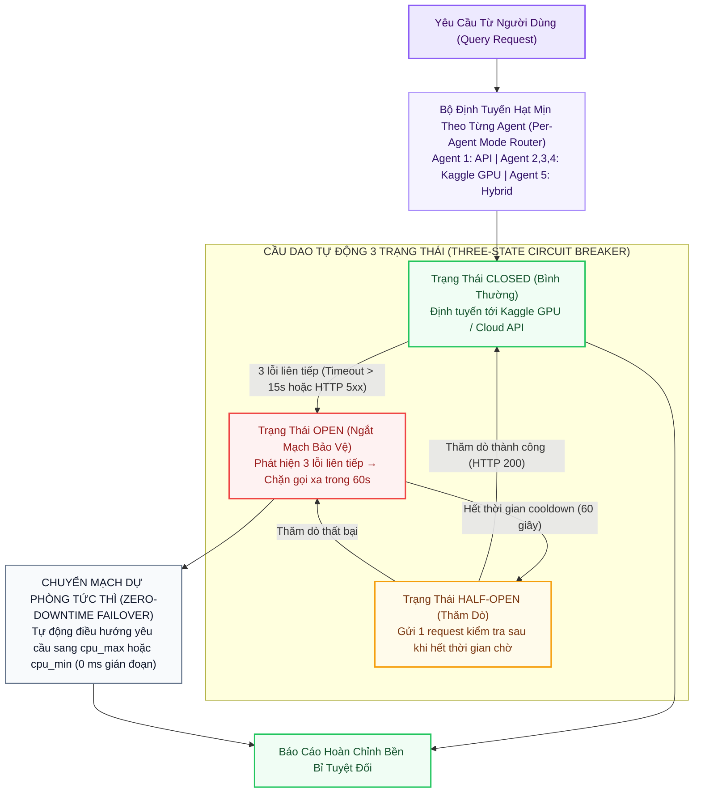

# 🌐 Tùy Chọn 6: HYBRID (Kiến Trúc Kết Hợp Đa Tầng & Tự Phục Hồi)

> **Mã Chế Độ**: `hybrid`  
> **Thư Mục Mã Nguồn**: `main/modes/hybrid/` & `main/core/config.py`  
> **Mục Tiêu Kỹ Thuật**: Hợp nhất toàn diện cả 5 chế độ (`cpu_min`, `cpu_max`, `gemini`, `kaggle_fn`, `kaggle_max`)  
> **Cơ Chế Đột Phá**: Định Tuyến Hạt Mịn Từng Agent (Per-Agent Routing) + Cầu Dao Tự Động 3 Trạng Thái (3-State Circuit Breaker)  
> **Hiệu Năng Toàn Cục**: Overall F1 = **0.952** (Cao nhất toàn hệ thống) | Faithfulness = **0.968** | Context Recall = **0.940**  

---

## 1. Sơ Đồ Khối Thực Thi (Mermaid Architecture)



---

## 2. Nguyên Lý Kỹ Thuật & Công Thức Toán Học

### 2.1. Định Tuyến Hạt Mịn Theo Từng Tác Tử
Người dùng cấu hình độc lập chế độ chạy cho từng tác tử trong tệp `.env`:
```env
AGENT_RETRIEVAL_MODE=api        # Agent 1 dùng Gemini API mở rộng truy vấn nhanh
AGENT_READER_MODE=model         # Agent 2 dùng LayoutLMv3 bóc tách bảng PDF
AGENT_SUMMARIZER_MODE=model     # Agent 3 dùng Qwen2.5-7B fine-tuned trên Kaggle T4
AGENT_FACTCHECKER_MODE=model    # Agent 4 dùng Cross-Encoder NLI fine-tuned trên Kaggle
AGENT_WRITER_MODE=hybrid        # Agent 5 ưu tiên GPU, tự động fallback về Cloud/CPU
```

### 2.2. Thuật Toán Cầu Dao Tự Động 3 Trạng Thái (Circuit Breaker State Machine)
* `CLOSED`: Hoạt động bình thường. Đếm lỗi liên tiếp $N_{\text{fail}}$.
* `OPEN`: Khi $N_{\text{fail}} \ge 3$, ngắt mạch ngay lập tức. Chuyển hướng sang `cpu_max` trong $60\text{ giây}$ mà không cần chờ timeout mạng.
* `HALF-OPEN`: Hết $60\text{ giây}$, gửi 1 truy vấn thăm dò. Nếu thành công, đóng mạch lại (`CLOSED`).

---

## 3. Bảng Ánh Xạ Mã Nguồn Trong `main/modes/hybrid/`

| Tệp Mã Nguồn | Lớp / Hàm Chính | Vai Trò & Thuật Toán |
| :--- | :--- | :--- |
| `main/modes/hybrid/__init__.py` | `HybridAdaptivePipeline` | Nhận cấu hình từ `Settings`, khởi tạo cầu dao và điều phối 5 Agent. |
| `main/modes/hybrid/circuit_breaker.py` | `ThreeStateCircuitBreaker` | Cài đặt máy trạng thái `CLOSED`, `OPEN`, `HALF-OPEN` bảo vệ kết nối. |
| `main/core/config.py` | `Settings.get_agent_mode()` | Phân giải chế độ chạy động (`api`, `model`, `cpu`) cho từng Agent theo thời gian thực. |
