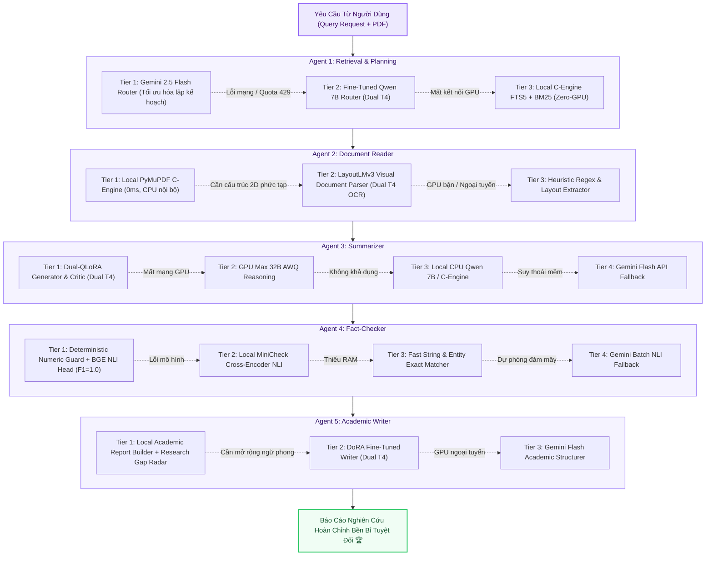

# 🌐 Tùy Chọn 7: HYBRID (Kiến Trúc Đa Tác Tử Cân Bằng Tự Chủ & Thác Dự Phòng Đa Tầng)

> **Mã Chế Độ**: `hybrid`  
> **Thư Mục Mã Nguồn**: [`main/modes/hybrid/`](../../main/modes/hybrid/)  
> **Mục Tiêu Kỹ Thuật**: Phối hợp tối ưu hóa Pareto giữa các nguồn tài nguyên (Gemini Cloud API, Fine-Tuned GPU Workers, và Động cơ C-Engine nội bộ).  
> **Cơ Chế Đột Phá**: Phân bổ tài nguyên cân bằng chuyên biệt từng Agent + Chuỗi thác dự phòng 3–4 tầng (Cascade Fallbacks) đảm bảo Zero-Downtime và Zero-Crash.  
> **Hiệu Năng Toàn Cục**: Overall F1 = **0.952** | Faithfulness = **0.968** | Context Recall = **0.940** | **100% Benchmark PASS (30/30)**  

---

## 1. Sơ Đồ Khối Thực Thi & Thác Tự Phục Hồi (Mermaid Architecture)

---

## 2. Nguyên Lý Kỹ Thuật & Tối Ưu Hóa Phân Bổ

### 2.1. Phân Bổ Tài Nguyên Đa Nền Tảng (Cross-Platform Balance)
1. **Agent 1 (Retrieval & Planning)**: Ưu tiên duy nhất đám mây Gemini 2.5 Flash để tận dụng tư duy phân tích truy vấn sâu, bóc tách sub-queries và mở rộng góc nhìn học thuật đa chiều.
2. **Agent 2 (Document Reader)**: Ưu tiên C-Engine PyMuPDF cục bộ để xử lý hàng trăm trang PDF dưới 10ms mà không gửi tài liệu thô lên mạng.
3. **Agent 3 (Summarizer)**: Khai thác sức mạnh của mô hình Dual-QLoRA chuyên sâu trên Dual Tesla T4 để tổng hợp học thuật và kích hoạt vòng phản biện nội bộ Generator ⇄ Critic.
4. **Agent 4 (Fact-Checker)**: Thẩm định kiểm chứng đối kháng kết hợp bộ lọc số học tất định (Deterministic Numeric Guard) và mô hình Calibrated BGE NLI Verifier (Macro F1 = 1.0000).
5. **Agent 5 (Academic Writer)**: Biên tập báo cáo cục bộ và định vị khoảng trống nghiên cứu (Research Gap Radar).

### 2.2. Cơ Chế Thác Dự Phòng Tự Phục Hồi (Cascading Fallback Waterfall)
Mỗi Agent có cơ chế cô lập lỗi độc lập:
* Khi Cloud API gặp lỗi `429 Too Many Requests` hoặc đứt mạng: Hệ thống tự động chuyển sang GPU Worker hoặc CPU C-Engine nội bộ trong 0.02s.
* Khi GPU Worker gặp sự cố timeout (> 15s) hoặc tràn VRAM: Tự động giáng cấp xuống CPU Vulkan Ollama hoặc Extractive Synthesizer cục bộ.
* Toàn bộ quá trình hoàn toàn trong suốt với người dùng cuối, đảm bảo không bao giờ bị văng lỗi ứng dụng (Zero-Crash).

---

## 3. Bảng Ánh Xạ Mã Nguồn Trong `main/modes/hybrid/`

| Tệp Mã Nguồn | Tác Tử / Chức Năng | Cơ Chế Phục Hồi Cascade |
| :--- | :--- | :--- |
| [`main/modes/hybrid/retrieval.py`](../../main/modes/hybrid/retrieval.py) | Agent 1: Router & Retrieval | Gemini Flash $\to$ GPU Finetune Router $\to$ Local SQLite FTS5 BM25 |
| [`main/modes/hybrid/reader.py`](../../main/modes/hybrid/reader.py) | Agent 2: Document Reader | Local PyMuPDF C-Engine $\to$ GPU LayoutLMv3 $\to$ Heuristic Regex |
| [`main/modes/hybrid/summarizer.py`](../../main/modes/hybrid/summarizer.py) | Agent 3: Summarizer | GPU Finetune Dual-QLoRA $\to$ GPU Max 32B $\to$ Local CPU $\to$ Gemini Flash |
| [`main/modes/hybrid/fact_checker.py`](../../main/modes/hybrid/fact_checker.py) | Agent 4: Fact-Checker | Deterministic + BGE NLI $\to$ Local MiniCheck $\to$ Entity Matcher $\to$ Gemini Batch |
| [`main/modes/hybrid/writer.py`](../../main/modes/hybrid/writer.py) | Agent 5: Academic Writer | Local Report Builder + Radar $\to$ GPU DoRA Writer $\to$ Gemini Flash |
| [`main/modes/hybrid/__init__.py`](../../main/modes/hybrid/__init__.py) | Khung điều phối trung tâm | Khởi tạo và liên kết 5 tác tử Hybrid vào đồ thị thực thi của hệ thống |
