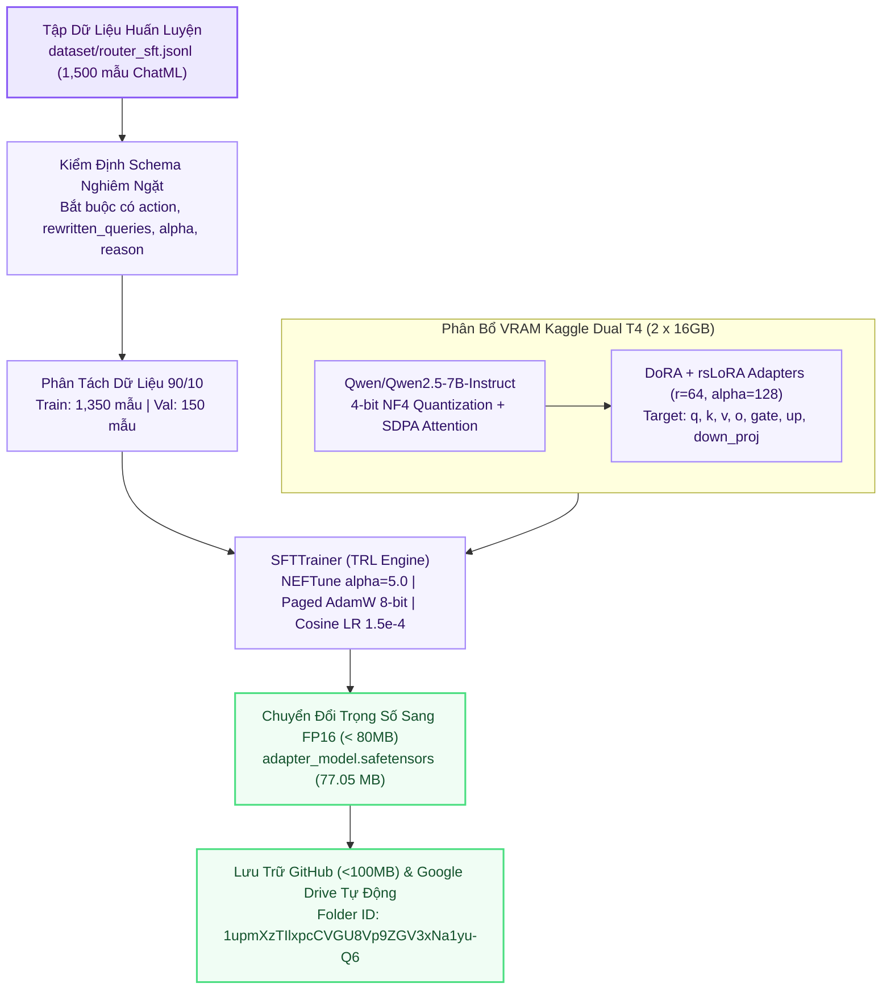

# 🧭 Kiến Trúc Huấn Luyện Agent 1: Retrieval Router & Query Planner

> **Thư Mục Mã Nguồn**: `training_lab/agent1_retrieval/`  
> **Mô Hình Nền**: `Qwen/Qwen2.5-7B-Instruct`  
> **Kỹ Thuật PEFT**: DoRA (`use_dora=True`) + rsLoRA (`use_rslora=True`, $r=64, \alpha=128$)  
> **Tối Ưu Phần Cứng**: `attn_implementation="sdpa"` | Dual T4 `14.5GiB/GPU`  
> **Đầu Ra Trọng Số**: FP16 `adapter_model.safetensors` (77.05 MB — sẵn trên GitHub)  

---

## 1. Sơ Đồ Quy Trình Huấn Luyện (Mermaid Flowchart)

---

## 2. Cấu Trúc Gói Mã Nguồn `src/` Trong `training_lab/agent1_retrieval/`

| Tệp Mã Nguồn | Vai Trò Kỹ Thuật | Điểm Nổi Bật SOTA |
| :--- | :--- | :--- |
| `src/config.py` | Quản lý siêu tham số huấn luyện | Thiết lập DoRA + rsLoRA $r=64$, SDPA Attention và trần VRAM `14.5GiB/GPU`. |
| `src/data_loader.py` | Nạp và tiền xử lý dữ liệu | Kiểm định JSON Schema đầu ra, mã hóa theo Qwen2.5 ChatML template. |
| `src/model_builder.py` | Khởi tạo mô hình & PEFT | Lượng tử hóa 4-bit NF4 BitsAndBytes, cân bằng tải `device_map="balanced"`. |
| `src/trainer.py` | Vòng lặp huấn luyện SFT | Tích hợp NEFTune noise $\alpha=5.0$, tối ưu hóa Paged AdamW 8-bit và xuất FP16. |
| `src/evaluator.py` | Đánh giá sau huấn luyện | Đo lường tỷ lệ tuân thủ JSON Schema (JSON Compliance Rate) trên tập truy vấn kiểm thử. |
