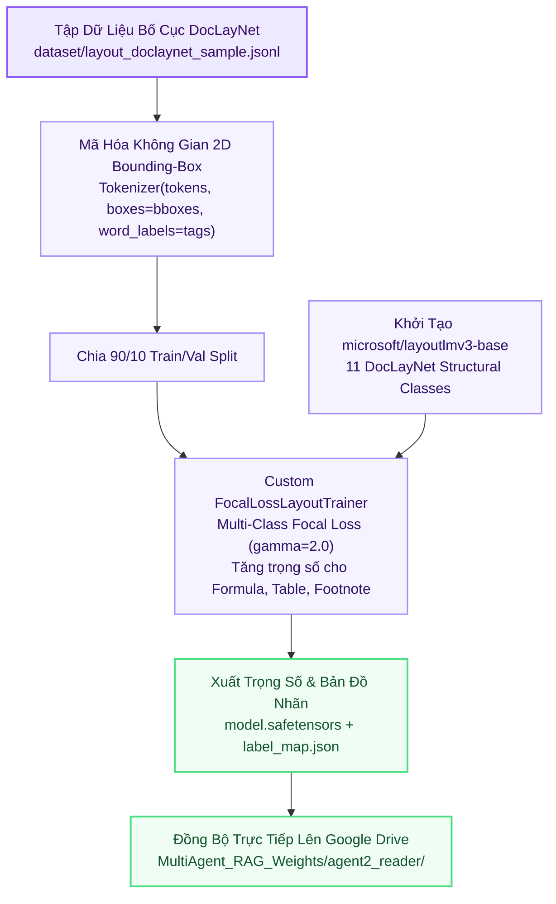

# 📄 Kiến Trúc Huấn Luyện Agent 2: Document Layout Reader

> **Thư Mục Mã Nguồn**: `training_lab/agent2_reader/`  
> **Mô Hình Nền**: `microsoft/layoutlmv3-base` (11-Class Token Classification)  
> **Thuật Toán Tổn Thất**: Multi-Class Focal Loss ($\gamma=2.0$) cho tập nhãn mất cân bằng  
> **Đầu Vào**: Bounding-Box không gian 2D $[x_0, y_0, x_1, y_1]$ + Tokens văn bản  
> **Tập Nhãn DocLayNet**: `Caption`, `Footnote`, `Formula`, `List-item`, `Page-footer`, `Page-header`, `Picture`, `Section-header`, `Table`, `Text`, `Title`  

---

## 1. Sơ Đồ Quy Trình Huấn Luyện (Mermaid Flowchart)

---

## 2. Cấu Trúc Gói Mã Nguồn `src/` Trong `training_lab/agent2_reader/`

| Tệp Mã Nguồn | Vai Trò Kỹ Thuật | Điểm Nổi Bật SOTA |
| :--- | :--- | :--- |
| `src/config.py` | Cấu hình siêu tham số và nhãn | Định nghĩa 11 nhãn DocLayNet, `max_seq_length=512`, `batch_size=16`. |
| `src/data_loader.py` | Mã hóa tọa độ không gian 2D | Chuẩn hóa tọa độ $[0, 1000]$ và ánh xạ `bbox` tương ứng với từng sub-token. |
| `src/model_builder.py` | Nạp mô hình LayoutLMv3 | Thiết lập `AutoModelForTokenClassification` với ánh xạ `id2label` và `label2id`. |
| `src/trainer.py` | Huấn luyện với Focal Loss | Cài đặt `FocalLossLayoutTrainer` trừng phạt nặng lỗi phân loại sai công thức/bảng biểu. |
| `src/evaluator.py` | Kiểm định tập nhãn phân đoạn | Đo lường độ nhất quán phân đoạn tài liệu khoa học phức tạp. |
