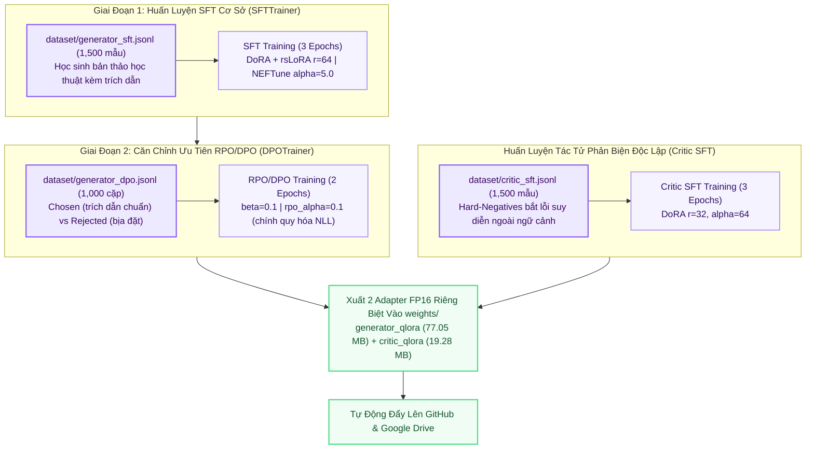

# ✍️ Kiến Trúc Huấn Luyện Agent 3: Academic Summarizer (Generator & Critic)

> **Thư Mục Mã Nguồn**: `training_lab/agent3_summarizer/`  
> **Mô Hình Nền**: `Qwen/Qwen2.5-7B-Instruct`  
> **Generator PEFT**: Two-Stage SFT + RPO/DPO ($r=64, \alpha=128$, `rpo_alpha=0.1`)  
> **Critic PEFT**: Adversarial Hard-Negatives SFT ($r=32, \alpha=64$)  
> **Đầu Ra Trọng Số**: `generator_qlora` (77.05 MB) & `critic_qlora` (19.28 MB)  

---

## 1. Sơ Đồ Quy Trình Huấn Luyện 2 Giai Đoạn (Mermaid Flowchart)

---

## 2. Cấu Trúc Gói Mã Nguồn `src/` Trong `training_lab/agent3_summarizer/`

| Tệp Mã Nguồn | Vai Trò Kỹ Thuật | Điểm Nổi Bật SOTA |
| :--- | :--- | :--- |
| `src/config.py` | Cấu hình Generator và Critic | Cấu hình riêng biệt 2 mức rank ($r=64$ cho Generator, $r=32$ cho Critic). |
| `src/data_loader.py` | Nạp dữ liệu SFT và cặp DPO | Nạp ChatML JSONL và định dạng cặp `(prompt, chosen, rejected)`. |
| `src/model_builder.py` | Khởi tạo mô hình Qwen2.5-7B | Lượng tử hóa 4-bit NF4, SDPA Attention và gắn DoRA. |
| `src/trainer.py` | Điều phối SFT $\rightarrow$ RPO/DPO | Kết hợp DPOTrainer với hệ số phạt NLL `rpo_alpha=0.1` bảo toàn cấu trúc trích dẫn. |
| `src/evaluator.py` | Kiểm tra kích thước adapter | Xác nhận tính toàn vẹn và dung lượng FP16 của 2 adapter. |
