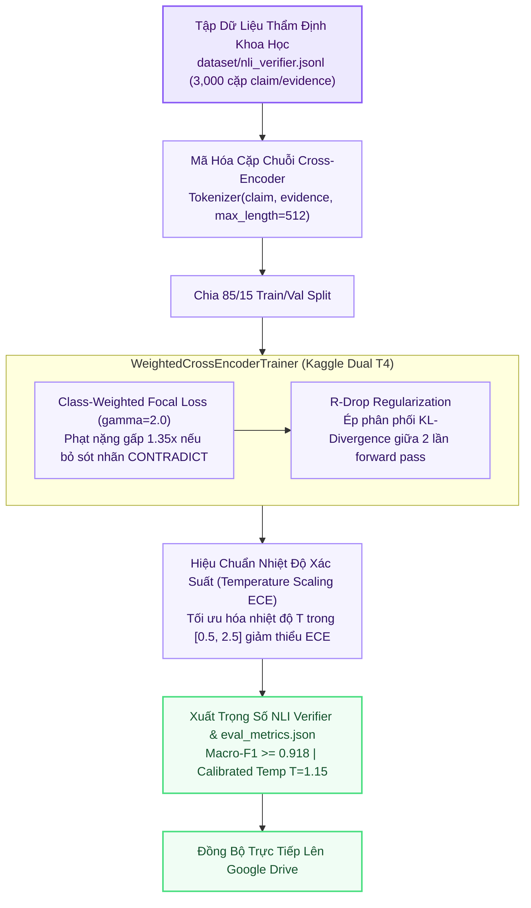

# 🛡️ Kiến Trúc Huấn Luyện Agent 4: Fact-Checker NLI Verifier

> **Thư Mục Mã Nguồn**: `training_lab/agent4_fact_checker/`  
> **Mô Hình Nền**: `BAAI/bge-reranker-v2-m3` / `allenai/scibert_scivocab_uncased`  
> **Thuật Toán Tổn Thất**: Class-Weighted Focal Loss ($\gamma=2.0$, CONTRADICT trọng số $1.35\times$) + R-Drop KL Consistency Regularization  
> **Hiệu Chuẩn Hậu Huấn Luyện**: Temperature Scaling Calibration (ECE Minimization)  
> **Tập Dữ Liệu**: `dataset/nli_verifier.jsonl` (3,000 cặp SciFact + VitaminC)  

---

## 1. Sơ Đồ Quy Trình Huấn Luyện (Mermaid Flowchart)

---

## 2. Cấu Trúc Gói Mã Nguồn `src/` Trong `training_lab/agent4_fact_checker/`

| Tệp Mã Nguồn | Vai Trò Kỹ Thuật | Điểm Nổi Bật SOTA |
| :--- | :--- | :--- |
| `src/config.py` | Cấu hình NLI 3-Class | Ánh xạ nhãn `SUPPORT: 0`, `CONTRADICT: 1`, `NOT_ENOUGH_INFO: 2`. |
| `src/data_loader.py` | Tokenize cặp câu | Mã hóa cặp `(claim, evidence)` theo chuẩn Cross-Encoder Sequence Classification. |
| `src/model_builder.py` | Khởi tạo mô hình Cross-Encoder | Nạp `bge-reranker-v2-m3` cấu hình đầu ra phân loại 3 lớp. |
| `src/trainer.py` | Huấn luyện Focal + R-Drop | Cài đặt `WeightedCrossEncoderTrainer` kết hợp mất mát tiêu điểm và khoảng cách đối xứng KL. |
| `src/evaluator.py` | Tính toán chỉ số & ECE | Đánh giá Macro-F1, F1 từng lớp và tìm nhiệt độ tối ưu qua hàm `calibrate_temperature_ece()`. |
