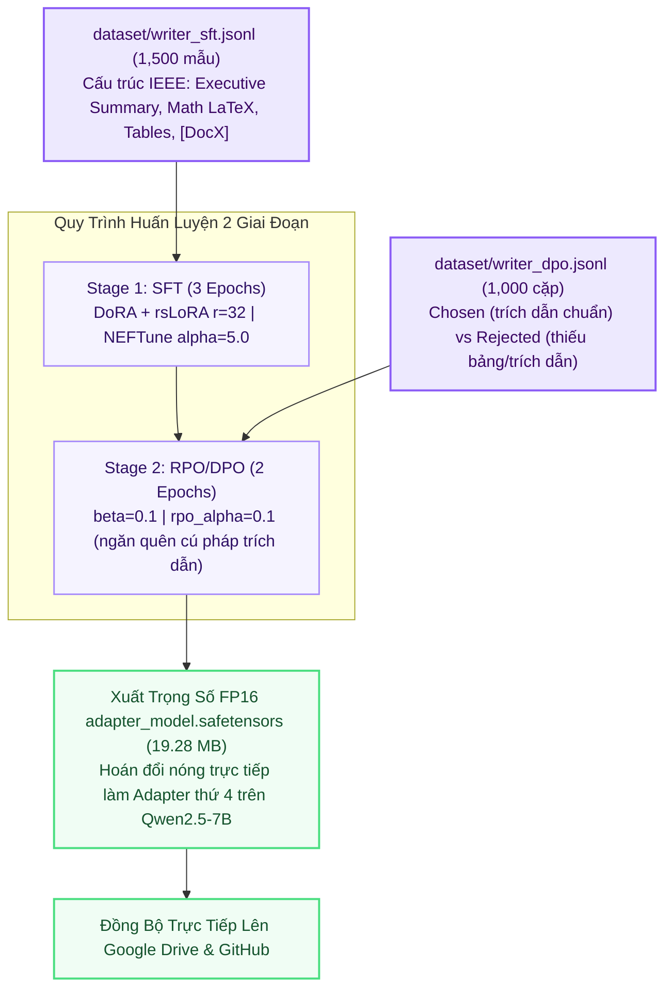

# 📝 Kiến Trúc Huấn Luyện Agent 5: Academic Report Writer

> **Thư Mục Mã Nguồn**: `training_lab/agent5_writer/`  
> **Mô Hình Nền**: `Qwen/Qwen2.5-7B-Instruct`  
> **Kỹ Thuật PEFT**: DoRA + rsLoRA ($r=32, \alpha=64$, `attn_implementation="sdpa"`)  
> **Huấn Luyện 2 Giai Đoạn**: Stage 1 SFT (1,500 mẫu) $\rightarrow$ Stage 2 RPO/DPO Citation Alignment (1,000 cặp)  
> **Đầu Ra Trọng Số**: FP16 `adapter_model.safetensors` (19.28 MB — tích hợp làm Adapter thứ 4 trên GPU 0)  

---

## 1. Sơ Đồ Quy Trình Huấn Luyện (Mermaid Flowchart)

---

## 2. Cấu Trúc Gói Mã Nguồn `src/` Trong `training_lab/agent5_writer/`

| Tệp Mã Nguồn | Vai Trò Kỹ Thuật | Điểm Nổi Bật SOTA |
| :--- | :--- | :--- |
| `src/config.py` | Cấu hình siêu tham số Writer | Thiết lập DoRA + rsLoRA $r=32$, SDPA Attention và $rpo\_alpha=0.1$. |
| `src/data_loader.py` | Nạp dữ liệu báo cáo học thuật | Nạp mẫu SFT cấu trúc và cặp đối chiếu DPO ưu tiên trích dẫn nội văn. |
| `src/model_builder.py` | Khởi tạo mô hình Qwen2.5-7B | Lượng tử hóa 4-bit NF4 cân bằng tải trên cụm Dual T4. |
| `src/trainer.py` | Huấn luyện SFT và RPO/DPO | Điều phối chuỗi 2 giai đoạn và xuất file trọng số FP16 siêu gọn 19.28 MB. |
| `src/evaluator.py` | Thẩm định cấu trúc báo cáo | Kiểm tra tự động 4 yếu tố: tiêu đề `###`, bảng Markdown `|`, công thức LaTeX `$$` và thẻ `[DocX]`. |
