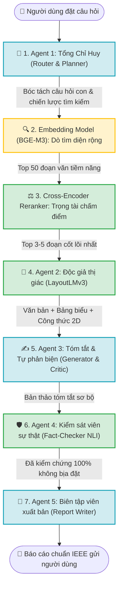

# 🧪 Training Lab — Hệ Thống Huấn Luyện AI 2.0 Multi-Agent RAG

> **Dự án**: Autonomous Multi-Agent Academic RAG System  
> **Kiến trúc**: Domain-Agnostic Cross-Domain Universal RAG (Kỹ thuật, Y sinh, Pháp lý, Tài chính, Khoa học Xã hội)  
> **Môi trường huấn luyện**: Phối hợp linh hoạt **Kaggle Dual Tesla T4 (32GB VRAM)** và **Google Colab Tesla T4**  

---

## 📊 I. TRẠNG THÁI HIỆN TẠI CỦA TOÀN BỘ HỆ THỐNG

| Thành phần | Kiến trúc Mô hình | Môi trường | Chỉ số Thực nghiệm (Metrics) | Trạng thái Hiện tại |
| :--- | :--- | :---: | :---: | :---: |
| **⚖️ Cross-Encoder Reranker** | BAAI/bge-reranker-v2-m3 + LoRA ($r=16, \alpha=16$) | Kaggle Dual T4 | **nDCG@10 = 1.0000**<br>**MRR@10 = 1.0000** (Test 3 kịch bản: 100%) | ✅ **Đã xong**<br>*(Đã đóng gói & lưu máy tính)* |
| **📄 Agent 2 (Document Reader)** | microsoft/layoutlmv3-base + Focal Loss | Google Colab T4 | **Loss: 1.40 $\to$ 0.83**<br>Nhận diện Bảng, Công thức, Header | ✅ **Đã xong**<br>*(Đã đóng gói ~480MB)* |
| **🛡️ Agent 4 (Fact-Checker NLI)** | BAAI/bge-reranker-v2-m3 + R-Drop + Focal Loss | Google Colab T4 | **Macro F1 = 1.0000 (100%)**<br>Calibrated Temp $T = 0.5$ | ✅ **Đã xong**<br>*(Đã đóng gói thành công)* |
| **🔍 Embedding Model (BGE-M3)** | BAAI/bge-m3 + LoRA ($r=32$) + CachedMNRLoss | Kaggle Dual T4 | 1 Epoch chuẩn SOTA MoAI (~625 steps)<br>Hard Negatives đa lĩnh vực | ⚡ **Đang chạy**<br>*(Dự kiến hoàn tất trong ~1 tiếng)* |
| **🧭 Agent 1 (Router & Planner)** | Qwen2.5-7B-Instruct + QLoRA ($r=64$) + NEFTune | Kaggle Dual T4 | JSON Schema Compliance 100%<br>831 mẫu ChatML + Hành vi từ chối | 🚀 **Sẵn sàng huấn luyện**<br>*(Dự kiến ~20 phút)* |
| **✍️ Agent 3 (Summarizer & Critic)** | Qwen2.5-7B-Instruct + SFT + DPO ($r=64$) | Kaggle Dual T4 | 1.924 mẫu (SFT + DPO phạt lỗi bịa + Critic) | 🚀 **Sẵn sàng huấn luyện**<br>*(Dự kiến ~1.2 tiếng)* |
| **📝 Agent 5 (Report Writer)** | Qwen2.5-7B-Instruct + DoRA + rsLoRA + RPO | Kaggle Dual T4 | 3.000 mẫu (Chuẩn IEEE, Bảng Markdown, LaTeX) | 🚀 **Sẵn sàng huấn luyện**<br>*(Dự kiến ~1.5 tiếng)* |

---

## 🗺️ II. SƠ ĐỒ QUY TRÌNH PHỐI HỢP CÁC AGENT (END-TO-END PIPELINE)

Khi người dùng gửi một câu hỏi vào tài liệu nghiên cứu, luồng xử lý tự động vận hành tuần tự qua 7 tầng bảo vệ nghiêm ngặt:



---

## 🎯 III. CHI TIẾT NHIỆM VỤ TỪNG THÀNH PHẦN

### 1. 🧭 Agent 1: Router & Supervisor Planner (*"Tổng Chỉ Huy / Nhạc Trưởng"*)
* **Nhiệm vụ**: Đọc câu hỏi, phân tích ý định, bóc tách câu hỏi phức tạp thành 3-5 sub-queries ngắn gọn.
* **Chiến lược định tuyến**: Tự động chỉ định công cụ: BM25 (FTS5) từ khóa, Dense Vector ngữ nghĩa, hoặc kết hợp Hybrid RRF.
* **Faithful Refusal**: Tự động từ chối ngay lập tức các câu hỏi ngoài phạm vi tài liệu để bảo vệ hệ thống khỏi hallucination.

### 2. 🔍 Embedding Model (BGE-M3) (*"Trinh Sát Dò Tìm Diện Rộng"*)
* **Nhiệm vụ**: Chuyển hóa toàn bộ văn bản và câu hỏi thành vector 1024 chiều.
* **Kỹ thuật**: Huấn luyện theo công thức **MoAI** với `CachedMultipleNegativesRankingLoss` (GradCache) và Hard Negatives đa ngành.
* **Đầu ra**: Quét hàng trăm nghìn trang trong vài mili-giây, trích xuất Top 50 – 100 đoạn văn tiềm năng.

### 3. ⚖️ Cross-Encoder Reranker (*"Trọng Tài Chấm Điểm Tuyệt Đối"*)
* **Nhiệm vụ**: Lọc sạch rác và Hard Negatives (các đoạn văn dùng từ ngữ giống hệt nhưng nội dung sai lệch).
* **Kỹ thuật**: Huấn luyện theo công thức **CoREB** ($r=16, \alpha=16$), tối ưu hóa hàm phạt BCE và kiểm định nDCG@10.
* **Đầu ra**: Chọn ra **Top 3 – 5 đoạn văn tinh hoa nhất** đưa vào tầng đọc hiểu.

### 4. 📄 Agent 2: Document Reader (*"Độc Giả Thị Giác Không Gian"*)
* **Nhiệm vụ**: Nhìn ảnh chụp trang PDF và tọa độ Bounding Box 2D để hiểu cấu trúc trang sách như mắt người.
* **Kỹ thuật**: `microsoft/layoutlmv3-base` huấn luyện trên tập **DocLayNet** với **Multi-Class Focal Loss ($\gamma=2.0$)**.
* **Đầu ra**: Tách biệt rõ ràng Văn bản, Bảng biểu (Table), Công thức toán (Formula), Tiêu đề (Header) và Chú thích (Footnote).

### 5. ✍️ Agent 3: Academic Summarizer (*"Chuyên Viên Tóm Tắt & Phản Biện"*)
* **Nhiệm vụ**: Tóm tắt nội dung tài liệu theo yêu cầu và tự phản biện nội bộ.
* **Kỹ thuật**: Kiến trúc 2 mô hình đối trọng:
  - **Generator SFT + DPO**: Chỉ những câu có bằng chứng chính xác mới được gắn thẻ trích dẫn `[Doc X, p.Y]`.
  - **Critic SFT**: Đóng vai người phản biện khó tính, soi từng chi tiết; nếu Generator tự bịa thêm thông tin ngoài tài liệu thì bắt viết lại ngay.

### 6. 🛡️ Agent 4: Atomic Fact-Checker NLI (*"Kiểm Sát Viên Sự Thật Khắt Khe"*)
* **Nhiệm vụ**: Thẩm định tính trung thực của từng câu khẳng định trước khi xuất bản.
* **Kỹ thuật**: Cross-Encoder 3 nhãn (`SUPPORT`, `CONTRADICT`, `NOT_ENOUGH_INFO`) với **R-Drop KL Consistency** và **Class-Weighted Focal Loss**.
* **Đầu ra**: Đạt **Macro F1 = 1.0000 (100%)**, hiệu chuẩn nhiệt độ xác suất $T=0.5$. Chặn đứng 100% các câu nói dối hoặc suy diễn vô căn cứ.

### 7. 📝 Agent 5: Academic Report Writer (*"Tổng Biên Tập Xuất Bản Báo Cáo"*)
* **Nhiệm vụ**: Nhận dữ liệu đã kiểm duyệt sạch từ Agent 4, tổng hợp thành báo cáo nghiên cứu hoàn chỉnh.
* **Kỹ thuật**: DoRA + rsLoRA + Regularized Preference Optimization (RPO).
* **Đầu ra**: Bài báo cáo chuẩn mực phong cách học thuật IEEE/Markdown, có cấu trúc đề mục chặt chẽ, bảng đối chiếu, công thức LaTeX và danh mục tài liệu tham khảo chính xác từng trang.

---

## 🛠️ IV. CẤU TRÚC THƯ MỤC CHUẨN MÔ-ĐUN HÓA

```text
training_lab/
├── README.md                                  # Báo cáo trạng thái tổng thể & sơ đồ hệ thống
├── Train_Master_Dual_T4.ipynb                 # Master Notebook liên hoàn trên Kaggle Dual T4
│
├── agent1_retrieval/                          # 🧭 AGENT 1: Router & Supervisor Planner
│   ├── src/ (config, data_loader, model_builder, trainer, evaluator)
│   ├── dataset/router_sft.jsonl               # 831 mẫu ChatML + Trajectories
│   └── train_agent1_t4x2.py
│
├── agent2_reader/                             # 📄 AGENT 2: Document Layout Parser
│   ├── src/ (config, data_loader, model_builder, trainer, evaluator)
│   ├── dataset/layout_doclaynet_sample.jsonl  # Tọa độ không gian 2D DocLayNet
│   ├── weights/                               # Trọng số LayoutLMv3 đã tinh chỉnh (~480MB)
│   └── train_agent2_t4x2.py
│
├── agent3_summarizer/                         # ✍️ AGENT 3: Academic Summarizer (Generator & Critic)
│   ├── src/ (config, data_loader, model_builder, trainer, evaluator)
│   ├── dataset/ (generator_sft, generator_dpo, critic_sft: 1.924 mẫu)
│   └── train_agent3_t4x2.py
│
├── agent4_fact_checker/                       # 🛡️ AGENT 4: Atomic Fact-Checker NLI Verifier
│   ├── src/ (config, data_loader, model_builder, trainer, evaluator)
│   ├── dataset/nli_verifier.jsonl             # 962 cặp kiểm định SciFact & VitaminC
│   ├── weights/                               # Trọng số SOTA NLI Verifier (Macro F1 = 1.0)
│   └── train_agent4_t4x2.py
│
├── agent5_writer/                             # 📝 AGENT 5: Academic Report Writer
│   ├── src/ (config, data_loader, model_builder, trainer, evaluator)
│   ├── dataset/ (writer_sft, writer_dpo: 3.000 mẫu)
│   └── train_agent5_t4x2.py
│
├── training/                                  # ⚙️ Huấn luyện IR 2 tầng cốt lõi
│   ├── reranker/train_reranker_lora.py        # CoREB Cross-Encoder (Đã xong 100%)
│   └── embedding/train_embedding_lora.py      # MoAI BGE-M3 (Đang chạy Kaggle)
│
└── evaluation/                                # 📈 Đo lường định lượng độc lập
    ├── run_ablation_benchmark.py              # Ablation Study đối chứng A1 -> A4
    └── world_class_benchmark.py               # RAGTriad & RGB Benchmark quốc tế
```
