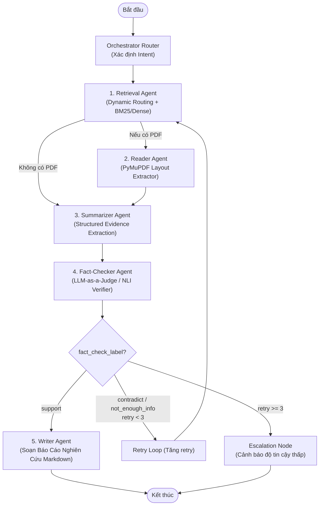

# Hệ Thống Multi-Agent RAG v2 (API-Driven Architecture)

Hệ thống RAG Đa tác tử (Multi-Agent Research RAG) thế hệ mới được tái cấu trúc hoàn toàn:
- **KHÔNG cần Fine-tuning** (bỏ toàn bộ QLoRA, bitsandbytes, DocLayNet, SciBERT).
- **Chạy nhẹ nhàng trên mọi Laptop cá nhân** (chỉ tốn ~100MB RAM, không yêu cầu GPU).
- **Tận dụng LLM Frontier Sẵn Có** (Google Gemini 2.5 Flash / Groq) thông qua **Structured Output (Pydantic)**.
- **Bóc tách PDF tự nhiên** bằng PyMuPDF (nhanh, chuẩn xác, không cần cài Tesseract binary hay LayoutLMv3).
- **Đầy đủ 5 Agent** với cơ chế tự sửa lỗi đa tầng (LangGraph StateGraph).

---

## 🏗️ Kiến Trúc Hệ Thống



---

## 🚀 Hướng Dẫn Cài Đặt & Sử Dụng

### 1. Cài đặt môi trường cực nhanh (chỉ mất 30 giây)
```bash
pip install -r v2_api_rag/requirements.txt
```

### 2. Thiết lập API Key
Tạo file `.env` trong thư mục `v2_api_rag/` (hoặc ngay tại thư mục gốc dự án) với nội dung:
```env
# Lấy miễn phí tại: https://aistudio.google.com/
GEMINI_API_KEY="AIzaSy..."
```

### 3. Chạy thử nghiệm hệ thống
```bash
python v2_api_rag/main.py
```
